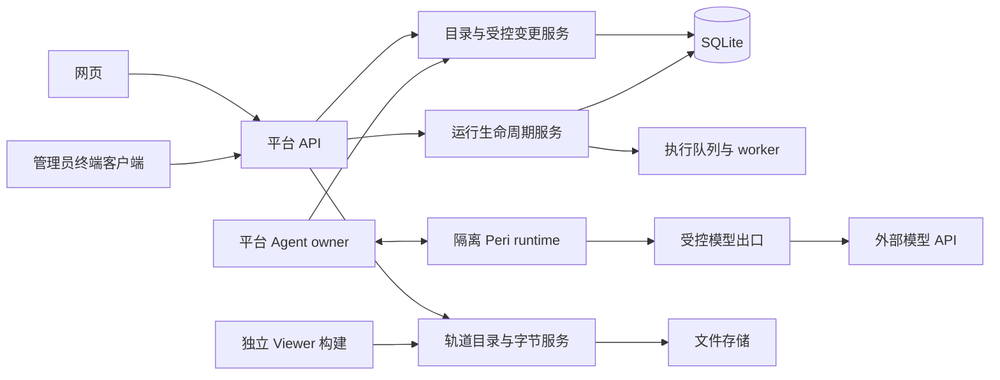

# 数据目录、受控 AI 整理与可视化边界设计

状态：2026-11-13 设计交付，待按阶段实施和验收。本文固定本轮产品选择及建议技术契约，
不声称新 API、表、CLI 或独立 Viewer 已存在。实施顺序见
[session 计划](../development/next-delivery-session-plan.md)。

## 1. 决策及实际起点

保留一个仓库、SQLite、现有文件存储和实验室共享项目模式。成员在一个选定项目内
查询、发现问题并产生建议；管理员可以在网页或终端确认目录整理。Peri 没有自己的
管理员身份，不执行任意 SQL，也不负责数据库迁移。数据目录的手工管理不依赖模型。

当前代码已有 Project、Sample、不可变 SampleRevision、输入/参考修订、snapshot/run
绑定及 artifact publications，可复用这些身份。Sample 是逻辑样本，不等同于一行
科学样本表或一份建库；不能因增加分类就批量重解释现有 Sample。
既有原则见 [数据基础 ADR](data-foundation-decision.md)、
[产物发布 ADR](artifact-publication-provenance-decision.md)和
[认证 ADR](lan-authentication-decision.md)。

当前实现证据（固定提交，不随活动分支变化）：

- [主干样本修订模型](https://github.com/ZichenYang-glitch/ENCODE-style-ChIPseq-CUT-Tag-pipeline/blob/5bc21a040951ba28333bcc04dfb151735089fcd6/src/encode_pipeline/platform/data_registry.py)：属性位于不可变 canonical payload。
- [A1 bridge 契约](https://github.com/ZichenYang-glitch/ENCODE-style-ChIPseq-CUT-Tag-pipeline/blob/e00130e2d5e55b3197624ef6bff9c25fd687cf87/src/encode_pipeline/services/authoring_bridge.py)：可选入口；未启用仍保留手工草稿。
- [A1 业务接线](https://github.com/ZichenYang-glitch/ENCODE-style-ChIPseq-CUT-Tag-pipeline/blob/e00130e2d5e55b3197624ef6bff9c25fd687cf87/src/encode_pipeline/services/authoring.py)：仍直接依赖 ENCODE 投影/样本处理和具体 SQLAlchemy repository。
- [native 会话](https://github.com/ZichenYang-glitch/ENCODE-style-ChIPseq-CUT-Tag-pipeline/blob/e00130e2d5e55b3197624ef6bff9c25fd687cf87/src/encode_pipeline/services/peri_runtime/session.py)：当前直接构造 ModelStub，尚未接真实 provider。
- [WashU 面板](https://github.com/ZichenYang-glitch/ENCODE-style-ChIPseq-CUT-Tag-pipeline/blob/bcdbd3256afb2eb61be955003fc318985cfca9d1/frontend/src/features/run-artifacts/GenomeBrowserPanel.tsx)：当前在平台 React 应用内调用生成客户端，尚非独立前端构建。

## 2. 模块归属

图为目标架构，真实 provider、目录整理及独立 Viewer 尚待实施。

- platform 定义 workflow-neutral 身份、分类、提案、回执和轨道 DTO；services 编排。
- persistence 管 SQLAlchemy/Alembic 和事务；通用服务依赖所需的 repository 契约。
- adapters 定义科学 schema、字段投影、实验输入约束和轨道语义。目录中的 assay 是
  可扩展分类词，不在通用 API 中穷举成 ENCODE 专属枚举。
- workers 管执行；目录查询及已有结果读取不启动它们。运行状态仍只由现有生命周期写入。
- Peri 接入模块负责协议、进程、工具准入和模型出口，不持有科学规则或全数据库工具。
- Viewer 渲染已授权轨道，不调用 SQL、不提交任务、不生成科学结论。

新增共享接口必须在同一 PR 有真实 consumer。不得为潜在第二引擎/数据库建设完整框架。

## 3. M1：最小数据目录

### 数据归属与修订

| 概念 | 首版表示与归属 | 更改规则 |
| --- | --- | --- |
| 课题 | 复用 Project，保持一个对象归属一个项目 | 名称不是文件路径或权限；跨项目集合后置 |
| 样本材料描述 | SampleRevision 中版本化的可选 `attributes.catalog` | 新建修订，不覆盖旧 payload；未提供信息保留 unknown |
| 实验／文库 | 新增 Experiment 及不可变 ExperimentRevision，属于 Project | 显式关联一至多条同项目 SampleRevision；不同 assay 可关联同一样本 |
| 分类词 | 稳定 term ID 及不可变 term revision，类型、显示名、来源和别名 | 管理员维护；词义改变产生新身份/修订，不改历史解释 |
| 文件 | 复用 InputFileRevision，实验修订可显式引用 | 不移动文件、不从文件名猜身份；当前准入与历史引用分开 |
| 运行／结果 | 复用 snapshot、run、publication、artifact generation/revision | 不复制第二套生命周期或结果存储；缺失关联显式标为 unresolved |

材料字段首版为物种、组织、细胞类型、细胞系、处理条件及短标签。细胞类型与细胞系
分别存储；可混合材料使用显式多值或未知，不强行选一个。实验字段首版为 assay、target、
批次和重复组/重复角色。重复关系必须人工登记，不能从 Rep1/Rep2 名称推定生物学重复。
target 允许“不适用”；没有检测到、未知和不适用不能合并成同一个空字符串。

受控词可以先由管理员建一个小词表，保留外部 namespace/accession 字段；不要求首版
导入完整本体，也不把未核对的术语自动宣布为标准映射。别名匹配只产生建议；歧义保留。
样本真实名称、供体标识和自由文本不是自动允许外发的字段。

建议技术实现：

1. 复用 SampleRevision 的 canonical payload；新增 catalog schema version，保持未使用
   新块的旧 payload 可读。现有自由属性不自动迁移成已确认分类。
2. Experiment/ExperimentRevision、词条及修订使用普通关系表；样本和输入关联用有外键
   的关联表，不做任意 subject/type 的无约束 EAV，也不重新设计现有 Sample 表。
3. 对常用筛选建立类型化索引投影：按样本修订保存物种/细胞系、细胞类型成员及标签；
   实验按项目/assay/时间等检索。投影在提交修订的同一事务生成，可从权威修订重建。
   不由客户端同时写 JSON 和投影，避免双写漂移。
4. 旧记录没有 catalog 时保持未分类；首次登记由管理员确认并产生新修订。
   迁移只做结构升级和确定性投影，不根据路径、样本名、QC 标签猜事实。
5. migration parent 以实施时最新主干为准；有升级覆盖和受影响 schema/打包检查。
   本设计不预占 Alembic revision ID，不与 #212 同时写迁移头。

课题/实验名称、标签用于检索，不改变 artifact 字节、reference identity 或运行参数。
历史运行仍绑定原 SampleRevision；新描述不能自动改变旧 snapshot 的含义。

### 查询契约

新增目录 API 的确切路由及 operation ID 由 M1 契约提交冻结；本设计规定语义：

- 必须有显式 project ID；分页默认 20、最大 50，使用绑定规范化过滤条件的 keyset cursor。
- 不同维度 AND，同一维度多选 OR；空筛选与“查未知值”是不同操作。支持项目、物种、
  细胞类型、细胞系、assay/target、标签和时间；默认只查活动记录。
- 样本目录默认查最新修订；历史修订有独立入口。结果查询默认按运行冻结的样本修订解释，
  明确标为“运行时元数据”；按最新整理信息筛选是显式另一模式，并显示原绑定与当前修订。
- 参考程序集属于运行/轨道参考身份，不能从物种、目录标签或 viewer 的 hg38/mm10 名称推断。
- 列表返回有界 DTO 和不透明身份，无宿主路径、任意 attributes、私有校验 payload。
  成员查询目录不自动扩大既有 artifact 下载权限，每次字节读取仍走现有鉴权。
- 对实际查询使用 EXPLAIN QUERY PLAN 和代表性数据量确认索引；不为每个字段机械建索引，
  不预先引入向量数据库、搜索集群或数据库替换。

重要限制：现有 publication 只知道 associated run samples，不证明每条 artifact 的贡献样本。
首版结果列表必须标明 `association_kind: run_input_scope`，不能把 pooled/control 等结果
冒充成精确样本轨道。Experiment 与结果也不能仅凭“样本一样”就连起来。
若需按实际执行的 assay 或 experiment 精确筛结果，必须增加真实 adapter 提供的公开投影
或显式冻结绑定，再用消费者验证；这部分是独立的 M1 结果接线任务。未建立关联的结果
显示 unresolved，不用文件名或当前分类补造历史 provenance。

### 权限

成员可以读取共享项目的批准目录及创建整理建议。新增标准分类块、实验描述和词典写入
由管理员执行。已有手工编辑权限不整体改变，但旧的通用样本编辑入口不能成为绕过：
成员编辑其他属性时必须保留已存在的 catalog 块，新增/修改/删除该块均要求管理员。
同一规则在公共 API、服务及事务入口一致生效，不只隐藏按钮。

## 4. M2：Peri 数据整理

### 工具与外发

新增独立的目录能力版本，复用现有桥接模式，不把现有 A1 配置提案接口改成万能写接口。
建议能力为：查询批准的分类规则、分页读取元数据投影、提交整理建议。
工具只返回当前会话项目范围内的别名和允许字段，不提供 SQL、shell、任意 URL/路径读取、
批量下载或自动采用工具。后续运行操作使用另一份契约。

普通成员可产生建议；管理员可以从自己的会话审阅这些待处理建议。只有同项目的
管理员审阅入口可发现它们，不公开原登录、模型上下文、原始请求/响应或未脱敏文本。
管理员的确认请求来自网页或 CLI，不能由模型的“用户已同意”文本代替。

现有 A1 禁止把输入修订目录发给模型，该限制不因 M2 自动解除。M2 另外定义 catalog
投影版本：默认允许规范化分类词和必要的结构化状态，样本用会话别名；不外发文件内容、
序列、路径、原始日志、供体身份或自由文本实验说明。外部模型接入与新工具目录必须
重新做准入及拒绝测试。没有证据的字段保持 unknown，模型确信程度不代替来源。

建议来源记录为平台可核对的样本/实验/词条修订 ID、规则版本及固定原因码。
模型可返回别名和证据 token，由平台映射为真实 ID；不能让它自行填一条不存在的修订。
自然语言查询是后续单独的数据外发设计，首版仍用有界结构化请求。

### 变更集与确认

首版建议默认值：一次变更集最多 100 条对象修改、单次预览/应用 body 不超过 256 KiB，
采用窗口 30 分钟，未采用提案过期后保留 7 天只读回执窗口；不承诺准时物理删除。
这些是新目录功能的设计默认，不能覆盖 A1 已有草稿/提案期限。
已采用回执和对应修订属于审计证据，按平台证据保留政策保存，不随提案 TTL 清除。

平台保存：提案 ID、项目、提交者、来源（人工/Agent）、目标精确 ID、base revision、
旧值/新值、允许字段、依据、词表/契约/投影版本、expires_at 和服务端规范摘要。
UI 展示差异及依据；管理员可选择子集。对一个选中子集先生成精确、不可变的预览摘要，
确认只作用于这个子集，剩余项不被暗中带入。

采用请求带预览摘要和幂等键。一个事务中：

1. 重查当前登录、管理员角色、项目活动状态、提案归属和期限。
2. 比较所有选中记录的 expected revision，以及分类规则/词表身份。
3. 任一冲突则整批不写，返回有界冲突信息；不静默覆盖、不暗中部分成功。
4. 追加必要样本/实验修订、维护查询投影、保存采用状态和完整回执，一起提交。

同键同 body 重试返回原回执，不能重复创建修订；同键不同 body 为冲突。
回执须能按项目/提案发现，丢响应或重新登录后可读取，仍按当前权限鉴权。
管理员禁用/降权与提交须有明确事务顺序：撤权先提交则采用拒绝；采用先提交保留回执。
多客户端同时确认只能有一个结果。跨项目 ID、过期、旧契约、被撤销提案均拒绝写入。

首版只改已允许的分类和描述字段。合并 Sample、迁移项目归属、批量删除、改文件/结果、
改运行状态和原地回写历史修订不开放。后续纠错仍追加修订；所谓撤销也要检查当前版本，
不能把其他人的后续编辑覆盖回去。

### 网页与终端

两者共用公开目录/提案/采用 API 和 DTO，终端不是直连 SQL 的第二实现。
CLI 作为一个真实 consumer 另行实现，使用现有平台登录会话及 CSRF 契约；服务端逐次
解析账号状态/角色，不凭本机用户名、sudo 或 Peri 启动方式判定管理员。
凭据不进入 shell 参数、模型 prompt 或普通日志，默认进程内持有；需要落地的临时会话
材料使用私有权限并在退出清理。不擅自新增长期 API token 认证系统。
终端先展示变更集，再显式确认同一摘要；网页中也能查看该回执。
数据库迁移、索引维护、备份恢复属于运维流程，不暴露成 Agent 工具。

## 5. P1/P2：Peri 接入边界收口及真实 provider

保留 AuthoringBridge、私有 socket、单 owner、独立 native/cgroup 和平台状态权威。
不为解耦拆数据库，也不开放 native 直接访问平台数据。

P1 在 A1 闭环之后以现有 consumer 为依据：将 ENCODE 字段投影/样本行转换从通用
AuthoringService 的直接导入移到 adapter 能力接口；将服务/owner 使用的持久化操作
收敛为窄 repository 协议。平台侧 owner 仍可组合 SQLAlchemy 实现，这不等于 native
获得 SQL 权限。老只读 AgentService 对 API 模型的反向依赖也登记为定向维护项，
不要求在 A1 修复 PR 顺带重写。

P2 明确区分资格 stub、普通测试 stub 与真实模型传输；NativeSession 不固定创建唯一
ModelStub 后宣称生产模型已经可用。使用外部模型 API，不要求本地模型部署。
模型 endpoint/凭据为 operator 配置，不能由用户输入或模型指令随意指定。
模型调用的实际转发位置执行有界投影、逐次授权、超时、取消、额度/用量记录及错误脱敏。
完整方案需要选定一个实际 provider/API 并对准其官方契约；本设计不猜测尚未选择的供应商。
P2 session 可先完成配置/传输契约，凭据或供应商未确定时不能声称真实联网验收。

未来 Peri 升级不会自动跟随上游。保留固定源码/补丁/binary 身份；检查 ACP、工具目录、
Default 审批、辅助 prediction、模型出口和断连恢复行为。升级失败保持助手不可用，
不回退到 Bypass，不自动启用 native load/resume/fork。复验范围按实际协议/策略变化确定，
已有 A0 证据不改标为新 runtime 的测试。当前不决定长期 fork。

## 6. V2：独立 Viewer 构建，嵌入同一平台

#217 首版先按其原范围验收；V2 独立 PR 使用同一个仓库，将 viewer 入口、依赖和
样式置于独立构建边界（具体目录由实施时构建系统决定）。不复制 WashU 引擎，不创建
另一套用户、数据库或文件服务器。先支持 WashU；当前未支持的格式不靠隐式转换伪装支持。

推荐首期部署为同源静态 viewer 页面，用 iframe 嵌入平台，并可打开全页。
同源 iframe 提供文档/CSS 与构建隔离，不是对不可信代码的强安全沙箱；仍要审核依赖，
限制网络出口并沿用同源鉴权。跨域部署、独立无平台的完整产品另行设计。

平台宿主只传版本化的会话标识、轨道稳定身份、初始区间和显示选项；viewer 读取
现有授权轨道/Range API。postMessage 校验 origin、source、会话 ID 和 schema，
不用 `*`，不传 Cookie、provider key、宿主路径或自由执行命令。
轨道契约保留 source generation/revision、真实参考身份、坐标约定、值/分数含义、
显示转换来源与限制；WashU 导航脚手架不能冒充参考 identity。

Viewer 可以关闭/替换而不改变科学计算及数据库。停掉计算 worker、Peri 后，平台 API
和文件存储在线时仍可读已有结果；尚需生成衍生物的轨道应走有界显示准备或明确提示，
不暗中启动科学 workflow。离开页面清理实例、样式、监听器和可取消的请求。

独立构建验收包括：平台非 Viewer 路由不拉取 viewer 引擎；独立页面与嵌入页面均能用
真实授权 Range 显示已知窗口；错误/空/截断分别呈现；撤销会话或替换产物/索引后拒绝读取。
具体读身份保证与 #217 已验契约一致，不把某一个替换负例扩大成任意文件系统攻击证明。

## 7. 验收与非目标

M1：升级既有数据库、旧样本缺字段、合法混合/未知状态、并发修订、索引重建一致、
组合过滤/分页、成员不能绕过新增分类写权限、历史运行与当前分类区分。
M2：同一变更集在网页/CLI 的预览和回执一致；成员写入拒绝、跨项目/过期/撤权拒绝、
同键重取、并发冲突整批回滚、未知依据拒绝、模型外发只包含批准投影。
P1/P2：关闭 bridge 的手工路径、固定 native 工具成功/失败、模型出口撤权、断连清理；
真实 provider 的证据单列，不用 stub 结果替代。
V2：真实绘图与模块隔离按上一节执行。所有阶段从最低相关层测试，不重复铺满每层。

不涉及生产容量承诺、科学默认冻结、自动科学归因、直接数据库管理工具、任意自由文本
保密、独立 ACL、样本自动合并、跨项目移动或长期 fork。Gate 按实际闭包影响裁决。
实现前先提交字段/迁移/API 契约供独立复审，再由 Cursor 分阶段 coding；
本设计文件本身不构成这些功能已经通过验收的证据。
