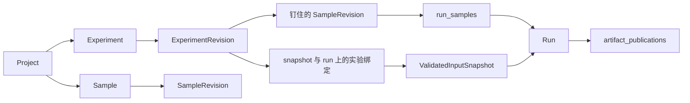

# 实验数据目录 M0：查询与结果追溯契约

状态：设计契约，供 M1 直接实现。文档分支的基线是 main
`ff3f7d981592a844750dba502f980a356becc874`。2026-11-18 又对照当时的
`origin/main` `9205a91455877b05d900daa67261425533a1c850` 复核了本文引用的身份、
迁移头和生成命令：#222 与 #223 没有改这些符号，Alembic 唯一头仍是 `20261110_16`。
`openapi:regenerate` 仍是 `npm run openapi:export && npm run openapi:generate`。
本文不新增表、迁移、路由、OpenAPI 或生成客户端，也不表示这些能力已经存在。

M1 实现查询、手工维护和结果关联时以本文为准。更宽的阶段划分仍以
[数据目录、受控 AI 整理与可视化边界设计](catalog-agent-viewer-boundaries.md) 为准；
本文只收紧其中 M1 的目录、查询和追溯，不改 M2、P1、P2 或 V2。
身份和权限的已接受决定见
[数据基础 ADR](data-foundation-decision.md)、
[产物发布 ADR](artifact-publication-provenance-decision.md)和
[认证 ADR](lan-authentication-decision.md)。

分工以
[session 计划 `bf66c6b`](https://github.com/ZichenYang-glitch/ENCODE-style-ChIPseq-CUT-Tag-pipeline/blob/bf66c6b93477c78cd449601fb15a9714c2799bb1/docs/development/next-delivery-session-plan.md)
为准：`Codex-Catalog-Design` / M0 只交付契约；`Cursor-Catalog-M1` 再写领域、
服务、repository、API、迁移和生成客户端。该计划所在的路线图 PR #221 正在改
`docs/development/` 下三份入口文件。M1 不要把本契约写进那些文件，也不要改
[边界设计](catalog-agent-viewer-boundaries.md) 来承载实现细节。

## 1. 已有决定

下列条目已经由现有 ADR、边界设计或基线代码固定。M1 沿用，不另起一套身份。

| 决定 | 基线证据 |
| --- | --- |
| SQLite 是身份、关系和可查询溯源的权威。清单、样本表和自由文本只是导入材料 | 数据基础 ADR |
| 一个部署、共享项目。角色只有 `administrator` 和 `member`，没有项目级 ACL | 认证 ADR；`UserRole` |
| 课题就是 Project（`prj_` + 32 位十六进制）。一个目录对象只属于一个 Project。跨项目集合不在 M1 | 边界设计第 3 节；`Project` |
| 保留的 Legacy Project `prj_00000000000000000000000000000000` 不能拥有可信 Sample | `LEGACY_PROJECT_ID`；`ck_samples_not_legacy` |
| Sample（`smp_`）是逻辑样本，不是样本表的一行、lane、文库或文件名 | `Sample`；数据基础 ADR |
| SampleRevision（`smpr_`）只追加。权威内容是 canonical payload `{display_name, attributes}`，摘要方案 `sha256-framed-sample-revision-payload-v1` | `SampleRevision`；`sample_revisions` |
| 运行创建不做“最新修订”查找。snapshot 冻结有序 SampleRevision 及 payload 摘要，消费时原样复制到 run | `snapshot_sample_revisions`；`run_samples`；`ProjectSampleBinding` |
| 绑定只有两种一致组合：`legacy_v1` + `unresolved` + 零个样本，或 `bound_v1` + `resolved` + 至少一个样本 | `BindingMode`；`BindingProvenance` |
| 发布是追加的 `artifact_publications`。行内不复制 Project 或 Sample。公开投影从 run 绑定得到项目，从 `run_samples` 得到关联样本 | 产物发布 ADR；`ArtifactPublicationRunSampleBinding` |
| 关联样本表示运行输入范围，不是每条产物的贡献样本。不能从文件名、路径、QC 标签、样本表或 adapter 私有 payload 推断 | 产物发布 ADR；边界设计第 3 节 |
| 迁移不回填历史发布。没有发布行就表示当时没有可信的 `published_at` | 产物发布 ADR |
| 预迁移运行保持 Legacy + `unresolved`，不合成 Sample、RunSample 或 Experiment | 数据基础 ADR |
| 目录读不扩大既有产物下载权限。字节读取仍走现有 `downloadRunArtifact` | 边界设计；`downloadRunArtifact` |
| 参考基因组身份属于运行或 Reference Profile，不能由物种、目录标签或 hg38/mm10 显示名推出 | 边界设计第 3 节 |
| 成员可读共享项目；匿名拒绝。目录分类的新增和修改只由管理员执行 | 认证矩阵；边界设计第 3 节 |
| 页面默认 20、最大 50。cursor 绑定规范化后的过滤条件。不同维度 AND，同一维度多选 OR。空筛选不是“查未知” | 边界设计第 3 节 |
| 样本目录默认看最新修订；结果默认按运行冻结的样本修订解释 | 边界设计第 3 节 |
| 材料字段是物种、组织、细胞类型、细胞系、处理条件和标签。细胞类型与细胞系分开。实验字段是 assay、target、批次和重复角色。重复关系只能人工登记 | 边界设计第 3 节 |
| `unknown`、`not_applicable`、`not_detected` 彼此不同，也不能写成空字符串 | 边界设计第 3 节 |
| 词义变化不改写已经记下的历史解释。别名只产生建议，歧义要保留 | 边界设计第 3 节 |
| M1 拆成两段：先分类和手工查询，再做可靠的结果接线。样本相同不能代替实验到运行的关联 | session 计划 C 节 |
| 生成客户端只由后端契约用 `npm --prefix frontend run openapi:regenerate` 生成。`frontend/src/api/generated/` 禁止手改 | `frontend/package.json`；平台概述 |
| 本基线 Alembic 唯一头是 `20261110_16`（父修订 `20260827_15`） | `20261110_16_agent_authoring.py` |

捆绑 workflow 的身份是 `encode-style-chipseq-cuttag-atac-mnase`。样本表的
`assay` 取值是 `chipseq`、`cuttag`、`atac`、`mnase`，`experiment` 列是 adapter
的重复分组字符串。二者都不是目录身份。见 [样本表说明](../sample-sheet.md)。

## 2. 本契约对 M1 的收紧

这些收紧不推翻上一节，只让 M1 有唯一实现：

1. 词条修订只表示同一含义的编辑修正（拼写、别名、外部 accession）。含义变化必须新建
   `term_id`。查询参数使用 `term_id`，因此编辑修正仍能命中旧行；DTO 显示的名称来自
   行上钉住的 `term_revision_id`，不改成该词的当前头修订名称。
2. M1 的手工维护是管理员 HTTP API，并在服务事务内再次核对角色。不为目录另写一套
   直连 SQL 的 CLI。已有本地 `revise_sample` 继续负责非目录属性，并且必须原样保留
   已有 `attributes.catalog`。终端目录客户端留到后续的 Catalog CLI，调用同一 HTTP API。
3. 标签是词条，不是自由字符串。自由文本留在 catalog 块之外，不进列表、不过滤、不建索引。
4. 现有 Sample 没有归档列。M1 不补样本级归档。Experiment 是新对象，用 `archived_at`
   表示停用，不删除。
5. 目录列表的页大小按边界设计，默认 20、最大 50。现有 `listArtifactPublications`
   的默认 50、最大 100 保持不变，目录追溯不复用那个页大小。
6. 准确的实验—运行关联只在样本修订集合相等时冻结。M1 不保存“部分重叠”的弱关联。
7. 第 11 节的路径和 operation ID 是 M1 契约提交要原样冻结的名字。本文件不修改 OpenAPI。

## 3. 仍需实验室负责人确认

未回复即按下列默认实现。M1 契约提交前若负责人改选，只改被点名的默认，不重开第 1 节。

| 编号 | 问题 | 默认 |
| --- | --- | --- |
| Q1 | 课题是否就是一个 Project，且 M1 不做 Project 内的子课题、也不做跨 Project 查询？ | 是 |
| Q2 | 缺少实验绑定的历史运行是否一直显示 unresolved，M1 不提供事后补绑？ | 是。事后补绑会给当时没有冻结的 snapshot 追加证据，须另开契约 |
| Q3 | 新建 snapshot 时，实验修订是否可以不选？ | 可以。不选则该 snapshot 的实验关联保持 unresolved。选了但样本修订集合不相等则整次校验失败，不写成弱关联 |
| Q4 | 首版词表是否预置科学术语？ | 不预置。不把 `chipseq` / `cuttag` / `atac` / `mnase` 或样本表的 `experiment` 列写成已确认词条。负责人若要首批词，在 M1 契约提交前给出清单 |

## 4. 身份与准确关联

复用的身份：Project、Sample、SampleRevision、ValidatedInputSnapshot（`vsnap_`）、
Run、`snapshot_sample_revisions`、`run_samples`、`artifact_publications`，以及
`run_id` + `artifact_id` + `artifact_generation` + `artifact_revision`。

新增的身份，全部用 `uuid4().hex`，小写：

| 对象 | 前缀 | 长度 | 说明 |
| --- | --- | --- | --- |
| Experiment | `exp_` | 36 | 一个 Project 内的实验／文库。`stable_key` 在项目内唯一，规则与 Sample 的 stable key 相同 |
| ExperimentRevision | `expr_` | 37 | 不可变。摘要方案 `sha256-framed-experiment-revision-payload-v1`，长度前缀算法与样本修订相同，不复用样本方案的字符串 |
| Term | `term_` | 37 | 部署级词条，不属于某个 Project |
| TermRevision | `trmv_` | 37 | 不可变编辑修订 |

关联：



- ExperimentRevision 的 canonical payload 写入有序样本钉：修订 ID、该修订的
  `payload_digest`、从 0 连续的 `ordinal`、可选的 `replicate_group` 和重复角色。
  关联表在同一事务里逐行镜像这份钉，并用外键约束它。两边不一致就拒绝写入。
  零条样本、跨项目、重复修订、摘要不匹配，都拒绝。
- `replicate_group` 只接受管理员输入的 stable-key 形态，或为空。不从样本名、Rep1/Rep2
  或样本表 `replicate` 列推导。
- 重复角色使用词条。状态不是 `known` 时没有 `term_revision_id`。
- 样本修订上的 catalog 钉住 TermRevision。投影表在同一事务写出，客户端不直接写投影。
- Slice A 没有实验到 snapshot 的绑定。实验追溯信封的 `trace_status` 固定为
  `unresolved`，`results` 为空。
- Slice B 在校验 snapshot 时，仅当请求带了 `experiment_revision_id`，且该实验修订的
  SampleRevision 集合与 snapshot 的 SampleRevision 集合相等，才写入
  `snapshot_experiment_bindings`。运行消费在现有 `consume_validated_input_snapshot`
  的同一事务把该绑定复制到 `run_experiment_bindings`；内存 repository 做同样的复制和比较。
  重放必须连实验修订 ID 和 payload 摘要一起比较，不一致则失败关闭。
  `createRun` 不接受实验修订，也不在消费时查找最新实验。
- 相等比较忽略顺序，要求两侧集合都非空且无重复。多一条、少一条或只是样本相同而修订不同，
  都是不相等。
- 实验绑定成立后，也不把某条 peak 或 bigWig 说成某一个样本的轨道。

追溯只使用下面这一套字段。产物行上没有第三种关联，也不使用名为
`association_kind` 的字段。

| 位置 | 字段 | 取值 |
| --- | --- | --- |
| 实验追溯信封 | `trace_status` | `unresolved` 或 `experiment_snapshot` |
| 实验追溯信封 | `reason` | 只有 `trace_status=unresolved` 时出现。没有绑定行时是 `experiment_snapshot_binding_absent` |
| 实验追溯信封 | `results` | 产物行数组。`unresolved` 时为空数组 |
| 产物行 | `artifact_association_kind` | 只有 `run_input_scope` |
| 产物行 | `publication_evidence` | 该行存在时必为 `present` |
| 样本追溯中尚未发布的运行 | `publication_evidence` | `absent`。这不是产物行，没有 `artifact_association_kind`，也没有 `artifact_generation` 或 `artifact_revision` |
| 运行样本绑定 | `provenance` | 现有的 `resolved` 或 `unresolved` |

样本追溯信封没有 `trace_status`。`experiment_snapshot` 只出现在实验追溯信封和
snapshot 响应的 `experiment_binding.status` 上，不出现在产物行上。
`unresolved` 同样不写成产物关联。没有发布行只表示缺少 `published_at`，
不把该运行改成 unresolved。

## 5. 分类字典、未知与冲突

词条类型是平台栏位，不是科学枚举：`species`、`tissue`、`cell_type`、`cell_line`、
`treatment`、`tag`、`assay`、`target`、`batch`、`replicate_role`。
OpenAPI 可以把这个栏位列成闭集。assay 的具体含义（CUT&Tag、ATAC 等）必须是词条行，
不能出现在通用 API 的枚举里。

部署级词表由管理员维护，所有项目可读。本部署没有项目级 ACL，M1 不做项目私有词表。
外部 `namespace` 和 `accession` 是可选字段，留在词条修订上。M1 不导入本体，也不按
accession 自动认领未核对的术语。

样本修订里的目录块是可选的 `attributes.catalog`。没有这个键表示 `unclassified`（未分类），
不是未知，也不是校验错误。已有自由属性保持原样，迁移不把它们提升成已确认分类。
现有样本摘要方案不变；只有新修订会因为内容变化得到新摘要。

`schema_version` 只能是 `1`。块内每个栏位都有状态：

| 状态码 | 画面 | 是否钉住词条 | 能否被该栏位的 term 筛选命中 |
| --- | --- | --- | --- |
| `unclassified` | 未分类 | 否，整块不存在 | 否。只在 `catalog_state=absent` 时返回 |
| `known` | 词条修订上的显示名 | 是 | 能，按 `term_id` |
| `unknown` | 未知 | 否 | 否 |
| `not_applicable` | 不适用 | 否 | 否 |
| `not_detected` | 未检出 | 否 | 否 |
| `ambiguous` | 歧义 | 只记录候选，不写入正向投影 | 否 |

空字符串、`null` 显示名和“把三种空状态合成一个空值”都拒绝。
`known` 必须有类型匹配的 `term_revision_id`。另外三种否定状态和 `ambiguous` 不能带正向词条。

栏位个数和投影如下。单值栏位是一个对象。多值栏位是 `{status, values}`。
状态筛选读投影上的状态列；词条筛选只读正向词条行。`unknown` 没有正向词条行，
所以只能靠状态列命中。

| 栏位 | 个数 | 权威位置 | 投影 |
| --- | --- | --- | --- |
| `species` | 单值 | `attributes.catalog.species` | `sample_catalog_projection` 的状态、可空 `term_id`、可空 `term_revision_id` |
| `tissue` | 单值 | `attributes.catalog.tissue` | 同上，独立列 |
| `cell_type` | 多值 | `attributes.catalog.cell_type` | 状态在 `sample_catalog_projection`；`known` 的每个词写入 `sample_catalog_values`，`field_name=cell_type` |
| `cell_line` | 多值 | `attributes.catalog.cell_line` | 同上，`field_name=cell_line` |
| `treatment` | 多值 | `attributes.catalog.treatment` | 同上，`field_name=treatment` |
| `tag` | 多值 | `attributes.catalog.tag` | 同上，`field_name=tag` |
| `assay` | 单值 | 实验 payload 的 `assay` | `experiment_catalog_projection` |
| `target` | 单值 | 实验 payload 的 `target` | `experiment_catalog_projection` |
| `batch` | 单值 | 实验 payload 的 `batch` | `experiment_catalog_projection` |
| `replicate_role` | 每个样本钉一个 | payload 的样本钉，并镜像到 `experiment_revision_samples` | 不参加 M1 筛选 |
| `replicate_group` | 每个样本钉一个可选字符串，不是词条 | 同上 | 不建词条投影，M1 不按它筛选 |

整块 `attributes.catalog` 不存在时是 `unclassified`，不命中任何 `*_status=unknown`。
样本目录块存在时，`species`、`tissue`、`cell_type`、`cell_line`、`treatment` 和 `tag`
这六个键都必须出现。实验 payload 存在时，`assay`、`target` 和 `batch` 都必须出现，
每个样本钉也必须有 `replicate_role`。`replicate_group` 可以省略。
缺上述任一必填键是 422 `catalog_payload_invalid`，不写入，也不改成 `unknown`。
多值栏位在 `known` 时 `values` 至少一项；单值栏位在 `known` 时必须有 `term_id` 和
`term_revision_id`。`unknown`、`not_applicable`、`not_detected` 不能带正向词条，
也不插入 `sample_catalog_values`。第 7 节第二条实验能被未知筛选命中，是因为它的
`cell_type.status` 被显式写成 `unknown`，不是因为缺键。

`ambiguous` 的正向 `values` 为空，不写入值表或标量词条列。候选只放在该栏位的
`candidates` 数组里，元素是 `{term_id, term_revision_id}`，可以是零个或多个。
候选不参与筛选。

成员可见的列表和追溯可以出现 `status=ambiguous` 以及已钉住词条的显示名。
这些响应省略 `candidates`、`aliases` 和原始 attributes。管理员用下面两个路由读回候选，
并带上词条修订的 `display_name`。非歧义栏位省略 `candidates` 键，不用空数组表示“没有歧义”：

| 方法与路径 | operation ID | 谁可以读 |
| --- | --- | --- |
| `GET /catalog/samples/{sample_id}/revisions/{sample_revision_id}` | `catalogGetSampleRevision` | 仅管理员 |
| `GET /catalog/experiments/{experiment_id}/revisions/{experiment_revision_id}` | `catalogGetExperimentRevision` | 仅管理员 |

成员调用这两个路由得到 403 `ADMINISTRATOR_REQUIRED`。实验详情里的候选包括
assay、target、batch 和每个样本钉上的 `replicate_role`。别名仍只出现在管理员的
`catalogGetTerm`。服务端不根据别名写入目录。别名同时命中多个词条时，界面保持歧义，
由管理员显式选择一个词条修订，或显式保存 `ambiguous` 和它的 `candidates`。

管理员读到的歧义栏位形状：

```json
{
  "cell_type": {
    "status": "ambiguous",
    "values": [],
    "candidates": [
      {
        "term_id": "term_aaaaaaaaaaaaaaaaaaaaaaaaaaaaaaaa",
        "term_revision_id": "trmv_bbbbbbbbbbbbbbbbbbbbbbbbbbbbbbbb",
        "display_name": "regulatory T cell"
      },
      {
        "term_id": "term_cccccccccccccccccccccccccccccccc",
        "term_revision_id": "trmv_dddddddddddddddddddddddddddddddd",
        "display_name": "keratinocyte"
      }
    ]
  }
}
```

同一修订在成员列表里只到 `{"status": "ambiguous", "values": []}`，没有 `candidates`。

冲突不是目录字段。两个写入用同一个 `expected_revision_number` 时，先提交的一方成功，
另一方得到 409 `catalog_revision_conflict`，库内仍是获胜的那一版。界面显示“冲突”和
当前修订号，不合并字段，不部分提交。

## 6. 数据来源

查询和追溯只读下列权威：

| 画面上的内容 | 来源 |
| --- | --- |
| 课题 | `projects`。名称只用于显示 |
| 样本分类 | 所解释的那条 SampleRevision 的 `attributes.catalog`，经同一事务生成的投影 |
| 实验分类 | ExperimentRevision 的 canonical payload，经投影 |
| 词条名称 | 被钉住的 TermRevision，不是词条头修订 |
| 样本到运行 | `run_samples` 与 `snapshot_sample_revisions` |
| 实验到运行 | Slice B 的 `snapshot_experiment_bindings` 与 `run_experiment_bindings` |
| 产物 | `artifact_publications`，再按现有规则判断 current 或 superseded |

明确不作为来源：文件名、相对路径、`run://` URI、QC 标签、样本表列、workflow id、
adapter 私有校验 payload、catalog 块以外的 attributes、Reference Profile、viewer 的
基因组显示名。workflow id 可以继续出现在现有发布查询里，但不能当成实验类型。

## 7. 组合查询示例

示例 ID 都符合前缀规则，不对应真实数据。课题是 Project
`prj_11111111111111111111111111111111`，显示名“Treg 表观”。

词条：

| 含义 | term_id | 钉住的 term_revision_id | 显示名 |
| --- | --- | --- | --- |
| 细胞类型 | `term_aaaaaaaaaaaaaaaaaaaaaaaaaaaaaaaa` | `trmv_bbbbbbbbbbbbbbbbbbbbbbbbbbbbbbbb` | regulatory T cell |
| 细胞类型 | `term_cccccccccccccccccccccccccccccccc` | `trmv_dddddddddddddddddddddddddddddddd` | keratinocyte |
| assay | `term_eeeeeeeeeeeeeeeeeeeeeeeeeeeeeeee` | `trmv_ffffffffffffffffffffffffffffffff` | CUT&Tag |
| assay | `term_99999999999999999999999999999999` | `trmv_88888888888888888888888888888888` | ATAC |

这个项目里有三条当前实验，外加一个未分类样本：

| 对象 | 实验类型 | 钉住的样本修订 | 该修订上的细胞类型 |
| --- | --- | --- | --- |
| `exp_44444444444444444444444444444444` 修订 `expr_55555555555555555555555555555555` | CUT&Tag | `smpr_33333333333333333333333333333333` 与对照 `smpr_abababababababababababababababab` | 处理样本是 regulatory T cell；对照也是该细胞类型，角色为 control |
| `exp_aaaaaaaaaaaaaaaaaaaaaaaaaaaaaaaa` | CUT&Tag | `smpr_bbbbbbbbbbbbbbbbbbbbbbbbbbbbbbbb` | 状态 `unknown` |
| `exp_cccccccccccccccccccccccccccccccc` | ATAC | `smpr_dddddddddddddddddddddddddddddddd` | keratinocyte |
| 样本 `smp_eeeeeeeeeeeeeeeeeeeeeeeeeeeeeeee` | 无实验 | 无 catalog 块 | 未分类 |

默认 `revision_view=linked`：细胞类型取实验修订钉住的样本修订，不取该样本更新的头修订。
一条实验钉住多个样本时，任一钉住修订命中所给细胞类型即算命中该实验。

查询“这个课题里，细胞类型是 regulatory T cell，并且实验类型是 CUT&Tag”：

```http
GET /api/v1/catalog/projects/prj_11111111111111111111111111111111/experiments?cell_type_term_id=term_aaaaaaaaaaaaaaaaaaaaaaaaaaaaaaaa&assay_term_id=term_eeeeeeeeeeeeeeeeeeeeeeeeeeeeeeee&limit=20
```

只返回 `expr_55555555555555555555555555555555`。keratinocyte、未知细胞类型和 ATAC
都不在这一页。同一请求再加 `cell_type_term_id=term_cccccccccccccccccccccccccccccccc`
时，两个细胞类型是 OR，assay 仍是 AND，于是 regulatory T cell 与 keratinocyte 的
CUT&Tag 都会返回；本例里 keratinocyte 的实验是 ATAC，所以仍只有第一条。

只查未知细胞类型，并且实验类型是 CUT&Tag：

```http
GET /api/v1/catalog/projects/prj_11111111111111111111111111111111/experiments?cell_type_status=unknown&assay_term_id=term_eeeeeeeeeeeeeeeeeeeeeeeeeeeeeeee
```

只返回第二条。它钉住的样本修订有完整的六个材料栏位，其中 `cell_type` 是
`{"status": "unknown", "values": []}`，没有 `term_id`，因此命中状态筛选、不会命中任何
细胞类型词条。该实验自己的 `assay.status` 是 `known`。未分类样本没有 catalog 块，
不会被 `cell_type_status=unknown` 选中；它只出现在样本列表的 `catalog_state=absent`。
样本块里若缺少 `cell_type` 键，请求会以 422 `catalog_payload_invalid` 失败，
不会留下一条看起来像未知的修订。
`cell_type_status=unknown` 再加某个 `cell_type_term_id` 是 400 `catalog_filter_invalid`。

不带筛选的实验列表返回该项目三条活动实验，这是空筛选，不是未知查询。
`include_archived=true` 才包含已归档实验。归档项目默认不出现在活动列表。

响应只给有界 DTO。下面只列出第一条的形状：

```json
{
  "ok": true,
  "project_id": "prj_11111111111111111111111111111111",
  "revision_view": "linked",
  "experiments": [
    {
      "experiment_id": "exp_44444444444444444444444444444444",
      "experiment_revision_id": "expr_55555555555555555555555555555555",
      "revision_number": 2,
      "display_name": "Treg H3K27me3 CUT&Tag",
      "assay": {
        "status": "known",
        "term_id": "term_eeeeeeeeeeeeeeeeeeeeeeeeeeeeeeee",
        "term_revision_id": "trmv_ffffffffffffffffffffffffffffffff",
        "display_name": "CUT&Tag"
      },
      "target": {
        "status": "known",
        "term_id": "term_12121212121212121212121212121212",
        "term_revision_id": "trmv_34343434343434343434343434343434",
        "display_name": "H3K27me3"
      },
      "batch": {"status": "unknown"},
      "samples": [
        {
          "sample_id": "smp_22222222222222222222222222222222",
          "sample_revision_id": "smpr_33333333333333333333333333333333",
          "ordinal": 0,
          "replicate_group": "biorep-1",
          "replicate_role": {
            "status": "known",
            "term_id": "term_56565656565656565656565656565656",
            "term_revision_id": "trmv_78787878787878787878787878787878",
            "display_name": "treatment"
          },
          "cell_type": {
            "status": "known",
            "values": [
              {
                "term_id": "term_aaaaaaaaaaaaaaaaaaaaaaaaaaaaaaaa",
                "term_revision_id": "trmv_bbbbbbbbbbbbbbbbbbbbbbbbbbbbbbbb",
                "display_name": "regulatory T cell"
              }
            ]
          },
          "cell_line": {"status": "not_applicable", "values": []}
        },
        {
          "sample_id": "smp_abababababababababababababababab",
          "sample_revision_id": "smpr_abababababababababababababababab",
          "ordinal": 1,
          "replicate_group": "biorep-1",
          "replicate_role": {
            "status": "known",
            "term_id": "term_90909090909090909090909090909090",
            "term_revision_id": "trmv_01010101010101010101010101010101",
            "display_name": "control"
          },
          "cell_type": {
            "status": "known",
            "values": [
              {
                "term_id": "term_aaaaaaaaaaaaaaaaaaaaaaaaaaaaaaaa",
                "term_revision_id": "trmv_bbbbbbbbbbbbbbbbbbbbbbbbbbbbbbbb",
                "display_name": "regulatory T cell"
              }
            ]
          },
          "cell_line": {"status": "not_applicable", "values": []}
        }
      ]
    }
  ],
  "next_cursor": null
}
```

上面的处理样本只展开了查询用到的 `cell_type` 和 `cell_line`。合法修订还要有单值的
`species`、`tissue`，以及多值的 `treatment`、`tag`；这四项在示例里省略，不表示可以缺键。
对照样本的六个材料栏位与处理样本相同。DTO 不包含宿主路径、原始 attributes、样本表、别名、
`candidates`、供体标识或自由文本。
`revision_view=current_sample_catalog` 时，细胞类型改按所链样本的当前头修订解释；
若头修订与钉住的修订不同，样本对象同时给出 `linked_sample_revision_id` 和
`current_sample_revision_id`。默认视图不要混入这个差别。

样本列表使用同一套细胞类型规则，但没有 assay。实验类型只出现在实验查询里。
物种、组织、细胞系、处理、标签、target 以及实验修订的半开创建时间
`[created_from, created_before)` 也是 AND 维度。M1 一次把这些已决定的维度做完，
不把接口留成只有细胞类型和 assay。

## 8. 从样本修订或实验修订追到运行结果

沿用第 7 节的对象。snapshot `vsnap_66666666666666666666666666666666`
冻结的样本修订集合正好是 `{smpr_33333333333333333333333333333333, smpr_abababababababababababababababab}`，
与 `expr_55555555555555555555555555555555` 钉住的集合相同。运行
`run_treg_h3k27me3_01` 原样复制了这个集合，并有一条当前发布，产物 `peaks`。
发布身份写在下面的成功响应里。
Legacy 运行 `run_legacy_01` 属于保留 Legacy Project，`provenance=unresolved`，
没有 `run_samples`。

从样本修订追溯：

```http
GET /api/v1/catalog/projects/prj_11111111111111111111111111111111/sample-revisions/smpr_33333333333333333333333333333333/run-results
```

成功时信封没有 `trace_status`。下面这一行就是唯一的产物行形状；实验追溯成功时重复使用它，
不另起字段名。`artifact_generation` 与 `artifact_revision` 使用现有的 76 字符身份，
不能写成 `g1` 或 `r1`。

```json
{
  "ok": true,
  "project_id": "prj_11111111111111111111111111111111",
  "sample_revision_id": "smpr_33333333333333333333333333333333",
  "results": [
    {
      "run_id": "run_treg_h3k27me3_01",
      "provenance": "resolved",
      "publication_evidence": "present",
      "artifact_association_kind": "run_input_scope",
      "workflow_id": "encode-style-chipseq-cuttag-atac-mnase",
      "artifact_id": "peaks",
      "output_type": "peaks",
      "artifact_generation": "artifactgen-aaaaaaaaaaaaaaaaaaaaaaaaaaaaaaaaaaaaaaaaaaaaaaaaaaaaaaaaaaaaaaaa",
      "artifact_revision": "artifactrev-bbbbbbbbbbbbbbbbbbbbbbbbbbbbbbbbbbbbbbbbbbbbbbbbbbbbbbbbbbbbbbbb",
      "published_at": "2026-11-18T00:00:00Z",
      "current_artifact_generation": "artifactgen-aaaaaaaaaaaaaaaaaaaaaaaaaaaaaaaaaaaaaaaaaaaaaaaaaaaaaaaaaaaaaaaa",
      "generation_status": "current",
      "run_sample_binding": {
        "binding_mode": "bound_v1",
        "provenance": "resolved",
        "associated_run_samples": [
          {
            "sample_id": "smp_22222222222222222222222222222222",
            "sample_revision_id": "smpr_33333333333333333333333333333333",
            "revision_number": 1,
            "ordinal": 0
          },
          {
            "sample_id": "smp_abababababababababababababababab",
            "sample_revision_id": "smpr_abababababababababababababababab",
            "revision_number": 1,
            "ordinal": 1
          }
        ]
      }
    }
  ],
  "next_cursor": null
}
```

`associated_run_samples` 按 ordinal 列出这条运行的全部样本修订，包括对照。
响应不把 `peaks` 写成 `smpr_3333…` 单独贡献的轨道。
`run_legacy_01` 不在这个样本的结果里，因为它没有这条样本修订。
若该运行尚未写出发布行，结果里仍有这个运行，但不是产物行：

```json
{
  "run_id": "run_treg_h3k27me3_01",
  "provenance": "resolved",
  "publication_evidence": "absent"
}
```

这里没有 `artifact_association_kind`，也不编造 `published_at`。

从实验修订追溯：

```http
GET /api/v1/catalog/projects/prj_11111111111111111111111111111111/experiment-revisions/expr_55555555555555555555555555555555/run-results
```

Slice A 即使上面的样本追溯已经看到运行，实验追溯也返回：

```json
{
  "ok": true,
  "project_id": "prj_11111111111111111111111111111111",
  "experiment_revision_id": "expr_55555555555555555555555555555555",
  "trace_status": "unresolved",
  "reason": "experiment_snapshot_binding_absent",
  "results": [],
  "next_cursor": null
}
```

这个未绑定信封没有产物行，因此也没有 `artifact_association_kind`。

Slice B 里，校验请求若带上这条实验修订，且 snapshot 的样本修订集合正好是实验钉住的集合，
则信封改为下面的成功形状。`results` 里的对象与样本追溯的产物行相同，
`artifact_association_kind` 仍是 `run_input_scope`。

```json
{
  "ok": true,
  "project_id": "prj_11111111111111111111111111111111",
  "experiment_revision_id": "expr_55555555555555555555555555555555",
  "trace_status": "experiment_snapshot",
  "results": [
    {
      "run_id": "run_treg_h3k27me3_01",
      "provenance": "resolved",
      "publication_evidence": "present",
      "artifact_association_kind": "run_input_scope",
      "workflow_id": "encode-style-chipseq-cuttag-atac-mnase",
      "artifact_id": "peaks",
      "output_type": "peaks",
      "artifact_generation": "artifactgen-aaaaaaaaaaaaaaaaaaaaaaaaaaaaaaaaaaaaaaaaaaaaaaaaaaaaaaaaaaaaaaaa",
      "artifact_revision": "artifactrev-bbbbbbbbbbbbbbbbbbbbbbbbbbbbbbbbbbbbbbbbbbbbbbbbbbbbbbbbbbbbbbbb",
      "published_at": "2026-11-18T00:00:00Z",
      "current_artifact_generation": "artifactgen-aaaaaaaaaaaaaaaaaaaaaaaaaaaaaaaaaaaaaaaaaaaaaaaaaaaaaaaaaaaaaaaa",
      "generation_status": "current",
      "run_sample_binding": {
        "binding_mode": "bound_v1",
        "provenance": "resolved",
        "associated_run_samples": [
          {
            "sample_id": "smp_22222222222222222222222222222222",
            "sample_revision_id": "smpr_33333333333333333333333333333333",
            "revision_number": 1,
            "ordinal": 0
          },
          {
            "sample_id": "smp_abababababababababababababababab",
            "sample_revision_id": "smpr_abababababababababababababababab",
            "revision_number": 1,
            "ordinal": 1
          }
        ]
      }
    }
  ],
  "next_cursor": null
}
```

成功信封没有 `reason`。对照样本留在 `associated_run_samples` 里。

Slice B 的反例：仍选择这条实验修订，但校验请求的 snapshot 只有
`{smpr_3333…}`，少了对照。`validateWorkflow` 整次失败，错误码 `catalog_sample_set_mismatch`，
不留下半份绑定，也不自动退回“未选实验”。调用方可以去掉实验修订后重新提交，
那一次的实验关联才是 unresolved。

历史 snapshot 在升级后没有实验绑定行。Slice B 不回填，`createRun` 也不补选实验。
`authoringValidateDraft` 在 M1 不接收实验修订，也不从草稿或样本表推断实验；
经该入口产生的 snapshot 保持 `experiment_snapshot_binding_absent`。
两个入口若未来都接收该字段，必须调用同一个冻结函数。

## 9. 分页与索引

目录对象列表按 `created_at ASC, id ASC`。追溯列表沿用发布排序：
`published_at DESC, run_id DESC, artifact_generation DESC, artifact_id DESC`。
cursor 是不透明字符串，前缀 `catcur_`，最大 1024，字符集与现有
`artifactpubcur_` 相同。cursor 内含过滤器的 canonical JSON SHA-256 和位置，
并带契约版本 `v: 1`。过滤器或排序变化会使旧 cursor 得到 400 `catalog_cursor_invalid`。
位置上的行已不满足过滤器时返回 404 `catalog_cursor_not_found`，不能静默跳到下一行。

升序主键使已经返回过的行不会在后面的页里重复。查询进行中新插入的、排序键更大的行
可以出现在后续页。调用方把这个 cursor 看成这一组过滤器的继续，而不是可变集合的快照。

投影在写入事务内替换，可以只从 canonical payload 重建。重建不修改 payload。
M1 把重建做成 repository 操作并用测试覆盖，不把它做成 HTTP 或 Agent 工具。

M1 至少建立这些索引，名字可以带常规前缀，但查询路径要保留：

| 索引用途 | 列 |
| --- | --- |
| 项目内的实验头 | `project_id, created_at, experiment_id` |
| assay 筛选 | `project_id, assay_term_id, experiment_revision_id` |
| 实验钉住的样本修订 | `sample_revision_id, experiment_revision_id` |
| 细胞类型及其他多值栏位 | `field_name, term_id, sample_revision_id` |
| 样本修订到运行 | 已有 `ix_run_samples_revision` |
| 实验修订到 snapshot | Slice B：`experiment_revision_id, snapshot_id` |

不为每个 JSON 键建索引，不引入全文或向量索引。验收时对第 7 节的组合查询做
`EXPLAIN QUERY PLAN`：计划不得 `SCAN sample_revisions` 或 `SCAN experiment_revisions`。
夹具至少在一个项目里放 200 条实验修订。计划文本写入测试，后续改索引时能看见差异。
样本修订到运行的追溯同样不得为了读目录去扫描发布表的无关项目；先走
`ix_run_samples_revision`，再按 `run_id` 找发布。

## 10. 权限、手工维护与并发

读接口使用 `require_principal`。写接口使用 `require_administrator` 和现有
`enforce_csrf`。服务在写入事务里重新读取账号：账号不存在、已停用或不再是管理员，
就整笔回滚。匿名是 401 `AUTHENTICATION_REQUIRED`。成员写目录是 403
`ADMINISTRATOR_REQUIRED`。CSRF 失败仍是 403 `CSRF_INVALID`。

成员可以读取活动项目中的目录、词条显示名和追溯。成员不能创建词条、修订目录、
归档实验或词条，也不能选择一个不存在的修订来制造关联。成员列表和追溯可以显示
`ambiguous`，但不能看到 `candidates` 或别名。目录查询命中不改变该成员是否可以下载
某个产物代际。

成员可以在已有的 `validateWorkflow` 上提交可选 `experiment_revision_id`。
该路由今天就对成员开放，并且会持久化 snapshot。成员只能选择同一活动项目里已经存在、
尚未归档、且样本修订集合相等的实验修订。这不新增角色，也不让成员创建实验。
M1 不把这个字段改成管理员专属；若要收紧，先改本契约。

管理员手工维护：

| 操作 | 行为 |
| --- | --- |
| 新建词条 | 同一事务写身份和修订 1。`change_kind=initial` |
| 修订词条 | 只允许 `change_kind=editorial`。就地修改显示名或别名都拒绝 |
| 归档词条 | `catalogArchiveTerm`。只写 `catalog_terms.archived_at`，不新增词条修订。已钉住该词的旧修订仍显示原名，并仍能被 `term_id` 命中。新的目录或实验修订不能再选它 |
| 新建实验 | 同一事务写身份、修订 1、样本关联和投影。不能建在 Legacy Project 或已归档项目 |
| 修订实验 | 新修订。旧修订及其已冻结的运行绑定不变 |
| 归档实验 | `catalogArchiveExperiment`。只写 `experiments.archived_at`，不新增实验修订。已冻结的 snapshot 仍可读。新 snapshot 不能再选它 |
| 写样本目录 | 新的 SampleRevision。请求可以改 `display_name`；省略则复制上一修订的名称。catalog 以外的 attributes 一律从上一修订复制，请求体不能携带它们 |
| 清除目录 | `catalog: null`。新修订去掉 catalog 键，投影为 `unclassified`。旧修订保留 |

本地 `revise_sample` 若提交的 attributes 含有 `catalog` 键，拒绝，错误码
`catalog_block_requires_catalog_command`。若不含该键，而上一修订有 catalog，
则把上一块原样复制进新 payload 后再计算摘要。这样操作员改显示名不会抹掉分类，
以后即使给成员开放通用样本编辑，也不能靠省略该键绕过管理员。

并发，全部在一个 SQLite 事务里完成：

1. 重新核对调用者仍是启用的管理员。
2. 按调用者和 `Idempotency-Key` 锁定回执。键的格式与长度跟 run id 相同，最大 128。
3. 已有回执且请求体摘要相同：返回当时的修订，不新建。
4. 已有回执但请求体摘要不同：409 `catalog_idempotency_conflict`。
5. `expected_revision_number` 与当前头修订不同：409 `catalog_revision_conflict`，不写回执。
6. 修订写入插入新修订、替换该修订的投影、更新头指针、写回执，然后提交。
   归档不插入修订，只在同一事务更新对应身份的 `archived_at`。
7. `(sample_id, revision_number)` 及实验上的同类唯一约束是最后一道防线。

写接口必须带 `Idempotency-Key`。缺少该头是 400。回执与修订一样保留，不套用 M2 提案的
30 分钟窗口。两个管理员使用不同的键、相同的期望修订号时，只有一个提交成功。
停用管理员若先提交，写入失败；写入若先提交，保留回执和新修订。
归档请求的期望修订号是当前头修订。头修订已经变化时返回 409
`catalog_revision_conflict`，并且 `archived_at` 仍为空。身份已经归档时返回 409
`catalog_already_archived`。同一键和同一请求体的重试返回当时的归档结果。

两条归档路由都要求管理员和 CSRF，请求体只有 `expected_revision_number`：

| 方法与路径 | operation ID | 写入 |
| --- | --- | --- |
| `POST /catalog/experiments/{experiment_id}/archive` | `catalogArchiveExperiment` | `experiments.archived_at` |
| `POST /catalog/terms/{term_id}/archive` | `catalogArchiveTerm` | `catalog_terms.archived_at` |

M1 不提供取消归档。默认列表隐藏已归档实验和词条；`include_archived=true` 才返回它们。
按实验修订 ID 读取历史修订和追溯仍然成功，因为归档不删除证据。
`validateWorkflow` 再选已归档实验时返回 409 `catalog_experiment_archived`，不创建 snapshot。
新的目录写入再选已归档词条时返回 409 `catalog_term_archived`。
`catalogGetTerm` 仍返回已归档词条，供管理员看到 `archived_at` 和别名。

目录路由若点名一个已归档 Project、Legacy Project 或不存在的 Project，返回 404
`catalog_not_found`。这与 authoring 把不可见项目当成不存在一样。
`include_archived` 不能把已归档项目重新列出来。项目归档仍走现有本地 CLI，不是目录路由。

实验修订请求里的样本关联是完整替换后的新修订，不是对旧修订做原地补丁。
旧实验修订上的样本集合保持不变，因此已经冻结的运行含义不变。

## 11. Schema 与 API

逻辑表如下。M1 再写成 Alembic 和 SQLAlchemy，本文件不指定 revision id。

| 表 | 要点 |
| --- | --- |
| `catalog_terms` | `term_id` 主键，`term_type`，`created_at`，可空 `archived_at` |
| `catalog_term_revisions` | 修订号从 1 连续；`display_name`、可空外部 namespace/accession、别名 JSON、`change_kind` |
| `experiments` | `project_id` 外键，项目内 `stable_key` 唯一，`archived_at` 可空。禁止 Legacy Project |
| `experiment_revisions` | canonical payload、摘要方案、摘要、修订号。唯一 `(experiment_id, revision_number)` |
| `experiment_revision_heads` | 每个实验一行当前修订，与新修订同一事务更新 |
| `experiment_revision_samples` | 钉住 `project_id, sample_revision_id, payload_digest`，外键对齐 `sample_revisions` 的现有唯一键；`ordinal`、`replicate_group`、角色状态和可选角色词条 |
| `experiment_catalog_projection` | 每个实验修订一行 assay/target/batch 的状态、`term_id`、`term_revision_id` |
| `sample_revision_heads` | 每个样本一行当前修订，等于该样本最大 `revision_number`。写入放在现有 `create_samples` 和 `append_sample_revision` 的同一事务，SQLAlchemy 与内存 repository 都要更新。只改目录服务会让本地 `revise_sample` 和头行分叉。authoring 仍可按最大修订号读取，但该修订必须等于头行 |
| `sample_catalog_projection` | 每个样本修订一行。含 `catalog_state`，以及 species、tissue、cell_type、cell_line、treatment、tag 六个状态列。species 和 tissue 另有可空词条列。多值栏位的状态也在这张表，这样 `unknown` 不必靠值表命中 |
| `sample_catalog_values` | 只存 `known` 的多值词条。主键 `(sample_revision_id, field_name, term_id)`，另存 `term_revision_id`。`field_name` 只允许 `cell_type`、`cell_line`、`treatment`、`tag` |
| `catalog_write_receipts` | `(actor_user_id, idempotency_key)` 唯一，保存请求体 SHA-256。修订写入记录新修订 ID；归档记录身份 ID 和提交后的 `archived_at` |
| `snapshot_experiment_bindings` | 仅 Slice B。主键 snapshot。保存实验修订 ID 及其 payload 摘要 |
| `run_experiment_bindings` | 仅 Slice B。主键 run。消费事务从 snapshot 复制实验修订 ID 和 payload 摘要 |

外键使用 `ON DELETE RESTRICT`，与样本证据相同。不更新和删除已有修订行。
实验归档只更新 `experiments.archived_at`。投影可以删除后按 payload 重建，payload 本身不可以。

实验 payload 包含 `schema_version`、`display_name`、assay、target、batch，以及上一节的
有序样本钉。payload 摘要因此会随样本集合改变。关联表是外键和查询所用的镜像，
不是另一套可以单独修改的关联。snapshot 与 run 上的实验绑定保存实验修订 ID 和这份
payload 摘要；重放比较这两项，不再另造第三个摘要。

路由都在 `/api/v1` 下。模型 `extra=forbid`。operation ID：

| 方法与路径 | operation ID | 阶段 |
| --- | --- | --- |
| `GET /catalog/projects/{project_id}/experiments` | `catalogListExperiments` | A |
| `GET /catalog/projects/{project_id}/samples` | `catalogListSamples` | A |
| `GET /catalog/samples/{sample_id}/revisions` | `catalogListSampleRevisions` | A，成员可见，无候选 |
| `GET /catalog/samples/{sample_id}/revisions/{sample_revision_id}` | `catalogGetSampleRevision` | A，仅管理员，含候选 |
| `GET /catalog/experiments/{experiment_id}/revisions` | `catalogListExperimentRevisions` | A，成员可见，无候选 |
| `GET /catalog/experiments/{experiment_id}/revisions/{experiment_revision_id}` | `catalogGetExperimentRevision` | A，仅管理员，含候选 |
| `GET /catalog/terms` | `catalogListTerms` | A |
| `GET /catalog/terms/{term_id}` | `catalogGetTerm` | A，仅管理员，含别名；已归档词条仍返回 |
| `POST /catalog/terms` | `catalogCreateTerm` | A |
| `POST /catalog/terms/{term_id}/revisions` | `catalogReviseTerm` | A |
| `POST /catalog/terms/{term_id}/archive` | `catalogArchiveTerm` | A |
| `POST /catalog/projects/{project_id}/experiments` | `catalogCreateExperiment` | A |
| `POST /catalog/experiments/{experiment_id}/revisions` | `catalogReviseExperiment` | A |
| `POST /catalog/experiments/{experiment_id}/archive` | `catalogArchiveExperiment` | A |
| `POST /catalog/samples/{sample_id}/catalog-revisions` | `catalogReviseSampleCatalog` | A |
| `GET /catalog/projects/{project_id}/sample-revisions/{sample_revision_id}/run-results` | `catalogListSampleRevisionRunResults` | A |
| `GET /catalog/projects/{project_id}/experiment-revisions/{experiment_revision_id}/run-results` | `catalogListExperimentRevisionRunResults` | A 固定 unresolved；B 才返回真实绑定 |
| `POST /workflows/{workflow_id}/validate` 增加可选 `experiment_revision_id` | 现有 `validateWorkflow` | B |

路径中的项目与修订所属项目不一致时返回 404，不返回别的项目的行。
`authoringListProjects`、`authoringListProjectSamples` 和 `listArtifactPublications`
保持原契约，不把目录筛选塞进去。

Slice B 的 `experiment_revision_id` 只加在 `ValidationRequest` 上，省略表示没有实验绑定。
`ValidatedInputSnapshotResponse` 增加 `experiment_binding`：没有绑定时
`status` 为 `unresolved`；有绑定时 `status` 为 `experiment_snapshot`，并给出实验修订 ID
和 payload 摘要。这里用 `experiment_binding.status`，不用追溯信封的 `trace_status`，
也不使用 `artifact_association_kind`。不要把该对象塞进 `RunRecordResponse` 或发布摘要。

领域错误使用发布 issue 的字段名：`code`、`message`、`severity`、`path`、`source`、`hint`。
`code` 保持下面这些小写值，不套用 `ArtifactPublicationIssueResponse` 的大写正则。
发布接口把找不到的 cursor 实现成 400；目录按本契约返回 404 `catalog_cursor_not_found`。
稳定码：`catalog_revision_conflict`、`catalog_idempotency_conflict`、
`catalog_already_archived`、`catalog_experiment_archived`、`catalog_term_archived`、
`catalog_cursor_invalid`、`catalog_cursor_not_found`、`catalog_not_found`、
`catalog_filter_invalid`、`catalog_payload_invalid`、`catalog_term_type_mismatch`、
`catalog_legacy_project`、`catalog_block_requires_catalog_command`、
`catalog_sample_set_mismatch`。
消息不包含路径、SQL 或 payload 原文。

模块归属沿用边界设计：`platform/` 放身份、payload 校验和关联种类；`services/` 编排并再次鉴权；
`persistence/` 持有 SQLAlchemy、Alembic 和事务；`api/` 只做薄路由。adapter 不提供目录枚举，
M1 不改科学规则。worker 不参与目录读写。

## 12. 迁移兼容

M1 开始写迁移时，父修订必须是当时主干的唯一头。若头仍是 `20261110_16`，父修订就是它。
不预留 revision 字符串，不分叉第二个头。把现有测试里钉死的唯一头和完整表清单一起移到新头，
包括 `test/persistence/test_migrations.py`、`test/persistence/test_migration_admission.py`
以及仍断言 `20261110_16` 的打包和认证迁移测试。搜索这个修订号，不要只改一处。

升级必须满足：

- 从父修订升到新头。已有 `sample_revisions.canonical_payload` 字节不变，摘要不变。
- 为每个已有 Sample 插入一条 `sample_revision_heads`，指向其当前最大修订号。
  这只是现有修订的指针，不产生 catalog 块、词条或新的样本修订。
- 不插入 Experiment、词条、目录值、`run_samples`、snapshot 样本行、实验绑定或
  `artifact_publications`。
- Legacy 运行仍是 `unresolved`，没有合成的实验绑定。
- 外键打开。旧的发布、运行和样本修订仍可按原 API 读出。
- 降级函数只删除本修订新建的表，不改写科学行。仓库现有迁移仍提供 `downgrade`。
- 不下载数据，不调用基因组管理，不移动产物字节。

Slice A 与 Slice B 可以是同一条迁移上的先后两个 revision，也可以是同一 revision 里的
两组表；若拆成两个 revision，A 的头必须仍是唯一头，B 再接上。不要让目录查询依赖
尚未创建的实验绑定表。Slice A 的实验追溯在绑定表不存在或行不存在时都返回
`experiment_snapshot_binding_absent`。

公开契约变化时，由该 PR 的后端所有者运行
`npm --prefix frontend run openapi:regenerate`，并让现有零漂移检查通过。
前端不手改生成文件。Slice A 和 Slice B 各自在改变 OpenAPI 的那个 PR 里生成一次。

## 13. M1 交付顺序

1. **契约冻结。** 第一份实现 PR 采用第 11 节的表、路径、operation ID 和错误码。
   评审若改名，先改契约再写迁移，不在实现中途另起名字。
2. **Slice A，手工目录。** 迁移、领域、repository、读写 API、投影、并发和样本追溯。
   实验追溯路由存在，但结果恒为 unresolved。生成客户端。没有实验绑定，也不改
   `validateWorkflow` 的请求体。
3. **Slice B，准确结果关联。** 可选的 `experiment_revision_id`、snapshot/run 绑定、
   消费时复制、重放比较，以及实验追溯的真实结果。没有 Slice A 的词条和实验修订，
   这段无法验收。
4. **目录 UI。** 不属于 M1。`Cursor-Catalog-UI` 在 Slice A 的客户端冻结后另开，
   先做无 AI 的查询和手工编辑。

两段都可以用 HTTP 测试验收，不把目录页面算进 M1。M2 的提案、别名自动采用和模型外发
不进入这两段。

## 14. 验收场景

M1 用下面的行为证明契约，不要求每一层重复同一断言。

| 编号 | 阶段 | 可观察结果 |
| --- | --- | --- |
| A1 | A | 从当时的唯一头升级后，旧样本 payload 和摘要不变；每个已有样本有一条头指针指向原最大修订；没有合成实验、词条、目录值或发布 |
| A2 | A | 管理员创建第 7 节的词条和实验后，成员的组合查询只返回 CUT&Tag + regulatory T cell 那一条 |
| A3 | A | 未知细胞类型查询只返回 `cell_type.status` 显式为 `unknown` 的实验；未分类样本只出现在 `catalog_state=absent`；缺栏请求得到 422，不落成 unknown；空筛选返回全部活动实验 |
| A4 | A | 同一栏位多个 term id 是 OR，assay 与细胞类型是 AND。互斥的状态和 term 组合返回 400 |
| A5 | A | 21 条命中、`limit=20` 时给出 cursor；下一页不重复上一页。改一个筛选后重用 cursor 得到 400。游标行不再命中时得到 404 |
| A6 | A | 两个管理员提交同一个期望修订号，一个成功，一个 409，失败方不产生新修订。同一键和同一请求体重试返回原修订。同一键不同请求体得到 409 |
| A7 | A | 成员写目录 403。匿名读 401。目录命中前后，同一成员对同一产物的下载授权不变 |
| A8 | A | 本地 `revise_sample` 省略 catalog 时，新修订里的目录块与上一修订字节相同。请求里夹带 catalog 被拒绝。管理员清除目录后，新修订未分类，上一修订仍可读取 |
| A9 | A | 样本追溯的产物行与第 8 节成功示例一致：`artifact_association_kind` 为 `run_input_scope`，并列出运行上的全部样本。信封没有 `trace_status`。Legacy 运行不出现。没有发布行时该对象只有 `publication_evidence=absent`，没有产物身份 |
| A10 | A | 实验追溯信封是 `trace_status=unresolved`、`reason=experiment_snapshot_binding_absent`、`results` 为空，响应中没有 `artifact_association_kind` |
| A11 | A | 组合查询的 `EXPLAIN QUERY PLAN` 不扫描 `sample_revisions` 或 `experiment_revisions`。重建投影后，投影和实验样本表都与 payload 一致，且重建不改 payload |
| A12 | B | 样本集合相等时，校验事务写入 snapshot 绑定，消费事务复制到 run，重放摘要不一致则失败。实验追溯信封是 `trace_status=experiment_snapshot`，产物行仍是第 8 节的 `run_input_scope` |
| A13 | B | 样本集合不相等时校验失败，数据库里没有新的 snapshot 实验绑定。省略实验修订的旧客户端仍能校验，实验追溯信封保持 `trace_status=unresolved` |
| A14 | B | 升级不给定历史 snapshot 补绑定。`createRun` 和 `authoringValidateDraft` 都不能在消费或草稿阶段补上一个实验 |
| A15 | A | `catalogArchiveExperiment` 与 `catalogArchiveTerm` 只写 `archived_at`。默认列表隐藏它们，`include_archived=true` 才返回。再选已归档实验或词条被拒绝。按修订 ID 仍能读到旧修订。已归档项目的目录路由返回 404 |
| A16 | A | 管理员的 `catalogGetSampleRevision` 在 `ambiguous` 栏位返回 `candidates` 和显示名。成员列表同一栏位只有 `status` 和空 `values`，调用管理员详情得到 403 |

A2 至 A4 使用第 7 节的对象关系，可以换成同构夹具，但命中和排除关系保持不变。

## 15. 非目标

M1 不实现：AI 整理、提案和批量采用、目录 CLI、目录网页、按产物贡献者归因、
从样本表或文件名回填、跨项目查询、项目私有词表、本体导入、样本自动合并、
样本级归档、取消实验或词条归档、事后给旧 snapshot 补实验、把作者草稿里的实验列认成
Experiment、在 v1 实验 payload 里钉 InputFileRevision，以及参考基因组推断。
边界设计允许实验以后显式引用文件，但本契约的摘要不包含该钉，M1 不要自行加入。
M2 已写明的外发限制和确认事务继续有效，不由本契约提前实施。
