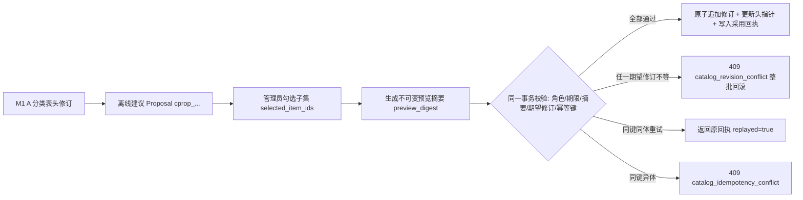

# 实验数据目录 M2：离线建议预览、子集选择与修订冲突契约

状态：IRENE-27 设计契约与可执行验收基线（2026-11-19）。本文固定 M2 离线建议预览的用户动作、
角色边界、合成目录夹具与可复现验收用例，配套可运行的内存契约夹具与测试；**不新增** Alembic 迁移、
正式批量写入 HTTP 路由、OpenAPI/生成客户端改动或目录网页改动。

上游依据：

- [实验数据目录 M0 契约](experiment-catalog-m0-contract.md)（M1 Slice A 为唯一读写契约基线；分类任务不依赖 M1 Slice B 的 `snapshot_experiment_bindings` / `run_experiment_bindings`）
- [数据目录、受控 AI 整理与可视化边界设计](catalog-agent-viewer-boundaries.md) 第 4 节（`M2：Peri 数据整理`）
- [下一批交付计划](../development/next-delivery-session-plan.md)（`M2` 与 `IRENE-27` 验收范围）

## 1. 边界与职责拆分

M2 将**提案生成（Proposal）**与**用户确认采用（Adoption）**严格分开：

| 层次 | 拥有方与职责 | 明确不做 |
| --- | --- | --- |
| 离线提案 / M2 预览契约（本契约与可运行 fixture） | 固定提案结构、建议引用（`citations`）、管理员子集选择、不可变 `preview_digest`、并发期望修订检查、丢响应后幂等与回执形状 | 不写目录数据库迁移；不实现正式批量写入 HTTP 接口；不修改目录网页；不依赖 M1 B；不调用真实模型/外部 provider |
| 正式迁移、公开 HTTP 路由与生成客户端 | 仍由目录负责人（`HW-Catalog`）在后续采用工单（如 IRENE-32）统一整合，避免并发改写 Alembic 头和 `frontend/src/api/generated/` | 不在本契约中提前占用 Alembic revision ID 或修改 `frontend/openapi.json` |
| 在线 Peri 整理与模型出口 | 仍受 P2 与边界设计第 4 节约束 | 不从模型直接提交修订；不把未脱敏路径、原始日志、序列、供体标识或自由文本外发 |

默认边界数值沿用[边界设计](catalog-agent-viewer-boundaries.md)第 4 节：

- 单次变更集最多 `100` 条对象修改，单次预览/采用请求体不超过 `256 KiB`（`262144` 字节）。
- 提案采用窗口为 `30` 分钟（`expires_at`）；未采用提案过期后保留 `7` 天只读回执窗口（`retention_until`）。
- 已采用回执和对应修订作为平台审计证据长期保留，不随提案 TTL 清除。
- 写请求必须携带符合 M1 A 规则的 `Idempotency-Key`（长度 `1..128`，正则 `^[A-Za-z0-9][A-Za-z0-9_.-]{0,127}$`）。

## 2. 用户行为与状态流转

### 2.1 参与者与权限

- **普通成员（`member`）**：
  - 在活动项目内可以发起或读取有界离线建议（不含受限管理员信息，如歧义候选 `candidates` 与词条别名 `aliases`）。
  - **不能**将提案推进到采用写入；成员调用采用入口固定返回 `403 ADMINISTRATOR_REQUIRED`，零写入。
- **管理员（`administrator`）**：
  - 在自己的会话中查看待处理提案的逐项字段前后差异、**建议引用**及**当前服务端头修订**。
  - 在不修改提案原文的前提下**勾选任意非空子集**（`selected_item_ids`），先生成不可变的子集预览摘要（`preview_digest`），确认被排除项不会暗中带入。
  - 携带 `preview_digest`、`selected_item_ids`、每个目标对象的 `expected_revision_number` 及 `Idempotency-Key` 提交采用。
  - 若请求响应丢失或重新登录，可使用同一 `Idempotency-Key` 与相同请求体安全重放并取回原回执，或按 `proposal_id` / `project_id` 重新查询已提交回执。

### 2.2 提案、预览与采用分离

1. **提案不直接写库**：离线提案只记录 `base_revision_id`、`base_revision_number`、`allowed_fields`、前后槽位（沿用 M1 A 的 `known` / `unknown` / `not_applicable` / `not_detected` / `ambiguous` 形状）与平台可核对引用。
2. **预览绑定子集**：`preview_digest` 对规范化 JSON `{proposal_id, proposal_digest, selected_item_ids, expected_revisions}` 取 SHA-256；未选中的提案项写入 `excluded_item_ids` 并在界面/回执中显式可见。
3. **采用整批原子**：事务内重查登录身份与管理员角色、项目活动状态、提案归属与 `expires_at`、幂等键与请求体摘要、`preview_digest`、所有选中目标的当前头修订号以及引用词条是否未归档。任一项冲突则整批不写，不合并字段、不部分提交。

## 3. 与 M1 Slice A 契约的对齐

本契约复用 M1 A（`438a943`）的以下规范，不另造第二套身份或槽位格式：

- **身份前缀**：Project `prj_`、Experiment `exp_`、ExperimentRevision `expr_`、Sample `smp_`、SampleRevision `smpr_`、Term `term_`、TermRevision `trmv_`（32 位小写十六进制）。本契约新增提案身份 `cprop_`、预览回执身份 `cadopt_`（同样为前缀加 32 位小写十六进制，供未来目录负责人落地表与路由时使用或调整）。
- **栏位语义**：
  - 实验分类字段：`assay`、`target`、`batch`（单值槽位），以及每个样本钉上的 `replicate_role`（单值）与可选 `replicate_group`。
  - 样本材料字段：`species`、`tissue`（单值）；`cell_type`、`cell_line`、`treatment`、`tag`（多值 `{status, values}`）。
  - `ambiguous` 栏位保留 `candidates` 供管理员审阅；成员视图省略 `candidates` 与 `aliases`。
  - 非 `catalog` 自由属性（如既有 `attributes.legacy_note`）在样本分类修订时原样复制到新 `SampleRevision`，绝不丢失。
- **复用错误码**：`catalog_revision_conflict`（409）、`catalog_idempotency_conflict`（409）、`catalog_payload_invalid`（422）、`catalog_not_found`（404）、`catalog_term_archived`（409）、`catalog_experiment_archived`（409）、`catalog_term_type_mismatch`（409）、`ADMINISTRATOR_REQUIRED`（403）、`API_REQUEST_INVALID`（400）。
- **M2 新增错误码（供后续采用接口整合）**：`catalog_proposal_expired`（410）、`catalog_proposal_invalidated`（409）、`catalog_preview_digest_mismatch`（409）。

## 4. 合成分类表与管理员预览用例

### 4.1 合成目录夹具（Project `prj_11111111111111111111111111111111`）

初始均处于 `revision_number = 1`：

| 目标对象 | 初始头修订 | 当前关键分类状态 | 离线提案项 | 建议变更（仅允许字段） | 建议引用（`citations`） |
| --- | --- | --- | --- | --- | --- |
| `exp_44444444444444444444444444444444`（`Treg H3K27me3 CUT&Tag`） | `expr_4444...1`（rev 1） | `assay=known(CUT&Tag)`、`target=known(H3K27me3)`、`batch=unknown` | `item_1` | `batch: unknown -> known(batch-2026-11)` | `rule_version=m2-catalog-rules/1`、`reason_codes=["BATCH_TERM_MATCH"]`、钉住 `trmv_5656...` 与 `expr_4444...1` |
| `exp_aaaaaaaaaaaaaaaaaaaaaaaaaaaaaaaa`（`Treg H3K4me3 CUT&Tag`） | `expr_aaaa...1`（rev 1） | `assay=known(CUT&Tag)`、`target=unknown`、`batch=known(batch-2026-11)` | `item_2` | `target: unknown -> known(H3K4me3)` | `rule_version=m2-catalog-rules/1`、`reason_codes=["TARGET_TERM_MATCH"]`、钉住 `trmv_4545...` 与 `expr_aaaa...1` |
| `smp_22222222222222222222222222222222`（`Treg sample 1`） | `smpr_3333...1`（rev 1，含非目录属性 `legacy_note`） | `cell_type=unknown`、`tag=unknown` | `item_3` | `cell_type: unknown -> ambiguous([regulatory T cell, keratinocyte])`；`tag: unknown -> known([m2-curated])` | `rule_version=m2-catalog-rules/1`、`reason_codes=["ALIAS_AMBIGUOUS_CANDIDATES", "TAG_TERM_MATCH"]`、钉住候选 `trmv_bbbb...` / `trmv_dddd...`、`trmv_1010...` 与 `smpr_3333...1` |

### 4.2 验收用例（`M2-P1` 至 `M2-P6`）

| 用例编号 | 操作场景与两条并发期望修订 | 预期可观察结果 |
| --- | --- | --- |
| `M2-P1` | 查看离线提案与建议引用；成员尝试预览采用或提交采用 | 管理员预览可见每项 `citations`（`rule_version`、`vocabulary_version`、`reason_codes`、`source_refs`）及 `ambiguous` 候选；视图不含宿主路径、供体标识、原始日志或自由文本。成员视图隐藏 `candidates`/`aliases`，成员提交采用返回 `403 ADMINISTRATOR_REQUIRED` 且零写入 |
| `M2-P2` | 管理员 A 勾选子集 `["item_1", "item_3"]`（排除 `item_2`），生成 `preview_digest` 并提交采用 | 预览响应明确列出 `selected_item_ids=["item_1", "item_3"]`、`excluded_item_ids=["item_2"]` 与不可变 `preview_digest`。若提交篡改后的子集但沿用原摘要，返回 `409 catalog_preview_digest_mismatch`。合法采用后仅 `exp_4444...` 与 `smp_2222...` 升至 `revision_number=2`（`legacy_note` 原样保留），`exp_aaaa...` 仍停留在 `revision_number=1` |
| `M2-P3` | **并发冲突（两条并发的期望修订 — 手工写入领先）**：提案与管理员 A 预览均期望 `exp_4444...` 为 `1`、`smp_2222...` 为 `1`；采用提交前，管理员 B 以 `expected_revision_number=1` 先行修订 `exp_4444...` 至 `revision_number=2` | 管理员 A 随后提交采用时，整批返回 `409 catalog_revision_conflict` 与有界冲突明细（`target_id=exp_4444...`、`expected_revision_number=1`、`current_revision_number=2`）。`exp_4444...` 保持管理员 B 的 rev 2（不合并字段），`smp_2222...` 保持 rev 1（**不部分提交**） |
| `M2-P4` | **并发冲突（两条并发的期望修订 — 双管理员并发采用）**：起始均为 rev 1，管理员 A 与管理员 B 同时以 `expected_revision_number=1` 和不同 `Idempotency-Key` 对包含 `exp_4444...` 的子集发起采用 | 先提交一方成功使 `exp_4444...` 升至 rev 2 并记录回执；后提交一方整批返回 `409 catalog_revision_conflict`，不产生 rev 3，且先提交方回执保持不变 |
| `M2-P5` | **丢响应后幂等与回执重查**：管理员 A 提交 `Idempotency-Key=idem-admin-a-adopt-1` 并成功提交（rev 1 -> 2），但客户端丢失 HTTP 响应；随后以同键同请求体重试，或重新登录后按 `proposal_id` 查回执；另试同键异体 | 同键同体重试直接返回原回执并标明 `replayed=true`，**不会**因为库内头修订已变为 rev 2 而误报 `catalog_revision_conflict`，也**不会**创建 rev 3；按 `proposal_id`/`project_id` 可重查该回执；同键异体返回 `409 catalog_idempotency_conflict` |
| `M2-P6` | 提案超过 30 分钟采用窗口；管理员在提交前被降权为 `member`；提案引用已归档词条或不存在的修订 | 过期提案拒绝采用并返回 `410 catalog_proposal_expired`（7 天内仍可只读查看）；被降权管理员提交返回 `403 ADMINISTRATOR_REQUIRED` 且零写入；已归档词条返回 `409 catalog_term_archived`，未知修订返回 `422 catalog_payload_invalid` |

## 5. 未纳入本阶段的项目（待后续集成）

- Alembic 数据库迁移、持久化 SQLAlchemy 表（`catalog_proposals`、`catalog_adoption_receipts` 等）及并发事务实现（由目录负责人统筹，接 IRENE-32）。
- 公开 FastAPI 路由与 `frontend/src/api/generated/` 客户端重新生成。
- 目录网页（IRENE-23）与目录 CLI 的实际消费接线。
- 在线 Peri 工具调用与真实外部模型出口（P2）。
