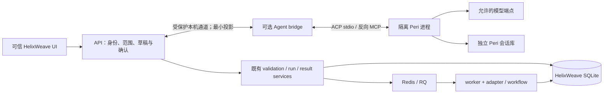
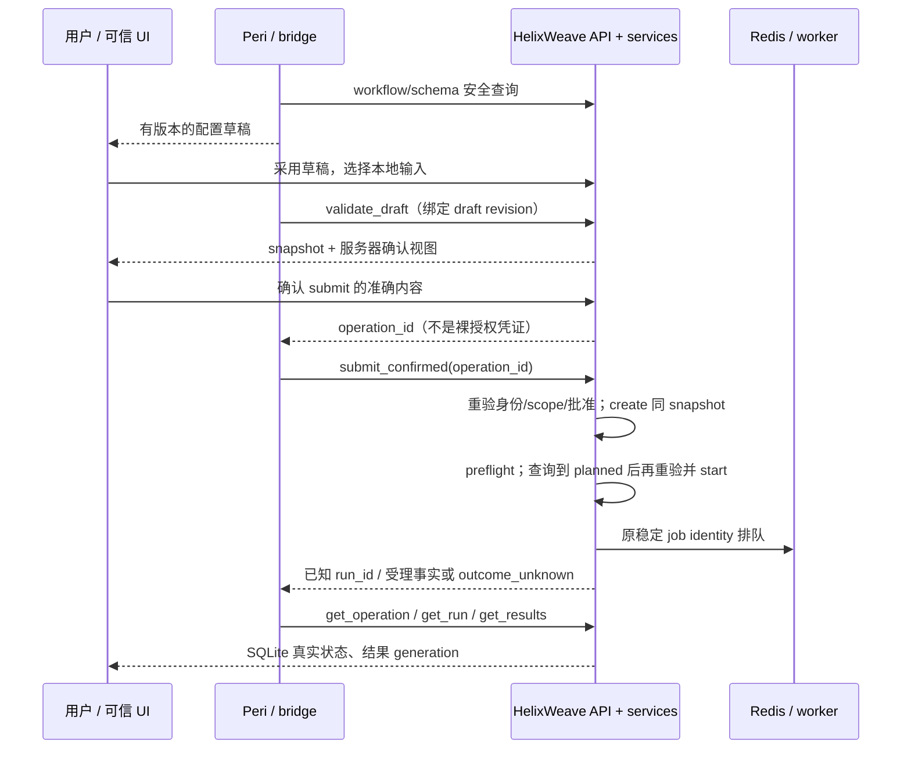

# ADR：Peri 作为 HelixWeave 的受控 Agent 入口

> ACP最终补测（2026-11-09）：原策略单测1/0/0通过，源码和运行binary身份不变；**固定版本、固定补丁和已声明边界内的A0验收通过，交回主会话审阅**。见[追加验收材料](../../scripts/peri_a0_closeout/evidence/acp-final/RESULTS.md)。A1未获准、未决定长期fork。以下保留此前各轮当时结论，不将旧“暂不通过”当作最新状态。

> 补测前收尾结论（2026-11-09，ACP 单测尚未执行）：固定受限候选 native 矩阵23/23通过，目录库回归通过；新增ACP Rust单测编译触发4GiB OOM，未执行，**当时完整A0暂不通过，不建议进入A1**。见[当时证据](../../scripts/peri_a0_closeout/evidence/RESULTS.md)。这不是补测后的当前状态。

当前状态只见 [A0 归档](../development/peri-a0-archive.md)：2026-11-09 ACP 补测之后，固定版本、固定补丁和已声明边界内通过。A1 未实施，未决定长期 fork。下文“不通过”均是当时结论。
初次研究：2026-11-08；本次修订：2026-11-09（Asia/Shanghai）。
初次研究未运行任何原型。本次只允许固定 Peri、合成数据、隔离进程与本地 stub；
本轮 [A0 调查](../../scripts/peri_a0/evidence/RESULTS.md) 已交付：**原版 native ACP + 反向 MCP 纯配置接法不通过工具闭合门槛，不进入 A1**。未接真实模型账号、样本、生产平台或科学执行。

## A0 接法修订与复验（2026-11-09）

原r1/r2结论保留；新增[候选交付](../../scripts/peri_a0_revision/README.md)比较官方
`3288b07bf871276026ae0677129821b096e75118` 与固定研究版，选择在旧版上接入三文件
完整目录策略实验补丁，而非升级或重写宿主。首次工具目录和一次真实审批拒绝通过，
但成功turn后额外prediction模型调用被严格stub拒绝，**候选A0仍不通过，不进入A1**。
工具过滤不是全部模型出口策略；未知策略身份、动态目录及双实例等缺口见
[完整矩阵](../../scripts/peri_a0_revision/evidence/RESULTS.md)。不扩大能力范围追求通过。

修订原型补上relay连接/读写/总期限、连接和消息预算；临时用户scope强制总内存、
CPU和PID限额，独立探针触发限制。旧报告“无cgroup”的描述仅属于原r1/r2，
新结果不倒改旧身份。没有总磁盘quota或seccomp全面限制，不称生产隔离已验收。
原ReadContextArchive是会话归档读取、DiscoverMCP是缓存查询、mcp_read_resource
是绑定server的资源I/O；超出准入不自动构成越权漏洞。三者仍未批准，辅助prediction
也未加入允许列表。源码事实、补丁身份、资源限制与未测门分别见候选交付。

## 决策摘要

推荐把 **原生 Peri ACP 进程放在可选、独立的本地 Agent bridge 服务之后**。
HelixWeave API 持有用户身份、项目范围、草稿、业务确认及工具执行边界；Peri
负责对话、模型调用和工具请求。工具复用现有服务及任务 API，不持有 SQLite、
Redis、科学工作区访问权。平台 UI/API 和已提交任务不依赖 bridge 存活。

这是有前置条件的推荐：当前 native ACP 默认 Bypass，反向 MCP 标记 UNSTABLE，
历史恢复可能发起新 continuation。只有附录 A0 的**实际拒绝、工具闭合、权限隔离、
恢复准入**实验通过，才接受该接法。失败时比较进程隔离、自定义装配、上游小修复，
不预先决定 fork，也不为了接上而降级权限。

用户已确认（本轮）：

- 保留实验室成员共享项目的权限模型；Agent 会话绑定一个用户选定的项目。
  服务端逐调用检查真实对象归属。这是操作范围限制，**不是项目 ACL**。
- 最小外发：仅必要 schema、脱敏问题和结构化摘要；样本别名化，不传文件内容、
  序列或原始日志。别名化不等于匿名化。
- 权限模式、工具面和拒绝行为核验失败即拒绝运行；重启/恢复必须重新准入。
  Peri 工具审批与平台具体业务确认相互独立，不能替代。

## 研究身份与事实边界

| 对象 | 固定来源及本轮检查 |
| --- | --- |
| HelixWeave 初次研究与 A0 实验基线 | 当时 `git ls-remote origin refs/heads/main` 为 `622778f64e59f935d822d92a91bade78807dabce`；本设计 worktree 及 r1/r2 实验仍基于此提交，未迁移 |
| #210 合入后的接续核验 | 2026-11-09 再次只读查询远端 main 为 `b2f15868c6f74ab8764a73ae6fe4394f67304475`；#210 已合入且合入后 CI、Lint、Lock Check 均 attempt 1 成功。这不是 A0 的运行基线 |
| 当前交付 | #207、#209、#208 均在该 main 历史中；roadmap 顶部仍写 #209 的 `cc06a03`，视为历史状态描述，不覆盖本轮远端核实 |
| Peri 官方身份 | GitHub 连接器核实 `KonghaYao/peri`，官方 README 指向 `https://docs.peri-code.dev/`；以固定源码中的文档为版本事实，不以会漂移的网页为实现保证 |
| Peri 研究源码 | `c7d154c9985cbe08ba25e964cb7468d15014e6d0`，提交时间 `2026-11-07T22:23:20+08:00`；初次远端 HEAD 一致；2026-11-09 远端 main 已为 `63d012d0750ccbb8d9ff4711ef1209a6809e10c8`，本轮仍固定旧 SHA 构建，不使用 latest |
| Peri 发布坐标 | 远端 `agent-v4.6.0` tag object `7431dfb9b1e8e4d92ad85e97e07e257eab638474`，peeled commit `a13f2d2d6c3fb5a79f6c12a9a8464830075ec4e1`；**不等于研究 HEAD**，本轮未验证该发布产物 |
| 本机 Peri | 找到 `~/.peri/agent-v4.4.7/` 二进制安装目录，有限目录检查未发现源码 checkout；未运行二进制、未读取个人配置/凭据/会话库 |
| peri-loom | 官方账号下另一个仓库，已核实身份；本轮不研究其数据库替换用途，不替换 HelixWeave SQLite，也不把它当 Peri Agent |

所有 HelixWeave 相对源码链接均指本 ADR 的基线版本；Peri 链接固定完整 SHA。
读取了仓库 AGENTS、[roadmap](../development/workflow-platform-agent-roadmap.md)、
[架构总览](platform-overview.md)和相关实际源码/测试/OpenAPI。
[helixweave-run skill](../../.agents/skills/helixweave-run/SKILL.md)及其 platform-run
引用仅用于核对现有生命周期入口，未执行运行流程。未使用额外流程框架。
SCI-7 仍为 **no conclusion、默认未冻结**。初次研究时另一 session 正在研究取消后
偶发 failed；此依赖现已由 [#210](https://github.com/ZichenYang-glitch/ENCODE-style-ChIPseq-CUT-Tag-pipeline/pull/210)
在上述 main 完成验收。本次只读比较的增量为 worker 冻结等待、其回归测试及两份
Bulk 执行身份文件，不触及 `scripts/peri_a0`。因此保留原 worktree、原实验和全部
未提交材料，不重复构建或实验，也不把旧实验标记为新 main 上的运行结果。
接续身份及证据核验见 [post210-review.json](../../scripts/peri_a0/evidence/post210-review.json)。

## Peri 的现成能力、缺口与协议选择

| 事实及固定源码 | 对本接入的含义 |
| --- | --- |
| [原生 ACP stdio 装配][p-stdio]承载 JSON-RPC 会话、prompt、事件和交互；[协议文档][p-protocol]区分 request/notification | 适合本机独立 Agent 进程；HelixWeave 需实现窄 ACP 客户端和连接管理，不是配置 URL 即可接入 |
| [TS SDK][p-sdk]提供 Chat、View、宿主 transport/WASM；主入口不启动/停止 CLI，也不提供本地 SQLite backend；[manager 实现][p-manager]要求 store/database/kv/runtime | 有真实应用消费者，但当前 Python 平台若选它会引入 TS 服务、Store 适配与同步层；不因有 SDK 就采用 |
| [peri-cf HTTP/WS][p-http]是基于 SDK/WASM 的应用装配；[HTTP 路由][p-http-code]处理 chat/actions/binding | 不是可直接信任的 HelixWeave 任务 API，也不是所有 native CLI 自带 HTTP daemon；不搬入其项目/sandbox/Turso 产品边界 |
| [MCP-over-ACP][p-mcp]及[会话挂载][p-mcp-attach]由 Rust 实现，支持宿主反向工具桥；会话创建后异步发现工具，标记 UNSTABLE | MCP 是 Peri 消费工具的方向，ACP 是控制 Peri 的方向；首轮必须等工具 ready，握手成功不算工具就绪；不另开公网 MCP 端口 |
| [assemble][p-assemble]仅非 bare session pool 装配反向 MCP | 不选 `bare` 作为万能安全开关；保留最小 MCP 链并逐项关闭其余能力 |
| [canonical store][p-store]保存会话、消息、配置、冻结上下文、MQ 等；[transcript persistence][p-transcript]有批量写/barrier和 sticky failure | 原生本地会话库可复用；已显示输出不等于落盘；Peri transcript 不是平台操作审计或 exactly-once 日志 |
| [恢复提醒][p-recovery]来自已提交历史，旧工具不自动重放，外围存活可 unknown；可进入新的 continuation | 续聊仍可能再次请求同工具；需平台幂等/批准复核。不能从对话恢复推出科学任务恢复 |
| TS SDK [ownership][p-owner]的 KV get→set 非原子、无 TTL/心跳/fencing；明确要求宿主串行并确认旧 owner 停止后清理 | 初期一个 bridge owner、每会话单活动实例；不做多副本自动接管或超时即夺锁 |
| [ACP CLI][p-cli]硬编码 Bypass；[set_mode/config handler][p-modes]可更改模式；Default、Auto、AcceptEdit 语义不同 | 普通 `--permission-mode default` 不足以保护 ACP；必须显式 Default 且验证拒绝行为，不允许 Auto 模型分类充当授权 |
| [权限装配追踪][p-workspace]和[请求分派][p-requests]需要结合 handler 阅读 | 不能只因请求带 sessionId 就断言隔离；源码结论与原型否定测试见附录 A0 |
| [配置解析][p-config]未知 MetaHarness 键只警告；[工具闭合测试][p-closure]覆盖上游若干关闭面 | 配置文本不是执行证据；完整受限组合尚未实测，升级必须重新核验可见及可调用工具 |
| [providers][p-provider]支持 Anthropic/OpenAI-compatible/Responses；[observability][p-observe]配置 Langfuse；[tracer][p-tracer]可记录 messages/tools | 固定服务端 provider/endpoint；默认无双 key 不启 Langfuse，但继承环境可能启用。禁遥测并限制出口，不能只靠供应商承诺 |
| [诊断规则][p-standards]明确保留原始错误/原因链；[OAuth 存储][p-oauth]保存 credentials blob | Peri 错误不能直通公共 API；不能宣称默认脱敏或加密凭据库。独立私有目录且不用 MCP OAuth |
| [LICENSE][p-license] Apache-2.0；SDK manifest `0.0.0`、workspace `0.2.0` 不代表发布 pin | 记录 commit、二进制摘要、锁文件/配置契约；发布包的依赖许可清单与兼容测试留实施阶段；无长期兼容/多租户保证声明 |

[Peri AGENTS][p-agents]明确单机本地完成、服务化/集群化未完成。
此事实支持小范围原型，不支持把 Peri 当现成高可用执行调度器。

原生权限与恢复的限定结论：`workspace.rs` 为每个正常会话新建权限 Atomic，
`requests.rs` 和实际执行链选择该会话 environment；正常 A/B 不共享权限 Arc。
这不是所有退化路径的隔离保证。A0只要求两个独立实例的实际隔离；同进程
多会话实验移为未来共享进程优化的前置研究，不属于本轮必做功能。另据
[server loop][p-server-loop]和[recovery launch][p-recovery-launch]，load/resume
返回后可能立即自动 continuation，新环境仍继承 host Bypass；事后 set_mode
不能消除竞态。**首期只允许 session/new，不允许 native load/resume/fork**；
重启后新建会话并从平台记录重建最小上下文，由用户继续。独立进程也不能修复该
时序问题；原生恢复须有恢复前的权限/模型出口/工具原子准入证明后另行开放。

## A0 新发现：MCP 目录不能证明完整工具面

固定源码的 [McpMiddleware::collect_tools](https://github.com/KonghaYao/peri/blob/c7d154c9985cbe08ba25e964cb7468d15014e6d0/peri-middlewares/src/mcp/middleware.rs#L596)
无条件加入 `ReadContextArchive`、`mcp_read_resource`、`DiscoverMCP`；前者是直接工具，
后两者是 deferred 工具。`ReadContextArchive` 是当前会话归档读取能力，不是任意文件
读取，但也不属于本次两个假工具的授权目录。顶层
[工具过滤装配](https://github.com/KonghaYao/peri/blob/c7d154c9985cbe08ba25e964cb7468d15014e6d0/peri-agent/src/session/exec/stage_builder/tools.rs#L74)
使用允许全部的过滤闭包；ACP 未接入 CLI allowed/disallowedTools 配置。
`mcp/list` 仅列 server raw tools，不能据此将实例判为完整工具闭合。

因此 A0 在 blocked 中运行固定合成准入探针，stub 从首个实际 provider 请求检查
直接工具白名单，异常时杀死该实例，不返回模型工具调用。用户 prompt 只能在全部
准入后进入；工具发现/模式检查之前连合成探针也不发起。后续发现路径仍须单独
验收，首个目录不合格时不能扩大白名单或继续测试写副作用来争取通过。
源码限制与实际运行结果分开记录于 [A0 交付](../../scripts/peri_a0/README.md)。

## 部署选项与推荐边界

| 方案 | 故障/运维/依赖成本 | 判断 |
| --- | --- | --- |
| 可选本地 bridge + native Peri 子进程，ACP stdio，独立本地会话文件 | 模型/Peri 崩溃不拖垮 API/worker；需一个服务、进程监管、窄协议客户端；无需 TS SDK、远程 Store 或数据库服务 | **推荐的 A0 候选**，先证明安全装配能成立 |
| 独立 TS 服务嵌入 SDK/WASM | 可复用 Chat/View；仍需宿主 ownership、Store、认证与工具 broker；增加 JS/WASM 升级及存储装配，不能从 SDK获得任务可靠性 | 若确需 SDK 交互/UI 能力再评估；最小闭环尚无消费者 |
| 在现有 API 内嵌 Rust/FFI 或 WASM runtime | 共享故障、内存和凭据域；跨 Python/Rust装配维护成本高，仍不能省服务端确认 | 不推荐；未找到可直接使用的官方 Python 嵌入接口 |

建议 bridge 单实例 systemd 服务，独立低权限 OS 用户；只可访问自己的配置、
会话库和空工作目录，不挂载 HelixWeave SQLite、输入池、结果或源码仓库。独立于
API/RQ worker 的 service/cgroup，不设停止 Agent 即停止 worker 的依赖。
部署初始化、二进制校验、升级和配置均由操作员管理；模型不能运行 update/install。

首个原型采用**每活动会话一个 native 进程及独立会话库**，配置、工具池和
恢复副作用分别管理；独立进程本身不提供权限隔离，OS边界见下节。先设小的全局并发上限（建议 2）和每会话单轮串行，不追求吞吐。
这不是断言 Peri 同进程模式已知有漏洞；成本是更多进程、会话文件与冷启动，
RSS/启动时间以 [A0 原型报告](../../scripts/peri_a0/README.md) 的实际测量及边界为准。
同进程多会话隔离须另行研究，不从本轮独立实例结果推导。
建议初始每实例 MemoryMax 512 MiB、TasksMax 64、CPUQuota 100%、有界消息/历史/日志
配额；这些是原型预算候选，不是 Peri 性能保证。超限令 Agent unavailable，任务继续。

API 与 bridge 用受文件权限和 peer identity 保护的本机 Unix socket；只开放固定的
会话控制与工具回调消息，不能接受任意 executable、URL、路径或 MCP server。
这是 **HelixWeave 待实现的本地控制通道**，不是声称 Peri 自带该 HTTP/UDS API。
API 持有认证 session 的服务端关联，bridge 只拿不透明 invocation/binding 标识；
不传浏览器 cookie、CSRF、管理员 credential 或通用 bearer token 给 Peri。
回调必须匹配连接、会话代次、挂起调用及真实用户 session，再进入现有服务。

图中工具由 Peri 发起，经 bridge 回到 API，**只有 API 的 broker 能调用 S**。
不建立独立任务 API；新 HTTP 面若有，仅为 Agent 会话、草稿确认、操作查询，
端点拼写在实施 OpenAPI 设计时确定，本 ADR 不把它们写成已存在路由。

## A0 的具体 OS 隔离边界（2026-11-09 修订）

本机探针：WSL2 Linux 6.6.87.2、bubblewrap 0.9.0；非特权 user/mount/net/pid
命名空间在获准的执行环境下可用，不需要root、sysctl或系统服务变更。默认工具执行
沙箱限制NETLINK_ROUTE，原型需申请该单条运行命令的执行权限，不能移除隔离来绕过。
探针不等于完整原型通过，最终证据须包含实际Peri及攻击性OS探针。

| 成熟机制 | 本环境适用性 | 选择 |
| --- | --- | --- |
| bubblewrap user/mount/pid/net/ipc/uts namespaces | 已安装，任务局部启动，空根FS白名单挂载、私有网络、降capabilities、no-new-privs；无daemon | 选为A0最小机制；参数和否定探针共同定义实际保障 |
| rootless OCI container | 能提供类似隔离，但需镜像/运行时与网络装配；宿主Docker socket自身有高权限，不能挂给Peri | 此闭环无额外消费者，避免引入容器daemon或更改其配置 |
| Landlock单独使用 | 宿主ABI 3缺后续TCP及Unix socket/signal scope限制，单独不能满足本轮网络边界 | 不选；不能将路径约束等同于完整sandbox |

依据：[bubblewrap官方安全说明](https://github.com/containers/bubblewrap#sandbox-security)。
它是构造边界的工具，不是默认即安全的通用sandbox。本轮只写固定A0启动器，
不开发可供任意命令使用的sandbox框架。

| 进程 | 权限与持有能力 | 明确不持有 |
| --- | --- | --- |
| 原型driver/bridge | 可信测试代码，宿主当前用户；本任务证据目录、ACP pipes、假工具计数；仅使用合成配置 | 无平台凭据/写操作代码，不读个人Peri数据；原型未给bridge创造独立OS账号，因此不宣称其自身对宿主已隔离 |
| Peri实例A/B | 每实例独立user/mount/pid/net等namespaces；固定只读binary/runtime及唯一公开CA bundle；自身state与空cwd；synthetic provider key；ACP stdin/stdout和私有stderr | 无宿主HOME、bridge配置/日志、其他实例目录、平台socket/SQLite/Redis/输入池挂载；无host网络或额外继承FD |
| namespace内固定relay | 只监听该namespace的loopback固定端口，转发到唯一挂载的model stub UDS | 无动态目标、DNS、CONNECT、平台socket；不持provider真实key；Peri可干扰自身relay，最多导致本会话失败 |
| 宿主模型stub | 合成响应队列、独立请求计数/日志；只监听任务UDS，不监听LAN；固定POST路径、请求大小与预算 | 无真实模型credential、网络转发或业务权限；日志不挂给Peri |
| 假工具broker | 在可信driver内，只读假对象与内存计数；绑定instance/session/generation，固定方法与输入schema | 无shell、文件访问、HTTP代理、数据库或任务API；工具副作用计数在sandbox外 |

启动环境完全重建，仅含固定PATH、私有HOME/XDG/cache/temp、LANG/TZ及必要Peri关闭
开关、固定公开CA路径；不继承用户provider、Langfuse、代理、MCP或shell配置。只传stdin/stdout/stderr，
`close_fds=True`；stub listener及其他session FD不能泄入。UID/GID为映射的当前用户，
不是宿主root；所有capabilities丢弃、禁止新增userns、独立session，no-new-privs由
bubblewrap提供。读写挂载必须逐项记录；只读运行库仍是允许读取的运行时资源，
不宣称“什么文件都读不到”。共享内核漏洞与宿主同UID恶意进程攻击不在此原型证明内。

Peri私有netns仅有loopback，不能直接访问宿主TCP、Redis、LAN或互联网；只挂一个
模型stub socket文件，不挂其父目录。relay让HTTP provider仅可达此stub。Unix pathname
socket不因netns自动隔离，必须靠挂载白名单排除其他控制socket；abstract socket按
netns隔离。PID namespace和私有/proc阻止从宿主进程FD目录取回未挂载能力。
文件/FD、网络和目录隔离要用合成canary及直连探针验证，不能靠“没有Read工具”。

A0没有真实provider凭据，固定synthetic key进入Peri。未来生产若直接由Peri调用
provider，必需key将进入Peri内存，必须作为该sandbox已授予的能力处理；若改由
bridge持key的固定provider代理代签，则Peri仅得本地会话能力。二者尚未实施，
不得把生产bridge与Peri同UID同目录、或仅传环境变量称作秘密隔离。

OS约束负责阻断直接资源访问；broker负责对象范围、请求/代次和工具白名单；Peri
permission负责实际工具审批。三者不可替代。模型输入字段投影在进入Peri前执行，
运行时工具清单与实际拒绝行为仍需独立验证。Peri进程退出不能修改stub/工具已记录
的事实；普通崩溃不自动判安全通过。

## 状态与权限归属

| 状态 | 权威保存方 | 恢复与限制 |
| --- | --- | --- |
| 对话、消息、Peri 工具 transcript | Peri 私有会话库 | 用 Peri 协议读取；平台不解析/迁移该数据库；原生可加载已提交历史，但首期只新建会话恢复平台上下文，禁用历史激活 |
| 会话 owner/project 绑定、代次、工具策略版本 | HelixWeave 持久关联；活动连接为内存状态 | `conversation_id → user_id + project_id + peri_session_id/store_id`；新连接重鉴权、新代次使旧回调失效 |
| 操作草稿 | 现有 workbench 为编辑入口；待实现的窄 Agent 草稿记录 | draft id + revision + 安全 patch + 本地输入引用；可丢弃或过期，不能表示已验证/批准 |
| validated snapshot | 现有 HelixWeave snapshot repository | 原 canonical payload、digest、期限和项目/输入/参考绑定；不另复制为 Peri 执行配置 |
| 人的确认、操作关联 | HelixWeave SQLite，窄 consent/operation 记录（待实现） | 保存意图、有效期、actor、工具版本、snapshot/run 引用及结果关联；不维护第二套 run status |
| 任务、事件、执行 assignment、结果 metadata | 原 HelixWeave SQLite | 使用原 run/worker 契约；Peri 会话结束/删除不影响任务 |
| 产物文件 | 原工作区/安全下载服务 | Peri 无直接文件权限；仅给 UI 经鉴权的下载入口 |

现有成员共享项目/任务，项目绑定是 provenance，不能作已有 ACL 宣称。
用户选项目后，服务端确定会话 scope；工具参数即使含 project_id 也只作一致性校验。
每次读取/写入均从真实 snapshot/run/input binding 解析项目对象归属；全局
workflow/schema/reference目录不虚构项目owner，按可用性、兼容性及已绑定exact
reference revision校验。其他项目对象
拒绝，不能由模型改 tags 或 project_id 越权。当前公共 RunResponse 不暴露项目绑定，
应使用服务器现有 repository binding resolver，不能猜 tags 或全量列 run 再交模型过滤。
跨项目切换必须显式 UI 操作，建立新 scope/代次，旧草稿/批准不得迁移。

当前没有 project/sample/input 的公共列表 API；首阶段由可信 UI/操作员提供已有
项目与样本 revision 选择，服务端核验；现有 workbench 尚无这些选择控件，A1
需做窄接线。输入文件先沿用已有合格的本地/兼容输入方式，真实路径仅本地保留。
当前 `ValidatedInputService` 对 `MANAGED_REVISION_V1` 明确返回
`INPUT_USE_CAPABILITY_UNAVAILABLE`，不能把有 input revision 数据模型写成已能
执行 managed handoff。若闭环必须该能力，另列前置资格工作，不绕过准入或偷偷纳入
A1。若选择器确实需要列表，补最窄的只读目录投影，不顺带做 registry CRUD。没有可核实项目绑定的 Legacy run 不给 Agent 操作，
原 UI/API 仍可用；全局 workflow/schema 可查询，但仍受外发字段规则约束。

所有工具重新检查启用账号、原会话有效性与撤销、绑定代次、项目归属、能力级别及
当前资源准入。长连接建立时通过不代表永久授权；原登录撤销后拒绝后续调用。
已提交任务不因用户 logout 或 Agent 断连被自动取消。管理员身份使用 Agent 时也
只授普通受限工具，不提供 recovery fail/requeue、账号/运行时/存储管理工具。

## 确认、调用时序与恢复

已有 snapshot 已固定 canonical submitted config/samples/options、build、schema、adapter、
project/sample/input/reference 身份；首次消费默认 30 分钟过期。同 snapshot 同 tags
可返回既有 canonical run，消费后重放不受首次消费期限限制。**它不证明人的同意**。
因此只补确认与操作关联，不补第二套 snapshot 或任务幂等系统。

平台确认必须由可信 UI 上的独立按钮、当前身份和 CSRF 产生；聊天中的“同意”、
模型生成按钮、Peri 的工具 permission response 都不算业务确认。确认内容至少包括：

- actor、conversation/scope、project/workflow、action；
- snapshot_id、payload/binding/input digest、reference revision、schema/adapter/build 身份；
- 完整可审阅参数、输入选择与 tags 的 canonical identity；显示摘要不能替代绑定；
- 工具契约版本、draft revision、服务器生成的 operation_id、批准时间/截止时间；
- cancel 则绑定既有 run 及当前执行身份，不能授权未来 recovery/requeue 的新执行。

产品决定仍待用户确认：建议一次确认 `submit` 可授权 **create → preflight → start 同一个 snapshot/run**，
UI 明示含预检和排队执行；cancel 单独确认。批准 TTL 建议最多 10 分钟并不超过未
消费 snapshot 的期限。参数、输入、tags、scope、工具版本或目标变化，必须失效并
重验/重确认；已有 run 不因新配置被重新映射。build/admission 漂移沿用平台拒绝。

A 阶段停在 snapshot；不调用 create/preflight/start。preflight 会物化工作区并执行
工作流 dry-run，不是纯校验，不能塞进 A。校验 `ok=true` 但 `snapshot=null` 时仅表明
authoring 可用，不能提交；提示配置 execution/reference binding，禁止 Agent 自行修准入。

create→preflight→planned→start 的推进由 services 内窄 operation coordinator
负责，不依赖 Peri turn 存活，不新增任务queue。它在每一步副作用前重查批准、当前
身份和准入；API重启后不自动恢复未执行副作用，需显式继续并重新鉴权。已排队任务
仍由原worker独立运行；尚在API-owned preflight的任务遵循下面的重启失败契约。

操作记录在副作用前落盘。相同 operation + 相同绑定查询或重试返回相同关联；不同
内容冲突。snapshot→run 原子消费、稳定 job reservation/dispatch 仍是执行幂等权威。
不承诺模型工具或跨 SQLite/Redis 事务 exactly-once。新操作表只记录“请求/批准/关联/
已知回执”，任务状态每次实时读取，不能缓存出第二个生命周期。

恢复规则：

1. 发送前超时且没有副作用证据：同 operation 查询，权限/批准仍有效才继续。
2. create 成功回执丢失：原 snapshot 同 tags 重放或服务器内部消费关联找原 run；
   禁止重新 validate 生成新 snapshot 当重试。无需发明现成 snapshot GET endpoint。
3. preflight 回执丢失：读取状态，离开 created 后不重触发。API重启时原
   `recover_interrupted_runs` 将 validating 标为 failed / `RUN_INTERRUPTED_BY_API_RESTART`；
   operation停止，重做须用户新意图、新snapshot和确认。有durable owner的queued/running
   按原契约保留。进程仍活着但validating卡住交既有诊断；BackgroundTasks不是durable queue。
4. start 回执丢失/队列 503：查询真实 run/assignment；批准有效时调用既有 start 收敛。
   `outcome_unknown` 是传输结果，不等于 failed；禁止直接 enqueue。
5. 批准过期/权限撤销：仍允许按当前权限查询已经产生的结果；没有 start 的原 run
   需要重新确认后才能继续，不能拿“恢复”绕过新副作用授权。
6. 多会话同时提交同 snapshot：原消费事务收敛同 run；各操作记录各自 actor/批准。
   不能仅用 Peri tool_call_id 幂等，因为它会随重启/重新推理改变。
7. Peri 重启：只新建会话，先重新准入，读 conversation→operation→run 关联。历史文本不可信，
   不自动重放写工具；新 continuation 再请求也要受 operation/批准约束。

取消工具返回 `request_accepted` 与真实状态，不能将 202 改写为 cancelled。
尚未running的任务可按现有契约直接取消，不虚构worker ack；下述等待ack针对running。
读取原 cancellation_requested / cancellation_acknowledged events；必要时给工具
增加安全的派生查询投影（不增加 lifecycle enum）。自然 succeeded/failed 先赢保留该
终态；ack 先赢保留 cancelled。未知/缺 ack 不假造。聊天“停止回答”只取消 Peri turn，
不调用科学 cancel；科学取消只通过独立业务确认和原 worker acknowledgement。
平台取消修复依赖已解除：[#210 的固定实现](https://github.com/ZichenYang-glitch/ENCODE-style-ChIPseq-CUT-Tag-pipeline/blob/b2f15868c6f74ab8764a73ae6fe4394f67304475/src/encode_pipeline/workers/timeouts.py)
等待 SIGSTOP 的冻结状态可见，仍使用原截止时间；根丢失、身份变化或证明失败时
拒绝确认，取消请求与 worker acknowledgement 继续分离。历史两次失败没有取得
worker stdout，具体 unconfirmed_reason 仍未知，不能补写。该进展不等于 Peri 写操作
获准：B2 的幂等、批准失效/撤销、丢响应及执行中断基础门仍须独立实施并验收。

## 数据边界与审计

工具准入和外发投影必须同时生效：允许调用 schema 工具，不等于原样转发 schema。
保留必要类型、枚举、约束与安全标签；递归审阅 description/title/default/examples、
`$ref` 来源及错误 context/hint，去除路径、地址、样本/项目显示名、私有扩展和秘密。
不能通过脱敏改变约束后声称模型已完整校验；真实校验仍使用平台完整 schema。
必要字段无法安全投影时返回 `requires_local_input`，由可信 workbench 补全。

| 数据 | 模型默认可见 | 本地/可信 UI 保留 |
| --- | --- | --- |
| 样本/项目 | 会话内随机别名及最小必要类型/计数；组合仍可能可识别 | 原名、临床/个人属性、真实 catalog 坐标、别名映射 |
| 输入/参考/配置 | 安全参数及不透明选择引用；必要枚举按 adapter schema | 绝对/相对私有路径、URI query、敏感 defaults、完整 snapshot payload |
| 状态/QC/artifact | 白名单结构化状态/issue code/计量和 generation；文本字段也筛选 | 原日志、技术异常、环境、下载文件/序列/BAM/FASTQ/任意报告内容 |
| 用户消息/上传 | 通过长度/字段/秘密检查的意图文本；拒绝或要求本地填写敏感片段 | 上传内容不默认进入 prompt；聊天明确提示不要粘贴序列/私密信息 |
| 凭据/遥测 | 无 | provider key 仅 bridge/Peri 私有配置；禁继承用户配置与 Langfuse env、禁公共 artifact/web/MCP OAuth |

Peri provider 出口 allowlist；禁 Web、Artifact 发布、任意 MCP、插件/hooks、shell、
文件工具、subagent、cron/workflow/goal 等无消费者能力，禁自动更新。外部网页/上传/
工具输出/样本标签均是不可信数据，不能改变 system policy、server binding、工具
清单或确认记录。结构白名单、参数模式校验、服务端权限及副作用 gating 才是边界，
提示词和现有 regex redaction/output filter 仅补防线。原始 Peri 诊断私有保存、限额和
保留期；对 UI/API 只返回稳定 code + correlation id。无需保存模型私有推理。

审计关联 `user → confirmation/operation → tool version + call id → snapshot/run →
真实结果/generation`。复用闭合 `SecurityAuditEvent` 和原业务事务审计；新增确认和
关联应采用窄表/字段及 Alembic upgrade coverage，不把 prompt 或自由文本塞入审计。
确认创建/消费记录要原子，副作用与关联之间崩溃用 snapshot/run 的真实关联对账，
不能由 after-commit best-effort sink 宣称成功。既有有界内存 Agent audit 不够。
会话过期/删除可删 transcript，但业务确认和任务审计按平台策略保留。

## 最小改动、非目标与交接

实施 PR 切分及验收见[附录](peri-agent-integration-contracts.md)。优先顺序：
A0 安全协议原型 → A1 只读/草稿/校验 → B1 确认和关联 → B2 受控提交/取消及基础故障门 → C 扩展恢复/运行维护。
每一步独立审阅；A0 未通过不接真实用户数据，B 未通过不开放执行。

改动落在真实消费者所在边界：services 的工具 broker/Agent 编排，api 的薄会话/确认
边界，persistence 的窄关联记录，frontend 的草稿审阅/确认 UI，独立 Peri transport
实现与部署单元。现有 validation/run/artifact 服务仍是唯一业务实现。
不在 platform 引入通用多 Agent 框架；Peri 特有协议和配置不得进入 adapter/workflow。
只有实际需要的中立确认值对象进入 platform；不重写全部 AgentService 或 LLMClient。
现有只读 explanation endpoint 的行为兼容保留，新能力 feature-gated、默认关闭。

非目标：项目 ACL、数据库替换、HA、自动科学参数冻结/生物学验收、科学默认更改、
工具任意扩权、自动 recovery/requeue、多 Agent 调度、公开部署、下载科学大数据。
Peri 或模型不可用时原 workbench、校验、提交、取消、下载和 worker 独立使用。

尚需决定（不阻断本轮设计交付）：

- 是否接受“submit 一次确认含 create/preflight/start”的交互；建议接受，显示三个动作。
- 原型 provider/模型和数据保留期；建议先用合成数据/可控模型 stub，接外部 provider
  前明确运营者凭据、端点和保留条款，不能把最小外发误写成已匿名化。
- A0 后接受 native bridge 还是小范围替代装配；当前不决定 fork、不采购服务。
- 本轮仅A0原型实施授权；A1、B阶段、提交、push、PR、部署仍未授权。

[p-agents]: https://github.com/KonghaYao/peri/blob/c7d154c9985cbe08ba25e964cb7468d15014e6d0/AGENTS.md
[p-stdio]: https://github.com/KonghaYao/peri/blob/c7d154c9985cbe08ba25e964cb7468d15014e6d0/peri-acp/src/host/stdio/mod.rs
[p-protocol]: https://github.com/KonghaYao/peri/blob/c7d154c9985cbe08ba25e964cb7468d15014e6d0/docs/design/peri-acp-protocol.md
[p-sdk]: https://github.com/KonghaYao/peri/blob/c7d154c9985cbe08ba25e964cb7468d15014e6d0/npm-packages/@peri-sdk/README.md
[p-manager]: https://github.com/KonghaYao/peri/blob/c7d154c9985cbe08ba25e964cb7468d15014e6d0/npm-packages/@peri-sdk/src/chat/manager.ts
[p-http]: https://github.com/KonghaYao/peri/blob/c7d154c9985cbe08ba25e964cb7468d15014e6d0/npm-packages/peri-cf/README.md
[p-http-code]: https://github.com/KonghaYao/peri/blob/c7d154c9985cbe08ba25e964cb7468d15014e6d0/npm-packages/peri-cf/server/api/index.ts
[p-mcp]: https://github.com/KonghaYao/peri/blob/c7d154c9985cbe08ba25e964cb7468d15014e6d0/peri-middlewares/src/mcp/acp/mod.rs
[p-mcp-attach]: https://github.com/KonghaYao/peri/blob/c7d154c9985cbe08ba25e964cb7468d15014e6d0/peri-acp/src/host/requests/acp_mcp.rs
[p-assemble]: https://github.com/KonghaYao/peri/blob/c7d154c9985cbe08ba25e964cb7468d15014e6d0/peri-acp/src/host/assemble.rs
[p-store]: https://github.com/KonghaYao/peri/blob/c7d154c9985cbe08ba25e964cb7468d15014e6d0/peri-resources/src/sessions/canonical.rs
[p-transcript]: https://github.com/KonghaYao/peri/blob/c7d154c9985cbe08ba25e964cb7468d15014e6d0/peri-agent/src/session/transcript/persistence.rs
[p-recovery]: https://github.com/KonghaYao/peri/blob/c7d154c9985cbe08ba25e964cb7468d15014e6d0/peri-acp/src/host/recovery/reminder.rs
[p-owner]: https://github.com/KonghaYao/peri/blob/c7d154c9985cbe08ba25e964cb7468d15014e6d0/npm-packages/@peri-sdk/src/chat/ownership.ts
[p-cli]: https://github.com/KonghaYao/peri/blob/c7d154c9985cbe08ba25e964cb7468d15014e6d0/peri-tui/src/main.rs
[p-modes]: https://github.com/KonghaYao/peri/blob/c7d154c9985cbe08ba25e964cb7468d15014e6d0/peri-acp/src/host/requests/config_options.rs
[p-workspace]: https://github.com/KonghaYao/peri/blob/c7d154c9985cbe08ba25e964cb7468d15014e6d0/peri-acp/src/host/workspace.rs
[p-requests]: https://github.com/KonghaYao/peri/blob/c7d154c9985cbe08ba25e964cb7468d15014e6d0/peri-acp/src/host/requests.rs
[p-config]: https://github.com/KonghaYao/peri/blob/c7d154c9985cbe08ba25e964cb7468d15014e6d0/peri-config/src/app.rs
[p-closure]: https://github.com/KonghaYao/peri/blob/c7d154c9985cbe08ba25e964cb7468d15014e6d0/peri-middlewares/src/mcp/builtin_runtime_closure_test.rs
[p-provider]: https://github.com/KonghaYao/peri/blob/c7d154c9985cbe08ba25e964cb7468d15014e6d0/peri-config/src/provider.rs
[p-observe]: https://github.com/KonghaYao/peri/blob/c7d154c9985cbe08ba25e964cb7468d15014e6d0/peri-config/src/observability.rs
[p-tracer]: https://github.com/KonghaYao/peri/blob/c7d154c9985cbe08ba25e964cb7468d15014e6d0/peri-controller/src/langfuse/tracer/input_snapshot.rs
[p-standards]: https://github.com/KonghaYao/peri/blob/c7d154c9985cbe08ba25e964cb7468d15014e6d0/docs/standards/architecture-contracts.md
[p-oauth]: https://github.com/KonghaYao/peri/blob/c7d154c9985cbe08ba25e964cb7468d15014e6d0/peri-resources/src/sessions/sqlite_store/oauth_credentials.rs
[p-license]: https://github.com/KonghaYao/peri/blob/c7d154c9985cbe08ba25e964cb7468d15014e6d0/LICENSE

[p-server-loop]: https://github.com/KonghaYao/peri/blob/c7d154c9985cbe08ba25e964cb7468d15014e6d0/peri-acp/src/host/server_loop.rs
[p-recovery-launch]: https://github.com/KonghaYao/peri/blob/c7d154c9985cbe08ba25e964cb7468d15014e6d0/peri-acp/src/host/recovery/coordinator/launch.rs

## A0 收尾修订与验收追加（2026-11-09）

本轮继续同一 HelixWeave `622778f64e59f935d822d92a91bade78807dabce` 实验 worktree，
Peri仍固定 `c7d154c9985cbe08ba25e964cb7468d15014e6d0`，没有升级上游。
#210取消冻结修复已合入平台main `b2f15868c6f74ab8764a73ae6fe4394f67304475`；
这是已解除的依赖，不是本轮运行基线，也不是写操作授权。请求接受与worker确认仍分离，
历史两次失败的具体unconfirmed_reason仍未知。

新增 [受限候选及复现命令](../../scripts/peri_a0_closeout/README.md) 和
[完整分层验收记录](../../scripts/peri_a0_closeout/evidence/RESULTS.md)。原r1/r2/q1/q2
记录保持不变：纯配置失败、q2合法prediction请求未纳入契约导致失败均仍成立。
本轮补丁关闭prediction的入口位于辅助任务/上下文读取之前；不是关闭通知。
以完整策略身份验证、Default实际拒绝、provider目录及回合结束gate计数共同决定ready。
动态目录在宿主tools/list发布前、native目录刷新/pin层分别收紧。

候选binary为 `60144bbe0919992b8913b9031696b2e30b1e9f82d95048ae3b07c887d5d85517`。
所有实验仅使用本地stub和fixture；权限、资源故障、外发、恢复和清理的层次与未测范围
详见结果，不将宿主检查、OS探针或库测试冒充更强的native全链保证。
首期仍一活动会话一进程；同进程多会话留给未来优化研究。不得移除OS隔离或回退Bypass。

调查交付不自动授权A1，也不决定长期fork。基础重复调用、丢响应、确认变更/过期、
权限撤销及执行中断仍是未来B2开放写操作前置；C只扩展恢复与运维。
一次submit确认覆盖create/preflight/start仍是待用户决定的产品建议。
本轮无业务表、提交/取消工具、真实数据或科学任务，无commit/push/PR/部署。

本次最终裁决：调查和证据交付完成；完整A0验收暂不通过。native矩阵23/23、Rust目录14/0
及策略/filter4项通过，但新增ACP配置Rust单测在4GiB编译限额下两次OOM，未执行。
这是测试构建环境阻塞，不是已发现的权限绕过；不放宽native运行边界、不扩大补丁。
244个观测PID、任务socket和活动scope已清理。下一步仅需单独评估测试构建预算或暂缓，
补齐该验证后再审阅A1；本轮不决定fork。

### ACP编译资源补测最终裁决

在8GiB、swap0、CARGO_BUILD_JOBS=1、有限CPU/PID的任务scope内，真实peri-acp原测试
`trusted_prediction_policy_is_strict_and_default_compatible` 实际1项通过、0失败、0忽略。
release的fat LTO/codegen-units=1保留，仅测试包opt-level=0；峰值6.2784GiB为编译scope
内核记录，8GiB只是上限。首轮通过，不执行非LTO备选。旧失败证据原样保留。
源码补丁、锁文件、测试断言和native binary均未改，原native23/23继续适用，不重跑矩阵。
当前必需A0门已齐；未测的未来能力仍按原矩阵界定。只更新验收裁决，不开始A1或业务写操作。
