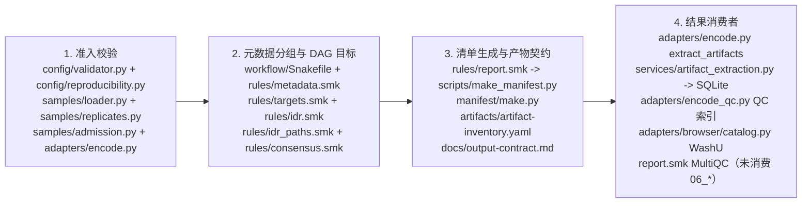

# 同项目混合生物重复数（2 vs 3 生物重复）可重复性路由设计规格（草案）

- **状态**：草案（待 Tibo 复审与 PI 拍板；仅设计文档，不改生产代码、测试、schema 或现有科学默认值）
- **关联工单**：IRENE-51（父工单 IRENE-22）
- **审查与复现基线**：`origin/main` @ `52973b6020e1bd6c9b44e08fdf1ae8b526a43666`
- **相邻只读上下文**：开放中的 PR `#258`（仅对齐 FRiP/CPM/IDR/controls 文档与宽峰警告措辞，不改动准入、DAG 或 manifest 规则）
- **既有文档盘点**：已检索 `docs/reproducibility-policy.md`、`docs/idr-contract.md`、`docs/assay-policy.md`、`docs/output-contract.md`、`docs/sample-sheet.md`、`docs/configuration.md`、`KNOWN_ISSUES.md` 与 `docs/development/scientific-computation-remediation-spec.md`。仓库尚无针对“同项目内 2 生物重复组与 3 生物重复组混合”的路由设计规格；既有文档均仅声明当前严格契约（IDR 仅接受恰好 2 个生物重复，3+ 重复 IDR 或不规则实验设计不在当前政策范围内）。按 [开发 SOP](development-workflow.md) 新建本主题规格，待 PI 拍板并落地实现 PR 时再同步更新既有用户文档与产物清单。

---

## 1. 背景、问题与现行公开验证器实测复现

### 1.1 问题定义

真实表观基因组项目（尤其是多条件/多时间点/多基因型对照的 ChIP-seq、ATAC-seq、CUT&Tag 项目）经常在同一份 `samples.tsv` 中出现**不同实验组生物重复数不一致**的情况：例如组 `GRP2` 拥有 2 个生物重复（`biological_replicate = 1, 2`），而同 `assay`、同 `peak_mode` 的另一组 `GRP3` 拥有 3 个生物重复（`biological_replicate = 1, 2, 3`）。

维护者提出的候选语义为**按实验组路由（per-group routing）**：在开启 IDR 与 consensus 的前提下，同一项目中满足 IDR 条件且恰好为 2 个生物重复的实验组运行 MACS3 IDR，3 个生物重复的实验组运行 MACS3 consensus，而不是因 `GRP3` 不是 2 个生物重复而整单拒绝；对 PE CUT&Tag 的独立 SEACR caller 分支，仍按其既有 consensus-only 契约独立产出。

### 1.2 最小合成输入与复现命令

在基线 `52973b6020e1bd6c9b44e08fdf1ae8b526a43666` 上构造最小合成样本表（同为 `chipseq/narrow`、`PE`、`hs`、`CTCF`，`GRP2` 含 2 个生物重复，`GRP3` 含 3 个生物重复，无对照）与最小配置（完整可独立生成的夹具脚本见 §6.4）：

```tsv
sample	layout	fastq_1	fastq_2	assay	peak_mode	genome	bowtie2_index	chrom_sizes	target	experiment	role	biological_replicate	technical_replicate	control_sample	control_bam
GRP2_r1	PE	.../r1.fq.gz	.../r2.fq.gz	chipseq	narrow	hs	.../hg38	.../hg38.chrom.sizes	CTCF	GRP2	treatment	1	1
GRP2_r2	PE	.../r1.fq.gz	.../r2.fq.gz	chipseq	narrow	hs	.../hg38	.../hg38.chrom.sizes	CTCF	GRP2	treatment	2	1
GRP3_r1	PE	.../r1.fq.gz	.../r2.fq.gz	chipseq	narrow	hs	.../hg38	.../hg38.chrom.sizes	CTCF	GRP3	treatment	1	1
GRP3_r2	PE	.../r1.fq.gz	.../r2.fq.gz	chipseq	narrow	hs	.../hg38	.../hg38.chrom.sizes	CTCF	GRP3	treatment	2	1
GRP3_r3	PE	.../r1.fq.gz	.../r2.fq.gz	chipseq	narrow	hs	.../hg38	.../hg38.chrom.sizes	CTCF	GRP3	treatment	3	1
```

```yaml
samples: samples.tsv
outdir: results
genome: hs
bowtie2_index: .../hg38
chrom_sizes: .../hg38.chrom.sizes
use_control: false
replicate_analysis: true
chipseq_idr: true
blacklist_mode: "off"
reproducibility:
  enabled: true
  consensus:
    enabled: true
    min_replicates: 2
    reciprocal_overlap: 0.5
```

使用当前公开验证入口执行校验（任务本地环境经 `scripts/checkout_bootstrap.py` 引导）：

```bash
python3 -I -S scripts/checkout_bootstrap.py --repository-root . \
  validate --config config.yaml
```

### 1.3 确切拒绝位置、调用栈与实测输出

所有 5 个 IDR 开关均在 **Pass 3 跨重复校验**函数 `validate_replicate_groups`（`src/encode_pipeline/samples/replicates.py:89-272`）中硬拒绝：只要与某个已开启 IDR 开关匹配 `(assay, peak_mode)` 的任意实验组满足 `len(bio_reps) != 2`，立即抛出 `ValidationError`，整个项目准入失败。

调用链如下：
1. 公开 CLI：`scripts/validate_samples.py` → `src/encode_pipeline/cli/validate.py` → `src/encode_pipeline/cli/_validator.py:36-78` → `src/encode_pipeline/samples/loader.py:111-120` → `src/encode_pipeline/samples/replicates.py:128-272`。
2. Snakemake DAG 入口：`workflow/Snakefile:146-154` 直接调用 `load_and_validate_samples(...)`，在任何规则构图之前即失败。
3. 平台 Adapter：`src/encode_pipeline/adapters/encode.py:1186-1195` 在 `_validate_scientific_inputs()` 中调用同一校验器。注意文件模式（`sanitize_errors=False`）透出原始错误；在线表单内联样本模式（`sanitize_errors=True`，`src/encode_pipeline/adapters/encode.py:206-236,1114`）会将其脱敏为通用消息 `"Sample sheet is invalid."`，前端用户无法直接看出是混合 2/3 重复导致失败。

下表汇总在基线 `52973b6020e1bd6c9b44e08fdf1ae8b526a43666` 上实测的关键合成探测结果：

| 探测用例 | 样本组成与开关 | CLI `validate` 退出码与精确报错 | 源码拒绝位置 | Adapter（path / inline） | `snakemake -n` | `build_manifest_rows()` 实测行为 |
| --- | --- | --- | --- | --- | --- | --- |
| `A` | 混合 2/3 `chipseq/narrow`，`chipseq_idr: true` | `rc=1`：`ERROR: ChIP-seq IDR: experiment 'GRP3' has 3 biological replicate(s) ([1, 2, 3]). ChIP-seq IDR requires exactly 2.` | `src/encode_pipeline/samples/replicates.py:142-147` | `ENCODE_SAMPLES_INVALID`（原消息 / `"Sample sheet is invalid."`） | `rc=1`（`workflow/Snakefile:146`） | 抛出相同 `ValidationError` |
| `A2` | 同 `A`，但用别名 `chipseq_idr: false` + `reproducibility.idr.chipseq_narrow: true` | 同 `A`（别名在 `src/encode_pipeline/config/validator.py:405-415` 解析为 `chipseq_idr=True`） | 同 `A` | 同 `A` | 同 `A` | 同 `A` |
| `B` | 混合 2/3 `chipseq/narrow`，IDR 关 + `consensus.enabled: true` | `rc=0`（通过） | 无 | `ok=True` / `ok=True` | `rc=0`（两组均仅生成 `consensus/`，均无 `final/`） | 返回两组 `chipseq_macs3_narrow_consensus_peak` 与 `..._summary`，无 `final` 行 |
| `C` | 混合 2/3 `atac/narrow`，`reproducibility.idr.atac_narrow: true` | `rc=1`：`ERROR: reproducibility.idr.atac_narrow: ATAC narrow experiment 'GRP3' has 3 biological replicate(s). IDR requires exactly 2.` | `src/encode_pipeline/samples/replicates.py:167-172` | 同 `A` 结构 | `rc=1` | **未拒绝！** 仅给 `GRP2` 产出 `atac_macs3_narrow_idr_final_peak`，两组均产出 `consensus`（见 §2.2 缺陷 #4） |
| `D` | 混合 2/3 `cuttag/narrow`，`reproducibility.idr.cuttag_narrow: true` | `rc=1`：`ERROR: reproducibility.idr.cuttag_narrow: CUT&Tag narrow experiment 'GRP3' has 3 biological replicate(s). IDR requires exactly 2.` | `src/encode_pipeline/samples/replicates.py:197-202` | 同 `A` 结构 | `rc=1`（`workflow/Snakefile:146`） | **未拒绝！** 给 `GRP2` 产出 `idr_final_peak`，但因全局开关门控，`GRP3` **缺失** `consensus_final_peak`（见 §2.2 缺陷 #3/#4） |
| `D2` | 混合 2/3 `cuttag/narrow`，IDR 关 + `consensus.enabled: true` | `rc=0`（通过） | 无 | `ok=True` / `ok=True` | `rc=0`（两组均提升至 `final/...replicate_validated.consensus.narrowPeak`） | 两组均有 `consensus_peak`、`consensus_summary`、`consensus_final_peak` |
| `D3` | 纯 2 重复 PE `cuttag/narrow`，同开 `idr.cuttag_narrow: true` + `consensus.enabled: true` + `cuttag.seacr.enabled: true`（`min_replicates=2` 与 `=3`） | `min_replicates=2` 与 `=3` **均为 `rc=0`** | 无 | `ok=True` / `ok=True` | 均为 `rc=0`；`-n --summary` **同时**列出 `CT2.cuttag.macs3.narrow.replicate_validated.idr.narrowPeak` 与 `CT2.cuttag.seacr.stringent.replicate_validated.consensus.bed`；`min_replicates=3` 时 `-n -p` 同时把 `--min-replicates 3` 与 `--bioreps 1 2` 传给 MACS3 和 SEACR 两条 `compute_consensus.py` 规则 | 同时包含 `cuttag_macs3_narrow_idr_final_peak` 与 `cuttag_seacr_consensus_final_peak`（不含 `cuttag_macs3_narrow_consensus_final_peak`） |
| `E` | 混合 2/3 `chipseq/broad`，`chipseq_broad_experimental: true` | `rc=1`（先输出过期 `UserWarning`，再报 `ERROR: reproducibility.idr.chipseq_broad_experimental: ChIP-seq broad experiment 'GRP3' has 3 biological replicate(s). IDR requires exactly 2.`） | `src/encode_pipeline/samples/replicates.py:227-233` | 同 `A` 结构 | `rc=1` | **未拒绝！** 同 `D`，`GRP3` 缺失 `consensus_final_peak` |
| `E2` | 混合 2/3 `cuttag/broad`，`cuttag_broad_experimental: true` | `rc=1`（先输出过期 `UserWarning`，再报 `ERROR: reproducibility.idr.cuttag_broad_experimental: CUT&Tag broad experiment 'GRP3' has 3 biological replicate(s). IDR requires exactly 2.`） | `src/encode_pipeline/samples/replicates.py:258-264` | 同 `A` 结构 | `rc=1` | **未拒绝！** 同 `D`，`GRP3` 缺失 `consensus_final_peak` |
| `F` | **跨模式混合**：`GRP2_N`（2 重复 `chipseq/narrow`）+ `GRP3_B`（3 重复 `chipseq/broad`），`chipseq_idr: true` + `consensus.enabled: true` | `rc=0`（**现行已通过**，因为 `replicates.py:138-139` 跳过 `peak_mode != "narrow"`） | 无 | `ok=True` / `ok=True` | `rc=0`（`GRP2_N` 走 `06_idr/` + `consensus/`；`GRP3_B` 走 `consensus/` + `final/consensus`） | 正确分别产出 `GRP2_N` 的 IDR 行与 `GRP3_B` 的 broad consensus final 行 |
| `G` | 混合 2/3 `chipseq/narrow`，IDR 关 + `consensus.min_replicates: 3` | `rc=0`（**验证器与 `snakemake -n` 均静默通过**） | 无 | `ok=True` / `ok=True` | `rc=0`（对 `GRP2` 仍排程 `consensus_compute_narrow`） | 生成两组行；但实测直接运行 `scripts/compute_consensus.py` 传入 2 个峰文件与 `--min-replicates 3` 时**运行期崩溃**（`rc=1`：`ERROR: min-replicates (3) exceeds number of biological replicates (2)`） |
| `H` | 混合 1/3 `chipseq/narrow`，`chipseq_idr: true` | `rc=1`：`ERROR: ChIP-seq IDR: experiment 'GRP1' has 1 biological replicate(s) ([1]). ChIP-seq IDR requires exactly 2.` | `src/encode_pipeline/samples/replicates.py:142-147` | 同 `A` 结构 | `rc=1` | 抛出相同 `ValidationError` |
| `I` | 纯 2 重复 `chipseq/narrow`，`chipseq_idr: true` + `consensus.enabled: true` | `rc=0` | 无 | `ok=True` / `ok=True` | `rc=0`（`06_idr/final/*` + `06_reproducibility/consensus/*`） | 产出 3 条 `06_idr` 行 + 2 条 `consensus` 行 |
| `J` | 纯 3 重复 `chipseq/narrow`，`chipseq_idr: true` | `rc=1`（同 `A` 报错） | `src/encode_pipeline/samples/replicates.py:142-147` | 同 `A` 结构 | `rc=1` | 抛出相同 `ValidationError` |
| `K` | 同 `A`，但 `use_control: true` 且两组各有匹配 `control_sample` | `rc=1`（同 `A` 报错；有无对照不改变 3 重复拒绝结果） | `src/encode_pipeline/samples/replicates.py:142-147` | 同 `A` 结构 | `rc=1` | 抛出相同 `ValidationError` |

---

## 2. 端到端源码追踪：准入 → DAG 目标 → Manifest → 结果消费者



### 2.1 分层代码清单与精确行位

| 层次 | 关键源码位置 | 当前职责与混合 2/3 相关性 |
| --- | --- | --- |
| **1a. 配置校验** | `src/encode_pipeline/config/validator.py:254-472`、`src/encode_pipeline/config/reproducibility.py:52-193` | 校验 `chipseq_idr` 与 `reproducibility.idr.chipseq_narrow` 别名（`validator.py:405-415`）；所有 5 个 IDR 开关均强制 `replicate_analysis=true`；`reproducibility.enabled: false` 时第 `63-64` 行直接早退 `return {"enabled": False}`，忽略其余子键；`reproducibility.consensus.min_replicates` 仅检查 `int >= 2`（`reproducibility.py:81-98`），**不与样本生物重复数交叉检查**。`reproducibility.py:169-175` 仍发出过期的 broad-IDR 警告（称 consensus 仍留在 `final/`，与 DAG 不符，见 `KNOWN_ISSUES.md` 与开放 PR `#258`）。 |
| **1b. 样本与重复校验** | `src/encode_pipeline/samples/loader.py:111-120`、`src/encode_pipeline/samples/replicates.py:89-272` | Pass 3 校验实验组一致性、重复 `(bio, tech)` 组合、实验内对照一致性（注意 `replicates.py:115` 在 `len(rows) < 2` 时跳过组内一致性与跨实验对照检查），随后对每个已开启的 IDR 开关遍历同 `(assay, peak_mode)` 实验组，凡 `len(bio_reps) != 2` 即报错，且若匹配 2 重复组数为 0 也报错。 |
| **1c. 平台准入与表单** | `src/encode_pipeline/samples/admission.py:490-557`、`src/encode_pipeline/adapters/encode.py:206-272,1132-1279`、`src/encode_pipeline/adapters/encode_authoring.py:20,228-243`、`src/encode_pipeline/adapters/encode_authoring_samples.py:21-30,71-96` | `admission.py:490-497` 在 `use_control=true` 时拒绝外部 `control_bam`；`reference_mode=strict` 下检查对照与处理组的 `experiment`、`genome`、`layout`、`bt2_idx` 一致性。Web authoring schema `3.2.0` 目前仅将 `replicate_analysis`、`chipseq_idr` 暴露为结构化布尔开关，尚未暴露 `reproducibility` 子块（高级 YAML 仍由后端权威校验）；`materialize_encode_sample_rows` 默认不携带 `experiment`/`biological_replicate`/`technical_replicate` 列。 |
| **2a. 实验组切分（元数据）** | `workflow/Snakefile:146-154`、`workflow/rules/metadata.smk:179-443` | `MULTI_BIOREP_EXPERIMENTS` 收录所有 `len(bio_reps) >= 2` 的非 MNase 实验组。`_build_idr_experiment_lists()` 仅收入 `len(bio_reps) == 2` 且匹配 `(assay, peak_mode)` 的实验组（`metadata.smk:293-362`）——**元数据层本身已按 `len(bio_reps) == 2` 过滤 IDR 组**；`CONSENSUS_EXPERIMENTS` 则按 `len(bio_reps) >= 2` 收录全部 5 种 MACS3 `(assay, peak_mode)` 组合（`metadata.smk:394-418`），`SEACR_CONSENSUS_EXPERIMENTS` 独立按 `cuttag` + `PE` + `>= 2` 重复组收录（`metadata.smk:429-440`），不受 MACS3 IDR 开关影响。 |
| **2b. 规则与目标展开** | `workflow/rules/targets.smk:73-95,850-956`、`workflow/rules/replicates.smk:29-87`、`workflow/rules/idr.smk`、`workflow/rules/idr_paths.smk:50-155`、`workflow/rules/consensus.smk:25-164,243-635` | `replicates.smk` 按 `(experiment, role, bio_rep)` 合并技术重复产出 `biorep<N>.final.bam` 与 `biorep<N>.control.final.bam`。ChIP-seq narrow IDR 写入 `06_idr/`（双峰集 `conservative.narrowPeak` + `optimal.narrowPeak` + 8 列 `reproducibility_summary.tsv`）；其余 4 类 MACS3 IDR 写入 `06_reproducibility/final/<exp>.<assay>.macs3.<mode>.replicate_validated.idr.<suffix>`（仅 `true_peaks` 复制，无 `optimal`）+ 15 列 `reproducibility_summary.tsv`。MACS3 consensus 仅对 `chipseq/broad`、`cuttag/narrow`、`cuttag/broad` 存在 `final/` 提升路径；SEACR consensus（`consensus.smk:562-635`）独立提升 `06_reproducibility/final/<exp>.cuttag.seacr.<mode>.replicate_validated.consensus.bed`，可与同一 CUT&Tag 实验组的 MACS3 IDR 最终峰并存。 |
| **3. Manifest 与产物契约** | `workflow/rules/report.smk:231-248`、`scripts/make_manifest.py`、`src/encode_pipeline/manifest/make.py:1430-1620,1751-1758`、`src/encode_pipeline/artifacts/artifact-inventory.yaml`、`docs/architecture/artifact-inventory.yaml`、`docs/output-contract.md` | `result_manifest.tsv` 为固定 10 列（`sample_id, experiment_id, assay, target, genome, output_type, method, path, status, qc_flag`），无 `n_bioreps` 或 `reproducibility_route` 列；靠 `output_type` 与 `path` 区分 caller（`macs3` vs `seacr`）及方法（`idr` vs `consensus`）。`test/docs/test_output_contract.py` 强制 `docs/output-contract.md` 与 `docs/architecture/artifact-inventory.yaml` 1:1 对应；`test/workflow/test_artifact_catalog_compatibility.py` 校验两份 `artifact-inventory.yaml` 同步。 |
| **4a. 平台产物提取与发布** | `src/encode_pipeline/adapters/encode.py:628-755`、`src/encode_pipeline/services/artifact_extraction.py` | `extract_artifacts()` 调用 `build_manifest_rows()`，按 `output_type` 查 `artifact-inventory.yaml`（未注册类型即抛出 `ENCODE_ARTIFACT_CATALOG_MISMATCH`），跳过目录与非 `present` 行，写入 `metadata`（`catalog_id, scope, level, experiment_id, assay, target, genome, method, qc_flag, analysis_branch, reference_assembly` 等），由 `ArtifactExtractionService` 按 `(output_type, relative_path)` 哈希落库 SQLite。后续注册/发布服务对 `output_type` 与 `metadata` 保持工作流中立、透明透传。 |
| **4b. QC 指标与 MultiQC** | `src/encode_pipeline/adapters/encode_qc.py:36-41`、`workflow/rules/report.smk:155-224`、`workflow/multiqc_config.yaml` | `QC_SOURCE_OUTPUT_TYPES` 仅解析 `analysis_policy`、`mnase_qc_summary`、`pooled_qc_summary`、`qc_summary` 进入 SQLite `RunQcMetric`（其中 `pooled_qc_summary` 记录 `replicates.biological_count` 与 `peaks.pooled_count`）；IDR 与 consensus 汇总表当前**不进入** `RunQcMetric`，也**不被** MultiQC 扫描（`report.smk` 不扫 `results/experiments/<exp>/`）。 |
| **4c. WashU 浏览器目录** | `src/encode_pipeline/adapters/browser/catalog.py:26-70,149-161`、`src/encode_pipeline/services/browser_tracks.py` | `_INTERVAL_OUTPUTS` 显式列出全部现行 `*_consensus_peak`、`*_idr_final_peak`、`*_consensus_final_peak`；`idr_conservative` 与 `idr_optimal` 虽不在 `_INTERVAL_OUTPUTS` 常量中，但因 `.narrowpeak` 后缀匹配 `_is_interval_name()` 仍被识别为 BED 轨道。所有峰轨道均呈现通用标签 `"Peaks"` 与 `score_meaning="source_interval_score"`，未按 IDR vs consensus 提示分值语义差异。 |
| **4d. 运行身份与旧目录保护** | `workflow/Snakefile:182-456,507`、`workflow/rules/analysis.smk:54-55`、`src/encode_pipeline/config/scientific_policy.py:25-32` | 仓库内**无**内置差异结合（DiffBind）或 motif 下游 Snakemake 规则；仅 `rule all` 与 `rule result_manifest` 消费 `06_idr/` 和 `06_reproducibility/`。Snakemake 解析期即执行 `_check_analysis_outdir_identity()`（`workflow/Snakefile:507`），对 `.helixweave/analysis_identity.json`（`ANALYSIS_MARKER_SCHEMA_VERSION = 3`、`SCIENTIFIC_POLICY_REVISION = 7`）与 `.helixweave/effective_config.json` 双重校验。注意 `_analysis_identity_config_values()`（`workflow/Snakefile:231-248`）会哈希 `VALIDATED_CONFIG` 中除 `("outdir", "samples", "threads")` 外的所有键，因此**向归一化 `reproducibility` 字典追加新默认键会直接改变身份哈希**（详见 §4.3）。 |

### 2.2 源码追踪发现的 5 处潜在缺陷与契约缺口（放开混合 2/3 前必须协同处理）

如果仅放宽 `src/encode_pipeline/samples/replicates.py` 而不协同修复下游，以下 5 个具体问题会立刻暴露：

1. **缺陷 #1 — `workflow/rules/targets.smk:925` 目标展开变量误用**：
   `_consensus_targets()` 在 `901-910` 行特意计算了排除 MACS3 IDR 实验组后的 `final_exps = [e for e in exps if e not in idr_set]`，但在第 `925` 行 `expand(...)` 中却传了 `experiment=exps` 而非 `experiment=final_exps`！当前因混合 2/3 在准入即被拦截而潜伏；一旦允许同模式混合 2/3（例如 `cuttag/narrow` 或 broad 实验组），`final_exps` 非空（含 `GRP3`），第 `925` 行会把 `GRP2` 也展开进 `06_reproducibility/final/<exp>.<assay>.macs3.<mode>.replicate_validated.consensus.<suffix>`，导致 `GRP2` 在 **MACS3 caller 内**同时产出相互冲突的 `idr` 和 `consensus` 两套 `final/` 峰！
2. **缺口 #2 — `chipseq/narrow` 与 `atac/narrow` 没有 `06_reproducibility/final/` consensus 提升路径**：
   `workflow/rules/targets.smk:911-918`、`workflow/rules/consensus.smk:121-164,393-418`、`src/encode_pipeline/manifest/make.py:1539-1619`、`src/encode_pipeline/artifacts/artifact-inventory.yaml` 和 `docs/output-contract.md` 均未定义 `chipseq_macs3_narrow_consensus_final_peak` 与 `atac_macs3_narrow_consensus_final_peak`。即使当前纯 3 重复运行 consensus，`consensus.summary.tsv` 也会写出 `final_method="none"`、`final_output=""`，`06_reproducibility/final/` 为空。在混合 2/3 路由下，3 重复的 `chipseq/narrow` 或 `atac/narrow` 组是否提升到 `final/` 成为必须由 PI 拍板的核心契约（见 **PI-2**）。
3. **缺陷 #3 — `src/encode_pipeline/manifest/make.py:1544,1563,1582` 使用全局开关而非按组差集**：
   `_build_reproducibility_rows()` 对 `chipseq/broad`、`cuttag/narrow`、`cuttag/broad` 的 MACS3 `*_consensus_final_peak` 行使用 `if not e["cuttag_narrow_idr"]:`（全局布尔值）门控，而非按实验组过滤 `exp not in set(e["cuttag_narrow_idr_experiments"])`。这在实测用例 `D`/`E`/`E2` 中已验证：在混合 2/3 运行中，即便 DAG 为 `GRP3` 生成了 `final/...macs3...consensus.*`，manifest 也会漏报 `GRP3` 的 MACS3 `*_consensus_final_peak` 行，进而导致平台 `extract_artifacts()` 遗漏该最终产物！
4. **缺陷 #4 — `src/encode_pipeline/manifest/make.py:1753-1757` 校验调用漂移**：
   `build_manifest_rows()` 调用 `load_and_validate_samples(samples_path, use_control=use_control, chipseq_idr_enabled=chipseq_idr)`，遗漏了其余 4 个 `reproducibility_idr_*` 关键字参数。实测用例 `C`/`D`/`E`/`E2` 证明 `make_manifest.py` 与 CLI/Snakefile/Adapter 校验语义不一致；后续实施时必须统一共享同一套准入策略判定。
5. **缺陷 #5 — `reproducibility.consensus.min_replicates` 未与各组（含 MACS3 与 SEACR 两条分支）生物重复数交叉校验**：
   `src/encode_pipeline/config/reproducibility.py:81-98` 仅校验 `min_replicates >= 2`，而 `workflow/rules/metadata.smk:402-440` 会为所有 `len(bio_reps) >= 2` 的组排程 MACS3 consensus 与（对 PE CUT&Tag）SEACR consensus。实测用例 `G` 与 `D3` 均证实：设置 `min_replicates: 3` 且存在 2 重复组时，验证器与 `snakemake -n` 全部返回 `0`（用例 `D3` 中 MACS3 与 SEACR 两条 `compute_consensus.py` 规则同时收到 `--min-replicates 3` 与 `--bioreps 1 2`），但运行期必然崩溃退出（`ERROR: min-replicates (3) exceeds number of biological replicates (2)`）。

---

## 3. IDR 适用性、峰模式与对照契约逐项核对

### 3.1 Assay / 峰模式 / Caller / Layout 与可重复性支持矩阵（对照现行源码）

| Assay | `peak_mode` | Caller | Layout | 现行 IDR 开关与地位 | IDR 最终产物命名空间 | Consensus 是否支持及是否提升 `final/` | 关键算法与按 Caller 互斥规则（核对源码） |
| --- | --- | --- | --- | --- | --- | --- | --- |
| `chipseq` | `narrow` | MACS3 | PE / SE | `chipseq_idr`（或别名 `reproducibility.idr.chipseq_narrow`）；**生产支持** | `06_idr/final/{conservative,optimal}.narrowPeak` + 8 列 `reproducibility_summary.tsv` | `06_reproducibility/consensus/` 支持；**当前无 `final/` 提升** | IDR 使用 `--keep-dup all` + 宽松 `-p`（`idr_macs3.pvalue=0.1`，`workflow/rules/idr_paths.smk:122-137`）；Consensus 使用标准 `-q`（`macs3.qvalue=0.01`，`workflow/rules/consensus.smk:25-38`） |
| `atac` | `narrow` | MACS3 | PE / SE | `reproducibility.idr.atac_narrow`；**生产支持（opt-in）** | `06_reproducibility/final/<exp>.atac.macs3.narrow.replicate_validated.idr.narrowPeak`（仅 `true_peaks`）+ 15 列 `reproducibility_summary.tsv` | `06_reproducibility/consensus/` 支持；**当前无 `final/` 提升** | 同上；注意无 `optimal` 峰集文件（仅在 15 列汇总表中报告 `Np`、rescue/self-consistency 比率） |
| `cuttag` | `narrow` | MACS3 | PE / SE | `reproducibility.idr.cuttag_narrow`；**受支持 opt-in** | `06_reproducibility/final/<exp>.cuttag.macs3.narrow.replicate_validated.idr.narrowPeak`（仅 `true_peaks`）+ 15 列汇总 | `06_reproducibility/consensus/` 支持；未开 IDR 时提升至 `06_reproducibility/final/` | **按 caller 互斥**：MACS3 内 IDR 与 consensus 最终峰互斥；但**不影响**同实验组的独立 SEACR 最终 BED |
| `chipseq` | `broad` | MACS3 | PE / SE | `reproducibility.idr.chipseq_broad_experimental`；**实验性 opt-in** | `06_reproducibility/final/<exp>.chipseq.macs3.broad.replicate_validated.idr.broadPeak` + 15 列汇总 | 支持；未开 broad IDR 时提升至 `final/` | IDR-ready MACS3 带 `--broad --broad-cutoff` + `-p`（`workflow/rules/idr_paths.smk:122-125`）；警告文本与 DAG 实际提升行为存在既有措辞偏差（`KNOWN_ISSUES.md` / PR `#258`） |
| `cuttag` | `broad` | MACS3 | PE / SE | `reproducibility.idr.cuttag_broad_experimental`；**实验性 opt-in** | `06_reproducibility/final/<exp>.cuttag.macs3.broad.replicate_validated.idr.broadPeak` + 15 列汇总 | 支持；未开 broad IDR 时提升至 `final/` | 同上；同样不影响独立 SEACR 最终 BED |
| `cuttag` | `narrow` / `broad` | SEACR | 仅 PE | **不支持 IDR**（BED 分值不满足 IDR 排序假设） | 无 | 仅 PE 且 `cuttag.seacr.enabled: true` 时支持，且**始终**提升至 `06_reproducibility/final/<exp>.cuttag.seacr.<mode>.replicate_validated.consensus.bed` | **独立 caller 分支**：与同实验组 MACS3 最终峰（IDR 或 consensus）合法并存；共用 `consensus.min_replicates` 与 `reciprocal_overlap`（`workflow/rules/consensus.smk:562-635`） |
| `atac` | `broad` | — | — | **样本行校验直接拒绝**（实测 `atac_broad`：`assay=atac currently supports peak_mode=narrow only, got 'broad'`） | 无 | 不适用 | — |
| `mnase` | `nucleosome` | — | 仅 PE | **无峰调用、无 IDR、无 consensus** | 无 | 不适用 | 排除在 `MULTI_BIOREP_EXPERIMENTS` 可重复性路径外 |

### 3.2 重复编码与技术重复规则（逐项核实）

- **技术重复先合并再计数**：`workflow/rules/replicates.smk:29-57`（`merge_biorep_bam`）按 `(experiment, role, biological_replicate)` 合并多条 `technical_replicate` 的分析 BAM；IDR 与 consensus 均按去重后的 `biological_replicate` 整数集合计数，而非按样本行数计数（实测 `noncontig_and_techrep_idr_on` 通过：`bio=1 tech=1,2` + `bio=3 tech=1` 视作 2 个生物重复）。
- **非连续生物重复编号允许**：`biological_replicate` 可为任意正整数（如 `[1, 3]`），规则层经 `sorted(_bioreps_for(...))` 排序后取 `bioreps[0], bioreps[1]`（`workflow/rules/metadata.smk:246-247`）。
- **同组内重复组合唯一性**：`src/encode_pipeline/samples/replicates.py:38-49` 拒绝重复 `(biological_replicate, technical_replicate)`（实测 `dup_bio_tech`：`ERROR: Experiment 'G2': duplicate (biological_replicate=1, technical_replicate=1) combination`）。
- **同组元数据一致性**：`src/encode_pipeline/samples/replicates.py:27-35` 要求同一 `experiment` 内所有 treatment 行的 `assay`、`target`、`condition`、`genome`、`peak_mode`、`layout` 完全一致。

### 3.3 对照（Control）契约逐项核实

1. **`use_control` 默认为 `false`，且 IDR 当前不强制要求对照**：
   - `src/encode_pipeline/config/validator.py:327` 默认 `use_control: false`；`src/encode_pipeline/samples/replicates.py:121-125` 仅在 `use_control=true` 时校验对照。实测用例 `I`（无对照纯 2 重复 ChIP-seq narrow IDR）通过全部校验与 `snakemake -n`。
2. **仅支持 FASTQ `control_sample`，明确拒绝外部 `control_bam`**：
   - `use_control=true` 时，任何 treatment 行填写 `control_bam` 均被 `src/encode_pipeline/samples/admission.py:490-497` 拒绝（实测 `external_control_bam`：`ERROR: Sample 's1': external control_bam is not supported. Use a FASTQ control_sample. use_control=false leaves an unused control_bam reference ignored.`）。
   - `control_mode` 在 `src/encode_pipeline/config/validator.py:246-251` 固定为 `"matched"`。
3. **单实验组内“全有或全无”对照一致性**：
   - `src/encode_pipeline/samples/replicates.py:52-65` 要求一个多行实验组内的所有 treatment 行要么全部指定 `control_sample`，要么全部不指定（实测 `partial_control_within_exp`：`ERROR: Experiment 'G2': partial controls detected — 1 of 2 treatment rows have controls...`）。
   - **但不同实验组之间允许异构对照**：在 `use_control: true` 下，`GRP2` 有匹配 Input 对照而 `GRP3` 无对照可通过校验（实测 `mixed_control_across_exps` 返回 `rc=0`）。在混合 2/3 场景中，这可能带来额外可比性差异（例如 `GRP2` 有对照走 IDR、`GRP3` 无对照走 consensus）。
4. **跨实验组引用对照的校验缺口（附带发现）**：
   - `src/encode_pipeline/samples/replicates.py:77-86` 禁止 treatment 引用属于另一 `experiment` 的 `control_sample`，但因为 `replicates.py:115` 对 `len(rows) < 2` 提前 `continue`，CLI 默认（非 strict）模式下单行实验组引用跨实验对照不会被拦截（实测 `cross_exp_control` 在 `G3` 仅 1 行时 `rc=0`）；而平台 `reference_mode=strict` 模式（`src/encode_pipeline/samples/admission.py:529-545`）会同时对单行与多行组强制检查 `experiment`、`genome`、`layout`、`bt2_idx` 匹配。对于 2 重复和 3 重复组（`len(rows) >= 2`），两条路径都会拦截跨实验对照。
5. **同实验组内允许多个生物重复共享同一个 `control_sample`**：
   - 实测 `shared_control_2rep_idr_on`（`bio=1` 与 `bio=2` 同指 `c1`）返回 `rc=0`。
6. **实际传给 MACS3 的对照 BAM（代码事实 vs 过期注释）**：
   - Per-biorep IDR-ready MACS3（`workflow/rules/idr_paths.smk:50-63`）、self-pseudorep MACS3（`workflow/rules/idr_paths.smk:93-96`）以及 per-biorep consensus MACS3（`workflow/rules/consensus.smk:83-98`）均使用**按生物重复匹配的对照 BAM** `biorep<N>.control.final.bam`（由 `workflow/rules/replicates.smk:65-87` 从该生物重复各样本指向的 `control_sample` 分析 BAM 构建）。
   - Pooled-pseudorep MACS3（`workflow/rules/idr_paths.smk:90-92`）使用全组汇总对照 `pool_control_bam`（`<exp>.pooled.control.final.bam`）。
   - 注意：`workflow/rules/idr.smk`、`workflow/rules/idr_paths.smk:53` 与 `workflow/rules/consensus.smk:86` 中的注释仍写“pooled control”，属于过期 docstring，实际实现已是 per-biorep 匹配对照。
7. **Blacklist 过滤阶段与计数口径**：
   - `blacklist_mode: analysis` 下，最终 IDR 峰（`scripts/chipseq_idr_summary.py`、`scripts/idr_reproducibility_summary.py`）与 consensus 峰（`scripts/compute_consensus.py`）均执行峰级 blacklist 过滤；但 IDR 汇总表中的 `Nt/Np/N1/N2` 是在 blacklist 过滤**之前**计数的既有口径，实施混合路由时不应静默更改，应在说明中标注。

---

## 4. 候选按组路由语义、待 PI 拍板事项与运行身份契约

### 4.1 候选语义概要（待 PI 确认后方可实施）

维持现有默认严格行为不变（所有旧配置零破坏），拟新增显式配置项 `reproducibility.mixed_replicate_policy: strict | per_group_fallback`（默认 `strict`）：

- **配置前置条件（推荐 PI-1A，独立于样本表重复数）**：
  - 省略该键或显式设为 `strict`：保持现行严格契约；`reproducibility.enabled: false`（或 `consensus.enabled: false`）与纯 2 重复 `chipseq_idr: true` 组合继续返回 `rc=0`。
  - 显式设为 `per_group_fallback`：**必须在配置校验阶段就强制要求 `reproducibility.enabled: true` 且 `reproducibility.consensus.enabled: true`**；若任一为 `false`（即使样本表恰好为纯 2 重复），直接返回 **`rc=1`** 拒绝（实施时 `src/encode_pipeline/config/reproducibility.py:63-64` 须在 `if not enabled:` 早退前校验 `raw.get("mixed_replicate_policy")`，禁止静默忽略）。
- **按实验组与按 Caller 路由**：
  - **2 生物重复组（符合已开启的 MACS3 IDR 开关）**：MACS3 走既有 IDR 路径（并在 `consensus.enabled: true` 且参数合法时保留 secondary MACS3 consensus，取决于 **PI-5**），不生成 MACS3 `consensus_final_peak`。
  - **3+ 生物重复组（同 `(assay, peak_mode)`，不满足 IDR 的恰好 2 重复前提）**：在 `per_group_fallback` 下不触发整单报错，MACS3 自动路由至 `consensus` 路径。
  - **独立 SEACR caller（PE CUT&Tag 且 `cuttag.seacr.enabled: true`）**：与 MACS3 路由正交，2 重复与 3+ 重复组均保留独立 SEACR consensus 最终 BED（`06_reproducibility/final/<exp>.cuttag.seacr.<mode>.replicate_validated.consensus.bed`），且均受 `consensus.min_replicates` 约束。
  - **若项目内不存在任何满足所开 IDR 开关的 2 重复组**（例如纯 3 重复却开了 `chipseq_idr: true`）：即使在 `per_group_fallback` 下也**仍拒绝（`rc=1`）**，防止用户误以为跑了 IDR 却完全退化成 consensus。

### 4.2 待 PI 拍板清单（决策前禁止修改生产代码与科学默认值）

| 编号 | 决策问题 | 候选方案 | 科学/工程影响 | 维护者建议（草案） |
| --- | --- | --- | --- | --- |
| **PI-1** | 混合 2/3 按组路由是**显式 opt-in** 还是**改变现行默认**？ | **A（推荐）**：新增 `reproducibility.mixed_replicate_policy: strict \| per_group_fallback`（默认 `strict`，保持现行 fail-closed 行为不变）；显式设为 `per_group_fallback` 时，**无论样本是纯 2 重复还是混合 2/3**，配置层均强制要求 `reproducibility.enabled: true` 与 `reproducibility.consensus.enabled: true`（否则 `rc=1`），且样本层要求至少存在 1 个符合该 IDR 开关的 2 重复组（否则 `rc=1`）。<br>**B**：直接改变默认行为，允许同模式 3+ 重复自动回退 consensus。 | 方案 A 100% 兼容现有脚本/测试，避免用户因误填样本表（如把技术重复标成 `bio=3`）而被静默降级为 consensus，也杜绝 `reproducibility.enabled: false` 下误以为 fallback 已生效；方案 B 会破坏现有针对 3 重复报错的契约测试。 | **选 A**（默认 `strict`，显式 `per_group_fallback` 前置拒绝 `consensus` 关闭） |
| **PI-2** | 混合 2/3（以及纯 3+）路由下，走 consensus 的 `chipseq/narrow` 与 `atac/narrow` 组是否提升输出到 `06_reproducibility/final/`？ | **A1（推荐，作用域限定于 `per_group_fallback` 路由到的 3+ 重复组）**：仅对 `per_group_fallback` 下因无 IDR 而路由到 consensus 的 3+ 重复 `chipseq/narrow` / `atac/narrow` 组，在 `06_reproducibility/final/` 提升产出 `<exp>.<assay>.macs3.narrow.replicate_validated.consensus.narrowPeak`（注册 `chipseq_macs3_narrow_consensus_final_peak` 与 `atac_macs3_narrow_consensus_final_peak`，`consensus.summary.tsv` 写 `final_method="consensus"`）；既有 `strict`（含省略键）的纯 2/纯 3 narrow consensus 配置产物**保持不变**（兼容 **PI-9A**）。<br>**A2（全局 narrow consensus 提升）**：所有主方法为 consensus 的 `chipseq/narrow` / `atac/narrow` 组（包括既有未开 IDR 的纯 2/纯 3 配置）均提升至 `06_reproducibility/final/`（**必须联动 PI-9B 将 `SCIENTIFIC_POLICY_REVISION` 升至 `8`**）。<br>**B**：不提升至 `final/`，仅保留 `06_reproducibility/consensus/*.consensus.narrowPeak`。 | 选 B 会导致同一次混合 ChIP-seq/ATAC narrow 运行中，`GRP2` 有 `final` 峰而 `GRP3` 在 `final/` 与 `*_final_peak` 视图中缺席；选 A1 兼顾同次混合运行产物对称与旧目录零破坏（rev 7 可复用）；选 A2 语义最统一，但会改变旧纯 2/纯 3 narrow consensus 配置的产物集合，因而必须升 rev 8 隔离旧目录。 | **请 PI 在 A1 与 A2 间确认**（草案推荐 **A1** 以便配合 **PI-9A** 保持旧目录复用；若优先全场景统一则选 **A2 + PI-9B**） |
| **PI-3** | `chipseq/narrow` 2 重复组是否继续独占 `06_idr/final/` 命名空间，以及 `06_reproducibility/reproducibility_summary.tsv` 跨引用如何定？ | **A（推荐）**：严格遵守 `docs/reproducibility-policy.md` §2.4/§5.2 不变式——2 重复 `chipseq/narrow` 的 `06_idr/final/{conservative,optimal}.narrowPeak` 与 8 列汇总路径完全不变；3 重复 `chipseq/narrow` 走 `06_reproducibility/`。同时修正 `docs/reproducibility-policy.md:161-162` 中未实际实现的 `../06_idr/final/conservative.narrowPeak` 文档表述（或在 `consensus.summary.tsv` 的 `final_output` 中准确回填 `06_idr/final/conservative.narrowPeak`）。<br>**B**：将 ChIP-seq narrow 迁移到 `06_reproducibility/final/`（破坏向后兼容，不推荐）。 | 选 A 保持所有既有 `chipseq_idr` 路径与消费脚本零破坏；需在文档和 provenance 中写清“同项目 `GRP2` 在 `06_idr/final/`（双峰集）、`GRP3` 在 `06_reproducibility/`（单峰集）”的命名空间不对称性。 | **选 A** |
| **PI-4** | 按组路由覆盖哪些 IDR 开关？ | **A**：仅生产级窄峰 IDR（`chipseq_idr` / `idr.chipseq_narrow`、`idr.atac_narrow`）。<br>**B（推荐）**：统一覆盖全部 5 个 MACS3 IDR 开关（含 `cuttag_narrow` 与两项 `*_broad_experimental`），同时修复 `targets.smk:925` 与 `make.py:1544-1582`，且保留 PE CUT&Tag 独立 SEACR consensus 最终 BED。 | 代码路径在 5 个开关上高度对称；若仅支持前两个却不修 `targets.smk:925` 和 `make.py`，留存逻辑分裂且易引入隐患。 | **选 B**（5 开关语义一致，实验性宽峰仍保留 opt-in 与警告） |
| **PI-5** | 当存在 2 重复组且设置 `reproducibility.consensus.min_replicates > 2`（例如 `3`）时，MACS3 与独立 SEACR 分支分别如何准入？ | **A（推荐，全分支 fail-closed）**：准入期检查**每一条将要运行 consensus 的分支**（包括所有 `CONSENSUS_EXPERIMENTS` 的 MACS3 分支，以及 `cuttag.seacr.enabled: true` 时所有 PE CUT&Tag 组的独立 SEACR 分支）；只要任一分支存在 `n_bioreps < min_replicates`，准入即拒绝（**`rc=1`**），彻底消除运行期崩溃。<br>**B（跳过 MACS3 secondary consensus，但独立 SEACR 分支仍 fail-closed）**：对已走 MACS3 IDR 的 2 重复组，允许自动跳过其 **MACS3** secondary consensus（仅对主方法为 consensus 的 3+ 重复组检查 `n_bioreps >= min_replicates` 并运行 MACS3 consensus）；**但若同时开启 `cuttag.seacr.enabled: true` 且任一 PE CUT&Tag 组满足 `n_bioreps < min_replicates`（例如 2 重复 `GRP2` 遇 `min_replicates=3`），因为 SEACR 没有 IDR 主路径、consensus 是 SEACR 唯一可重复性方法，独立 SEACR 分支达不到门槛时准入仍必须拒绝（`rc=1`）**，不得静默跳过或降级 SEACR 最终 BED。<br>**C（不推荐）**：按组自动截断为 `min(min_replicates, n_bioreps)`。 | 方案 C 会静默放宽用户请求的门槛，违背科学可审计性；方案 A 最简单一致（无论是否开启 SEACR，2 重复遇 `min_replicates=3` 均 `rc=1`）；方案 B 支持“纯 MACS3 混合 2/3：2 重复走 IDR、3 重复严格 3/3 consensus”，同时对独立 SEACR 分支守住 fail-closed 底线（不静默丢失所请求的 `cuttag_seacr_consensus_final_peak`）。 | **请 PI 在 A 与 B 间拍板**（默认倾向 **A**；若科研高频需要“无 SEACR 场景下 2-rep IDR + 3/3 consensus”则选 **B**，并保留 SEACR 门槛不足 `rc=1`） |
| **PI-6** | ChIP-seq IDR（及混合 2/3 中的 ChIP-seq 组）是否继续保持 `use_control: false` 允许无对照，以及是否允许跨组“一组有对照、另一组无对照”？ | **A（维持现状）**：不改变现行 `use_control` 契约，但对混合路由下“同模式内一组有对照、另一组无对照”或“无对照 ChIP-seq IDR”发出明确告警并记录在 `effective_config.json`。<br>**B**：对 `chipseq` 开启 IDR 或混合路由时强制要求 `use_control: true` 且每组均配对 FASTQ `control_sample`。 | 方案 B 会破坏现有无对照 ChIP-seq IDR 合成测试及部分公共数据重分析流程；方案 A 保持向后兼容，但存在无对照假阳性差异风险。 | **选 A**（除非 PI 明确要求收紧 ChIP-seq 对照准入） |
| **PI-7** | 同项目内混合 IDR 与 consensus 产物的**下游可比性风险**如何显性化？ | 在以下位置同步标注“混合可重复性方法，非统计等价”：<br>1. 验证器 stderr/Adapter `WARNING` 级告警（列出每组解析路由与 `n_bioreps`）；<br>2. `effective_config.json` 增加 `resolved_reproducibility_by_experiment` 结构化记录（不改 `result_manifest.tsv` 10 列结构，也不破坏既有 rev-7 `effective_config.json` 校验）；<br>3. WashU `describe_browser_artifact()` 在 `detail` 与 `score_meaning` 中区分 IDR 分值（`-125*log2(idr)`）与 consensus 分值（`round(1000 * support / n)`，`pValue/qValue=-1`）。 | 防止用户在 WashU 或外部 DiffBind/DESeq2 差异分析中，把宽松 MACS3 + IDR 峰与标准 MACS3 + 互惠重叠并集峰误当作同口径峰集直接比较。 | **建议 3 项全选**，请 PI 确认告警级别（仅 `WARNING` 还是要求配置显式确认） |
| **PI-8** | 当同模式中混入 **`n_bioreps == 1`** 或 **`n_bioreps >= 4`** 的实验组时如何处理？ | - **`n_bioreps == 1`**：**A（推荐）** 仍拒绝（`rc=1`，防止单样本误混入重复验证队列，或掩盖 `experiment` 列拼写拆分错误）；**B** 跳过可重复性仅产出单样本峰。<br>- **`n_bioreps >= 4`**：与 3 重复组一致，统一路由至 `consensus`（`min_replicates` 适用）。 | `n_bioreps == 1` 没有生物学重复，无法生成任何 replicate-validated 峰集；若静默跳过容易掩盖样本表错误。 | **`n == 1` 建议选 A（拒绝）**；**`n >= 4` 同 3 重复走 consensus** |
| **PI-9** | 落地实施时运行身份与旧目录复用如何约定（是否递增 `SCIENTIFIC_POLICY_REVISION` `7 → 8`）？ | **A（推荐，配 PI-1A + PI-2A1/PI-2B）**：保持 `SCIENTIFIC_POLICY_REVISION = 7`，并在 `workflow/Snakefile:_analysis_identity_config_values` 实行**默认 `strict` 省略归一化**（详契约见 §4.3）：缺键与显式 `strict` 产出完全相同的基线哈希 `H_baseline`，**允许复用基线 rev-7 旧目录**；显式 `per_group_fallback` 保留进哈希产出 `H_fallback != H_baseline`，**拒绝复用旧目录**。<br>**B（配 PI-2A2 或 PI-1B）**：若既有未配置新键的旧配置在新版下会改变产出（如 PI-2A2 新增纯 2/纯 3 narrow `final/` 峰），则必须将 `SCIENTIFIC_POLICY_REVISION` 升至 `8`，使所有 rev-7 旧目录在 `_read_analysis_identity_marker()` 与 `_check_effective_config_record()` 统一 fail-closed 拒绝复用（`rc=1`），要求新 `outdir`。 | 实测已证实（见 §4.3）：若仅保留 rev 7 却把默认 `mixed_replicate_policy: "strict"` 直接写入被哈希的 `VALIDATED_CONFIG["reproducibility"]`，所有旧目录哈希会立即失效并被拒绝复用；因此 **PI-9A 必须以 §4.3 的显式哈希归一化规则为实施前提**。 | **若采 PI-1A + PI-2A1/B 则选 A（附 §4.3 归一化）**；**若采 PI-2A2 或 PI-1B 则必选 B（rev 8）** |

### 4.3 运行身份哈希与旧目录复用契约（可验证规格）

现行 `workflow/Snakefile:231-262` 中的 `_analysis_identity_config_values(config_values)` 会把 `VALIDATED_CONFIG` 中除 `("outdir", "samples", "threads")` 外的所有键原样纳入 SHA-256 载荷；`_check_analysis_outdir_identity()`（`workflow/Snakefile:440-448`）比对 `.helixweave/analysis_identity.json` 的 `identity`，而 `_check_effective_config_record()`（`workflow/Snakefile:387-438`）再用同一个 `_analysis_identity_payload(recorded["config"], _analysis_samples_identity())` 复算 `.helixweave/effective_config.json` 内的 `config` 是否自洽。

基线 `52973b60` 实测已确认：`validate_config()` 产出的 `VALIDATED_CONFIG["reproducibility"]` 仅含 `['consensus', 'enabled', 'idr']` 三个键（子字典哈希前缀 `ece93538a3ba7006`）；若直接向其中写入默认值 `"mixed_replicate_policy": "strict"`，子字典哈希会立即变为 `297045937d5543f3`，导致所有未改动的旧目录在 `snakemake -n` 阶段即被 `_check_analysis_outdir_identity()` 拒绝，或篡改 `effective_config.json` 后被 `_check_effective_config_record()` 报 `"does not match its recorded identity"`。

因此，本规格对三种输入形态进入身份哈希的方式做出如下明确约定：

| 配置写法 | **PI-9A**（`SCIENTIFIC_POLICY_REVISION = 7`，旧配置产物不变）进入 `_analysis_identity_config_values()` 的表示 | 对基线 rev-7 旧目录（`analysis_identity.json` + `effective_config.json`）行为 | **PI-9B**（`SCIENTIFIC_POLICY_REVISION = 8`，旧配置产物有变化）对基线 rev-7 旧目录行为 |
| --- | --- | --- | --- |
| **缺键**（历史 `config.yaml` 未写 `mixed_replicate_policy`） | `reproducibility` 哈希字典**不含** `mixed_replicate_policy` 键 → 哈希 = `H_baseline` | **复用（`rc=0`）**：`recorded_identity == H_baseline` 且 `effective_config.json` 复算自洽 | **拒绝（`rc=1`）**：`scientific_policy_revision`（7 vs 8）不匹配，报 `"created by a different scientific policy revision; use a fresh outdir"` |
| **显式 `mixed_replicate_policy: strict`** | 校验层可保留或归一化为 `"strict"`，但 `_analysis_identity_config_values()` 在 `key == "reproducibility"` 时**显式剔除值为 `"strict"` 的 `mixed_replicate_policy`** → 哈希 = `H_baseline`（与缺键等价） | **复用（`rc=0`）**：无论旧目录由基线创建（无键）还是由新版显式 `strict` 创建（记录了 `"strict"`），经 `_analysis_identity_config_values()` 均复算为 `H_baseline` | **拒绝（`rc=1`）**：同上，因 rev 7 != 8 拒绝复用旧目录（新创建的 rev-8 目录内部，缺键与显式 `strict` 同样等价互用） |
| **显式 `mixed_replicate_policy: per_group_fallback`** | `_analysis_identity_config_values()` **保留** `"mixed_replicate_policy": "per_group_fallback"` → 哈希 = `H_fallback != H_baseline` | **拒绝（`rc=1`）**：报 `"Existing analysis outdir has a different analysis identity; use a fresh outdir."`；反之，用缺键/`strict` 重跑已有 `per_group_fallback` 目录亦以相同错误拒绝 | **拒绝（`rc=1`）**：对 rev-7 旧目录先因 rev 不匹配拒绝；对 rev-8 `strict` 目录因 `H_fallback != H_baseline` 拒绝 |

补充约定：
- `_effective_config_record_payload()`（`workflow/Snakefile:310-324`）可新增顶层信息字段 `resolved_reproducibility_by_experiment`（记录每实验组及 caller 解析出的路线与 `n_bioreps`）。由于 `_RECORD_FIELD_TYPES`（`workflow/Snakefile:379-384`）仅强制检查 `config_schema_version`、`scientific_policy_revision`、`identity`、`config` 四个顶层字段，**不**把 `resolved_reproducibility_by_experiment` 加入 `_RECORD_FIELD_TYPES` 即可保证基线 rev-7 `effective_config.json` 无需改写即可通过 `_check_effective_config_record()`。
- **验收独立性**：旧目录复用/拒绝契约由 §6.3 的 **`I-01`–`I-04`** 专项断言（直接核验 `.helixweave/analysis_identity.json` 与 `.helixweave/effective_config.json`），不依赖 `M-06` 的 10 列 manifest 回归替代。

---

## 5. 现行行为 vs 拟议行为矩阵

> 说明：下表“拟议行为”以推荐组合（**PI-1=A**、**PI-2=A1**、**PI-3=A**、**PI-4=B**、**PI-5=A**、**PI-6=A**、**PI-8=A**、**PI-9=A + §4.3**）为基准，同时在相关单元格标明 **PI-2=A2 / PI-5=B / PI-9=B** 的分叉结果。

### 5.1 场景总表（纯 2 / 纯 3 / 混合 2/3 / 非法组合 / 历史兼容）

| 场景类别 | 具体场景 | 现行行为（基线 `52973b60`） | 拟议行为（含明确退出码） | 产物命名 | 来源与统计口径（Provenance） | 潜在歧义 | 兼容性 |
| --- | --- | --- | --- | --- | --- | --- | --- |
| **纯 2 重复（既有默认）** | 2 重复 `chipseq/narrow`，`chipseq_idr: true`，`reproducibility.enabled: false` 或 `consensus.enabled: false`，**缺键或显式 `strict`** | **`rc=0` 通过**；产出 `06_idr/final/*`（无 consensus） | **`rc=0` 完全不变**（与缺键等价，复用基线 rev-7 旧目录） | `experiments/<exp>/06_idr/final/{conservative,optimal}.narrowPeak`、`reproducibility_summary.tsv` | 宽松 MACS3（`-p 0.1 --keep-dup all`）+ per-biorep 匹配对照（若有）+ IDR（默认 `threshold=0.05, rank=p.value`）+ 峰级 blacklist；`Nt/Np/N1/N2` 计于 blacklist 前 | 无新增歧义 | **100% 向后兼容**（rev 7 哈希不变） |
| **纯 2 重复（`per_group_fallback` 但 consensus 关）** | 2 重复 `chipseq/narrow`，`chipseq_idr: true`，`reproducibility.enabled: false` 或 `consensus.enabled: false`，**显式 `mixed_replicate_policy: per_group_fallback`** | 当前未知键报错（`unknown key 'mixed_replicate_policy'`，若 `enabled: false` 当前会静默忽略） | **`rc=1` 准入拒绝**（与 PI-1A、V-03 一致：`per_group_fallback` 前置条件不满足，无论样本是否纯 2 重复均拒绝，且 `enabled: false` 时禁止静默忽略） | 无（准入拒绝） | — | 彻底消除“同一输入在纯 2 下通过却在 V-03 拒绝”的矛盾 | fail-closed，零误配 |
| **纯 2 重复（IDR + consensus 均开）** | 2 重复 `chipseq/narrow`，`chipseq_idr: true` + `reproducibility.enabled: true` + `consensus.enabled: true`（缺键/`strict` 或 `per_group_fallback`） | 缺键时 **`rc=0`**；产出 `06_idr/final/*` + `06_reproducibility/consensus/*` | 缺键/`strict`：**`rc=0`**（复算为 `H_baseline`，可复用基线 rev-7 目录）；`per_group_fallback`：**`rc=0`**（无 3+ 组触发回退，不发混合告警；但身份哈希为 `H_fallback`，不复用 `strict` 目录） | `06_idr/final/{conservative,optimal}.narrowPeak`、`reproducibility_summary.tsv` + `06_reproducibility/consensus/<exp>.chipseq.macs3.narrow.consensus.{narrowPeak,summary.tsv}` | 同上；`consensus.summary.tsv` 标 `final_method=idr` | 同一实验既有 `06_idr/final/` 又有 secondary `06_reproducibility/consensus/` | 缺键/`strict` 100% 向后兼容 |
| **纯 2 重复（非 ChIP 窄峰 IDR，含 CUT&Tag + SEACR）** | 2 重复 `atac/narrow`、`cuttag/narrow` 或 broad 实验性 IDR 开（`cuttag` PE 可同开 `seacr`）；缺键/`strict` 或 `per_group_fallback`（后者要求 `consensus.enabled: true`） | 缺键时 **`rc=0`**；若 `cuttag` PE 同开 `seacr` + `consensus`，DAG 与 manifest **同时**产出 MACS3 `...idr.narrowPeak` 与 SEACR `...consensus.bed` | 缺键/`strict`（及 `consensus.enabled: true` 时的 `per_group_fallback`）均 **`rc=0`**；`per_group_fallback` 且 `consensus.enabled: false` 时 **`rc=1`**；修复 `targets.smk:925` 保证 **MACS3** 内无 `consensus_final`，同时保留 **SEACR** `final/...consensus.bed` | MACS3：`06_reproducibility/final/<exp>.<assay>.macs3.<mode>.replicate_validated.idr.<suffix>` + 15 列汇总；若 PE CUT&Tag 开 SEACR：另保留 `06_reproducibility/final/<exp>.cuttag.seacr.<mode>.replicate_validated.consensus.bed` | MACS3 IDR 仅 `true_peaks` 复制为最终峰（无 `optimal`）；SEACR 走独立 BED consensus-only 管线 | 同一 CUT&Tag 实验组的 `06_reproducibility/final/` 下并存 MACS3 IDR 与 SEACR consensus 两个不同 caller 的最终峰，属既有预期行为而非冲突 | **100% 向后兼容** |
| **纯 2 重复（consensus-only）** | 2 重复走 consensus-only（IDR 关、`consensus` 开，含 `cuttag/seacr` PE） | **`rc=0`**；broad、`cuttag/narrow` 与 `seacr` 提升至 `final/`；`chipseq/narrow` 与 `atac/narrow` 仅在 `consensus/` | 按 **PI-2A1 / PI-2B**：**`rc=0` 且完全不变**（rev 7 旧目录可复用）；按 **PI-2A2**：`chipseq/narrow` 与 `atac/narrow` 同步提升至 `final/...replicate_validated.consensus.narrowPeak`（需 **PI-9B** 升 rev 8） | `<exp>.<assay>.<caller>.<mode>.consensus.<suffix>` 及（若提升）`final/<exp>.<assay>.<caller>.<mode>.replicate_validated.consensus.<suffix>` | 标准 MACS3（`-q 0.01 --keep-dup all`）或 SEACR + 互惠重叠图连通分量（`reciprocal_overlap=0.5`, `support>=2/2`）+ 峰级 blacklist | 2-of-2 合并区间是最小起点到最大终点（非严格交集），`score=1000`，`pValue=qValue=-1` | PI-2A1/B 零变化；PI-2A2 需升 rev 8 |
| **纯 3 重复（及 ≥3），IDR 开** | 纯 3 重复 `chipseq/narrow`（或 `atac`/`cuttag`），**IDR 开** | **`rc=1` 准入硬拒绝**（`replicates.py` 报 `IDR requires exactly 2`） | **`rc=1` 仍拒绝**（即使 `per_group_fallback`，因该项目无任何符合所开 IDR 开关的 2 重复组，避免用户误以为跑了 IDR） | 无（准入拒绝） | — | 若用户真想全组跑 consensus，应显式关闭对应 IDR 开关而非依赖回退 | 保持既有错误语义（防止静默错配） |
| **纯 3 重复（及 ≥3），IDR 关 + consensus 开** | 纯 3 重复，**IDR 关 + `consensus` 开** | **`rc=0`**；3 个 biorep 跑标准 MACS3 → `consensus/`（`broad`/`cuttag`/`seacr` 另提升 `final/`） | 与上“纯 2 consensus-only”一致：PI-2A1/B 完全不变；PI-2A2 同步提升 narrow `final/` 并升 rev 8 | 同“纯 2 consensus-only” | 标准 MACS3 + `min_replicates` 支持度（默认 2/3 时 `score` 为 `667` 或 `1000`；3/3 时为 `1000`） | 传递连通性可能导致非直接重叠源峰被合并，且并非合并区间内每个碱基都有 `min_replicates` 支持 | PI-2A1/B 零变化；PI-2A2 需升 rev 8 |
| **混合 2/3（同模式 `chipseq/narrow`）** | `GRP2`（2 重复）+ `GRP3`（3 重复）同为 `chipseq/narrow`，`chipseq_idr: true` + `consensus.enabled: true` | **`rc=1` 准入硬拒绝**（CLI、Snakefile、Adapter、Manifest 全部在 `GRP3` 报 `requires exactly 2`） | - 缺键 / `strict`：**`rc=1` 仍拒绝**<br>- `per_group_fallback`：**`rc=0` 通过 + 发出混合方法告警**；`GRP2` 走 `06_idr/final/*`（+ secondary `consensus/`）；`GRP3` 走 `06_reproducibility/consensus/*` 及（PI-2A1/A2 时）`06_reproducibility/final/GRP3.chipseq.macs3.narrow.replicate_validated.consensus.narrowPeak` | `GRP2`：`06_idr/final/{conservative,optimal}.narrowPeak` + `reproducibility_summary.tsv`<br>`GRP3`：`06_reproducibility/consensus/GRP3.chipseq.macs3.narrow.consensus.{narrowPeak,summary.tsv}` +（PI-2A1/A2）`06_reproducibility/final/GRP3.chipseq.macs3.narrow.replicate_validated.consensus.narrowPeak` | `GRP2`：宽松 MACS3 + IDR；`GRP3`：标准 MACS3 + 互惠重叠 consensus（2/3 或 3/3）。两者在 `effective_config.json` 中逐组记录 `route` 与 `n_bioreps` | **核心歧义**：(1) 命名空间不对称（`06_idr/` vs `06_reproducibility/`）；(2) `GRP2` 有双峰集（conservative/optimal），`GRP3` 仅单峰集；(3) 分值与统计显著性口径不可直接横向比较（IDR vs consensus `p/q=-1`）；(4) WashU 需提示口径差异 | 默认 `strict` 零破坏；`manifest` 维持 10 列结构；新增 `chipseq_macs3_narrow_consensus_final_peak` 需同步注册到 catalog/WashU |
| **混合 2/3（同模式 `atac/narrow`）** | `GRP2`（2 重复）+ `GRP3`（3 重复）同为 `atac/narrow`，`idr.atac_narrow: true` + `consensus.enabled: true` | CLI/Snakefile/Adapter `rc=1` 拒绝；但现行 `make.py` 存在校验漂移（未拒绝） | 缺键/`strict`：**`rc=1` 拒绝**（含统一后的 `make.py`）；`per_group_fallback`：**`rc=0` 通过**，`GRP2` 产 `final/...macs3.narrow.replicate_validated.idr.narrowPeak` + 15 列汇总，`GRP3` 产 `consensus/` 及（PI-2A1/A2）`final/...macs3.narrow.replicate_validated.consensus.narrowPeak` | 均在 `06_reproducibility/` 下，通过文件名 `.idr.narrowPeak` vs `.consensus.narrowPeak` 与 `output_type` 区分 | 同上；`GRP2` 仅 `true_peaks` 晋升 `final/` | 文件名后缀同为 `.narrowPeak`，下游脚本若按通配符 `06_reproducibility/final/*.narrowPeak` 抓取会混读两种方法 | 需修复 `make.py:1753` 校验漂移；PI-2A1/A2 新增 `atac_macs3_narrow_consensus_final_peak` |
| **混合 2/3（同模式 `cuttag/narrow` 或 broad，含可选 SEACR）** | `GRP2` + `GRP3` 同为 `cuttag/narrow`（可选 `cuttag.seacr.enabled: true`）或 `chipseq/broad` / `cuttag/broad`，对应 IDR 开 + `consensus` 开 | CLI/Snakefile/Adapter `rc=1` 拒绝；现行 `targets.smk:925` 与 `make.py:1544-1582` 存在潜伏缺陷 | 缺键/`strict`：**`rc=1`**；`per_group_fallback`：**`rc=0`**。<br>- **MACS3 caller 内严格互斥**：`GRP2` 产 `...macs3.<mode>.replicate_validated.idr.<suffix>`（**不产** MACS3 `consensus_final`）；`GRP3` 产 `...macs3.<mode>.replicate_validated.consensus.<suffix>`（**不产** MACS3 `idr_final`）。<br>- **SEACR caller 独立保留**：若 PE CUT&Tag 开启 `cuttag.seacr.enabled: true`，`GRP2` 与 `GRP3` **均保留** `...cuttag.seacr.<mode>.replicate_validated.consensus.bed`（`cuttag_seacr_consensus_final_peak`）。 | MACS3：`GRP2` 走 `...macs3.<mode>.replicate_validated.idr.<suffix>`，`GRP3` 走 `...macs3.<mode>.replicate_validated.consensus.<suffix>`（既有 `output_type`）；SEACR：`GRP2`/`GRP3` 均保留 `...cuttag.seacr.<mode>.replicate_validated.consensus.bed` | MACS3 与 SEACR 各自独立调用与记录 `caller`；broad 模式下保留修正后的实验性告警 | 下游按目录扫描 `06_reproducibility/final/` 时必须按 caller（`macs3` vs `seacr`）和方法（`idr` vs `consensus`）筛选，不可假设每组只有一个 `final/` 文件 | 必须同时修 `targets.smk:925` 与 `make.py:1544-1582,1753` |
| **混合 2/3（跨模式）** | `GRP2_N`（2 重复 `chipseq/narrow`）+ `GRP3_B`（3 重复 `chipseq/broad`），`chipseq_idr: true` + `consensus` 开 | **`rc=0` 现行已通过**（实测用例 `F`） | **`rc=0` 保持通过**（跨 `(assay, peak_mode)` 本就不冲突，在 `strict` 与 `per_group_fallback` 下均无需额外干预） | `GRP2_N` 走 `06_idr/final/*`，`GRP3_B` 走 `06_reproducibility/final/...broad...consensus.broadPeak` | 各模式按既有策略独立产出 | 不同 `peak_mode` 本就不可直接比较 | **100% 向后兼容** |
| **混合 2/3 + 对照** | `use_control: true` 且两组各自匹配 FASTQ `control_sample`；或一组有对照、另一组无对照 | 同模式混合 2/3 因 3 重复被拒；若关 IDR 仅开 consensus，则两种对照情形目前均 `rc=0` | 均匹配对照者在 `per_group_fallback` 下 `rc=0`，per-biorep 使用 `biorep<N>.control.final.bam`、pooled-pr 使用 `pooled.control.final.bam`；跨组“一有一无对照”在 PI-6=A 下 `rc=0` 并发出可比性警告（PI-6=B 则 `rc=1`） | 产物路径不变；来源记录在 `effective_config.json` 与 `consensus.summary.tsv` | 同组内 per-biorep 匹配对照，支持多 biorep 共享同组内同一 `control_sample` | 同项目内一组有对照、另一组无对照会叠加放大背景噪声差异 | 保持 FASTQ-only 对照政策，不恢复 `control_bam` |
| **参数边界：`min_replicates > 2`（含 SEACR）** | 存在 2 重复组（纯 2 CUT&Tag+SEACR 或混合 2/3）且设置 `consensus.min_replicates: 3` | **缺陷**：`validate` 与 `snakemake -n` 静默返回 `rc=0`（实测 `G`/`D3`），MACS3 与 SEACR 两条 `compute_consensus.py` 均收到 `--min-replicates 3` + `--bioreps 1 2`，运行期崩溃 | - **PI-5A**：无论是否开 IDR/SEACR，只要任一 consensus 分支（MACS3 或 SEACR）存在 `n_bioreps < min_replicates`，准入即 **`rc=1` 拒绝**。<br>- **PI-5B**：无 SEACR 且 2 重复组走 MACS3 IDR 时，`rc=0` 跳过 2 重复组 MACS3 secondary consensus，仅对 3 重复组运行 `min_replicates=3`；**但若开启 `cuttag.seacr.enabled: true` 且存在 2 重复 PE CUT&Tag 组，独立 SEACR 分支达不到门槛 3，准入仍必须 `rc=1` 拒绝**。 | PI-5A 无产物；PI-5B（无 SEACR 冲突时）仅 `GRP3` 有 MACS3 `consensus/` 与 `final/` | 杜绝静默降级 `min_replicates`，也杜绝静默丢弃独立 SEACR 最终 BED | 若选 PI-5B，`GRP2` 将缺少 secondary MACS3 consensus 文件，需在 `effective_config.json` 与汇总中显式记录 | 消除运行期崩溃；纯 3 重复设 `min_replicates: 3` 继续 `rc=0` |
| **非法组合** | (a) `n_bioreps=1` 与 2/3 重复同模式混用且 IDR 开；(b) `replicate_analysis: false` + IDR 开；(c) 同组部分对照；(d) 跨实验对照（多行组或 strict 模式）；(e) `use_control: true` + `control_bam`；(f) `atac/broad`；(g) 重复 `(bio, tech)`；(h) `per_group_fallback` 但 `reproducibility.enabled: false` 或 `consensus.enabled: false` | (a)-(g) 均在准入校验拒绝（见 §1.3 / §3.3 实测）；(h) 为新增配置 | **全部在准入校验阶段 fail-closed 拒绝（`rc=1`）**，且 (h) 在纯 2 与混合 2/3 下一致报错 | 无 | — | 特别注意修补 `replicates.py:115` 单行组跳过跨实验对照校验的既有一致性缺口（可作为独立或同批小修） | 严格 fail-closed |
| **历史与既有项目** | (1) 既有 `config.yaml`（`config_schema_version` 1.0.0/2.0.0，不含新键）；(2) 已跑完的基线 rev-7 outdir（`.helixweave/analysis_identity.json` + `effective_config.json`）；(3) 历史 SQLite 产物/发布记录；(4) 旧 10 列 `result_manifest.tsv`；(5) Web Authoring Schema `3.2.0` 与保存草稿 | 按现行契约正常运行、读取、展示 | (1) 缺键等价 `strict`；(2) 旧目录只读可读；重跑行为严格遵循 **§4.3**（PI-9A 下缺键与显式 `strict` 复算为 `H_baseline` 可复用旧目录，`per_group_fallback` 因 `H_fallback != H_baseline` 拒绝复用；PI-9B 下 rev 8 拒绝复用全部 rev-7 旧目录）；(3) SQLite 无需 Alembic 迁移；(4) `result_manifest.tsv` 保持 10 列；(5) Authoring Schema `3.2.0` 旧草稿完全有效 | 既有路径、既有 `output_type` 与既有目录结构均不重命名、不删除 | 新旧产物在 `artifact-inventory.yaml` 中并存，仅增量追加（若 PI-2A1/A2） | 在线内联编辑触发 `ENCODE_SAMPLES_INVALID` 时 `sanitize_errors=True` 仍脱敏为 `"Sample sheet is invalid."`，需保留脱敏边界 | **向后兼容，无 DB 迁移，无 OpenAPI 破坏性变更，身份复用边界可机测验证** |

---

## 6. 可执行验收用例（实施阶段准出标准）

以下验收用例全部基于仓库既有公开入口与测试框架。验收均在任务本地验证环境执行（先运行 `python3 -I -S scripts/checkout_bootstrap.py --repository-root . verify-checkout`）。

> **基线 vs 实施后分级标注**：
> - **`[基线当前可通过]`**：在基线 `52973b6020e1bd6c9b44e08fdf1ae8b526a43666` 上即可执行并通过的断言（含现行契约锁定与现行缺陷复现）。
> - **`[实施后方应通过]`**：在 PI 拍板并完成实现 PR 后必须通过的断言。

### 6.1 验证器验收用例（CLI + Platform Adapter + 单元测试）

建议在现有 `test/samples/test_replicates.py`、`test/config/` 与 `test/adapters/test_encode.py` 中补齐下列用例：

| 用例 ID | 阶段标记 | 输入条件 | 预期退出码 / 返回值 | 精确通过断言 |
| --- | --- | --- | --- | --- |
| `V-01` | `[基线当前可通过]` | 混合 2/3 `chipseq/narrow` + `chipseq_idr: true`，缺键（默认 `strict`） | CLI `rc=1`；Adapter `ok=False` | stderr 含 `ChIP-seq IDR: experiment 'GRP3' has 3 biological replicate(s) ([1, 2, 3]). ChIP-seq IDR requires exactly 2.` |
| `V-01b` | `[基线当前可通过]` | 纯 2 重复 `chipseq/narrow` + `chipseq_idr: true` + `reproducibility.enabled: false`（缺键或实施后显式 `strict`） | CLI `rc=0`；Adapter `ok=True` | 既有成功用例保持不变（与 `V-03` / `V-03b` 并列对照） |
| `V-02` | `[实施后方应通过]` | 同 `V-01`，显式 `mixed_replicate_policy: per_group_fallback` + `reproducibility.enabled: true` + `consensus.enabled: true` | CLI `rc=0`；Adapter `ok=True` | 通过校验；发出结构化 `WARNING` 指明 `GRP2 -> idr`、`GRP3 -> consensus`（`n_bioreps=2` vs `3`）；同样覆测 `idr.chipseq_narrow` 别名、`atac_narrow`、`cuttag_narrow`、`chipseq_broad_experimental`、`cuttag_broad_experimental` |
| `V-03` | `[实施后方应通过]` | 混合 2/3 + `mixed_replicate_policy: per_group_fallback`，但 `reproducibility.enabled: false` 或 `consensus.enabled: false` | CLI `rc=1`；Adapter `ok=False` | 明确报错指出 `per_group_fallback` 需要同时启用 `reproducibility.enabled` 与 `reproducibility.consensus.enabled` |
| `V-03b` | `[实施后方应通过]` | **纯 2 重复** `chipseq/narrow` + `chipseq_idr: true` + 显式 `mixed_replicate_policy: per_group_fallback`，但 `reproducibility.enabled: false` 或 `consensus.enabled: false` | CLI `rc=1`；Adapter `ok=False` | 与 `V-03` 统一退出码 `rc=1`（配置前置条件与样本数解耦；`reproducibility.enabled: false` 时不得静默忽略 `mixed_replicate_policy`）；对比 `V-01b`（缺键/`strict` 返回 `rc=0`） |
| `V-04` | `[实施后方应通过]` | 纯 3 重复 `chipseq/narrow` + `chipseq_idr: true` + `per_group_fallback`（0 个 2 重复组） | CLI `rc=1`；Adapter `ok=False` | 报错指出无任何 2 重复实验组满足已开启的 IDR 开关（防静默退化） |
| `V-05` | `[实施后方应通过]` | 混合 1/2/3 重复 `chipseq/narrow` + `chipseq_idr: true` + `per_group_fallback` | CLI `rc=1`（按 PI-8=A） | 拒绝 `n_bioreps=1` 组并指出实验名与重复数 |
| `V-06` | `[实施后方应通过]` | `consensus.min_replicates: 3` 且存在 2 重复组：(a) 混合 2/3 无 SEACR（IDR 开/关）；(b) 纯 2 或混合 2/3 PE CUT&Tag + `idr.cuttag_narrow: true` + `cuttag.seacr.enabled: true` | **PI-5A**：(a)(b) 均 `rc=1`。<br>**PI-5B**：(a) IDR 关时 `rc=1`、IDR 开时 `rc=0`；**(b) 无论是否开 MACS3 IDR 均必须 `rc=1`**（独立 SEACR 分支达不到门槛 3） | 绝不允许进入运行期才在 `scripts/compute_consensus.py` 崩溃（对比基线 `52973b60` 下 (b) 错误返回 `rc=0`） |
| `V-07` | `[基线/实施后]` | 混合 2/3 + `use_control: true`：合法匹配 FASTQ `control_sample`（实施后 `rc=0`）；反向用例：(a) 单组部分对照、(b) 跨实验对照（多行组）、(c) 外部 `control_bam`（基线与实施后均 `rc=1`） | 合法 `rc=0`；(a)/(b)/(c) 均 `rc=1` | 保持 FASTQ-only、组内全有或全无、同实验组归属约束 |
| `V-08` | `[基线/实施后]` | 平台 Adapter 内联校验（`sanitize_errors=True`）执行 `V-01`（基线）与 `V-03`/`V-03b`（实施后） | `ok=False` | 错误消息不泄露宿主机绝对路径、环境变量或 traceback，保持 fail-closed 脱敏契约 |

### 6.2 DAG Dry-Run 验收用例（`snakemake -n --summary` 与 `-n -p`）

> **命令选择说明**：`snakemake -n --quiet rules` 仅输出规则统计、**不输出**具体目标路径（已实测在 CUT&Tag + SEACR 场景下不包含 `replicate_validated.consensus.bed`）。核验按组目标路径必须使用 **`-n --summary`**（第 1 列 `output_file` 与第 3 列 `rule` 为稳定 TSV 契约）；核验命令行参数（如 `--min-replicates`、`-c biorep<N>.control.final.bam`）必须使用 **`-n -p`**。

| 用例 ID | 阶段标记 | 输入场景 | 预期干跑结果与目标断言 |
| --- | --- | --- | --- |
| `D-00` | `[基线当前可通过]` | 纯 2 重复 PE `cuttag/narrow`（`CT2`），`idr.cuttag_narrow: true` + `consensus.enabled: true` + `cuttag.seacr.enabled: true`（`min_replicates=2`） | `-n --summary` 返回 `rc=0`；断言 `output_file` **同时包含** `CT2.cuttag.macs3.narrow.replicate_validated.idr.narrowPeak`（规则 `idr_summary_cuttag_narrow`）与 `CT2.cuttag.seacr.stringent.replicate_validated.consensus.bed`（规则 `consensus_final_seacr`），且**不包含** `CT2.cuttag.macs3.narrow.replicate_validated.consensus.narrowPeak`。 |
| `D-01` | `[实施后方应通过]` | 混合 2/3 `chipseq/narrow`（`GRP2`=2 重复、`GRP3`=3 重复），`chipseq_idr: true` + `consensus.enabled: true` + `per_group_fallback` | `-n --summary` 返回 `rc=0`。<br>- `GRP2` 含 `06_idr/final/conservative.narrowPeak`、`06_idr/final/optimal.narrowPeak`、`06_idr/final/reproducibility_summary.tsv`，**不含** `06_reproducibility/final/GRP2.chipseq.macs3.narrow.replicate_validated.consensus.narrowPeak`。<br>- `GRP3` **不含**任何 `06_idr/` 目标，含 3 条 `consensus_macs3_biorep_peaks`（`biorep1..3`）、`06_reproducibility/consensus/GRP3.chipseq.macs3.narrow.consensus.{narrowPeak,summary.tsv}`，以及（PI-2A1/A2 时）`06_reproducibility/final/GRP3.chipseq.macs3.narrow.replicate_validated.consensus.narrowPeak`。<br>- `-n -p` 断言 `GRP3` 的 `consensus_compute_narrow` 传入 `--final-method consensus`（PI-2A1/A2）或 `none`（PI-2B）；`GRP2` 传入 `--final-method idr`。 |
| `D-02` | `[实施后方应通过]` | 混合 2/3 PE `cuttag/narrow`（`GRP2`=2 重复、`GRP3`=3 重复），同开 `reproducibility.idr.cuttag_narrow: true` + `consensus.enabled: true` + **`cuttag.seacr.enabled: true`** + `per_group_fallback`（**`targets.smk:925` 与按 Caller 区分核心回归用例**） | `-n --summary` 返回 `rc=0`。<br>- **MACS3 互斥断言**：`GRP2` 含 `GRP2.cuttag.macs3.narrow.replicate_validated.idr.narrowPeak` 与 `reproducibility_summary.tsv`，**严格不含** `GRP2.cuttag.macs3.narrow.replicate_validated.consensus.narrowPeak`；`GRP3` 含 `GRP3.cuttag.macs3.narrow.replicate_validated.consensus.narrowPeak`，**严格不含** `GRP3.cuttag.macs3.narrow.replicate_validated.idr.narrowPeak` 或任何 `GRP3/06_reproducibility/idr/` 目标。<br>- **SEACR 保留断言**：`GRP2` 与 `GRP3` **均必须包含** `06_reproducibility/final/<exp>.cuttag.seacr.stringent.replicate_validated.consensus.bed`（规则 `consensus_final_seacr`）。 |
| `D-03` | `[实施后方应通过]` | 混合 2/3 `atac/narrow`、`chipseq/broad`（实验性）、`cuttag/broad`（实验性，含可选 SEACR） | `-n --summary` 返回 `rc=0`；MACS3 内 `GRP2` 仅走 IDR 最终产物、`GRP3` 仅走 consensus 最终产物（broad 均晋升 `final/...macs3.broad.replicate_validated.consensus.broadPeak`）；PE `cuttag/broad` 开启 SEACR 时两组同样保留 `final/...cuttag.seacr.<mode>.replicate_validated.consensus.bed`。 |
| `D-04` | `[实施后方应通过]` | 混合 2/3 `chipseq/narrow` + `use_control: true`（每 biorep 独立 `control_sample`）+ `per_group_fallback` | `-n -p` 返回 `rc=0`；断言 `GRP2` 的 IDR biorep MACS3 与 `GRP3` 的 consensus biorep MACS3 均传入对应 `biorep<N>.control.final.bam`，且 `GRP2` pooled-pseudorep MACS3 传入 `GRP2.pooled.control.final.bam`。 |
| `D-05` | `[基线当前可通过]` | 混合 2/3 `chipseq/narrow`（缺键 / 默认 `strict`） | `-n --summary` 返回 `rc=1`，在 `workflow/Snakefile:146` 准入处即失败，零规则排程。 |

### 6.3 Manifest、目录契约与运行身份验收用例

在现有 `test/manifest/test_make_manifest.py`、`test/workflow/test_artifact_catalog_compatibility.py`、`test/docs/test_output_contract.py`、`test/adapters/test_encode.py` 与 `test/test_dag_snapshots.py`（参照其 `1078-1148` 行 `analysis_identity_marker` 模式）中补齐验证：

| 用例 ID | 阶段标记 | 输入与动作 | 精确通过断言 |
| --- | --- | --- | --- |
| `M-00` | `[基线当前可通过]` | 对 `D-00`（纯 2 重复 PE `cuttag/narrow` + IDR + consensus + SEACR）调用 `build_manifest_rows()` | 同时含 `("CT2", "cuttag_macs3_narrow_idr_final_peak")` 与 `("CT2", "cuttag_seacr_consensus_final_peak")`，不含 `("CT2", "cuttag_macs3_narrow_consensus_final_peak")`。 |
| `M-01` | `[实施后方应通过]` | 对 `D-01` 调用 `build_manifest_rows()` 与 `scripts/make_manifest.py` | 输出仍为标准 10 列 TSV；`GRP2` 含 `idr_conservative`、`idr_optimal`、`idr_reproducibility_summary`（不含 `chipseq_macs3_narrow_consensus_final_peak`）；`GRP3` 含 `chipseq_macs3_narrow_consensus_peak`、`chipseq_macs3_narrow_consensus_summary` 及（PI-2A1/A2 时）`chipseq_macs3_narrow_consensus_final_peak`（不含任何 `idr_*` 行）。 |
| `M-02` | `[实施后方应通过]` | 对 `D-02`（混合 2/3 PE `cuttag/narrow` + IDR + consensus + **SEACR**）及 broad 混合场景调用 `build_manifest_rows()`（**`make.py:1544-1582` 与按 Caller 区分核心回归用例**） | - **MACS3 互斥断言**：`GRP2` 含 `cuttag_macs3_narrow_idr_final_peak` + `cuttag_macs3_narrow_idr_summary`（**不含** `cuttag_macs3_narrow_consensus_final_peak`）；`GRP3` **必须含** `cuttag_macs3_narrow_consensus_final_peak`（**不含** `cuttag_macs3_narrow_idr_final_peak`）。<br>- **SEACR 保留断言**：`GRP2` 与 `GRP3` **均必须含** `cuttag_seacr_consensus_final_peak`（及各自 `cuttag_seacr_consensus_peak` / `cuttag_seacr_consensus_summary`）。 |
| `M-03` | `[实施后方应通过]` | 对默认 `strict` 下的混合 2/3 `atac/narrow` / `cuttag/narrow` / broad 场景直接调用 `build_manifest_rows()`（**`make.py:1753` 校验漂移回归用例**） | 与 CLI/Snakefile 一致抛出 `ValidationError`，不再静默通过。 |
| `M-04` | `[实施后方应通过]` | 将 `M-01` / `M-02` 生成的占位文件目录送入 `EncodeStyleWorkflowAdapter.extract_artifacts()` 与 `describe_browser_artifact()` | 全部 `present` 行均在 `src/encode_pipeline/artifacts/artifact-inventory.yaml` 中精确命中，零 `ENCODE_ARTIFACT_CATALOG_MISMATCH`；WashU 描述中 `GRP2` IDR 峰与 `GRP3` consensus 峰均正确识别为 interval 轨道且 `detail`/`score_meaning` 明确区分统计口径。 |
| `M-05` | `[基线/实施后]` | `pytest test/docs/test_output_contract.py test/workflow/test_artifact_catalog_compatibility.py -v` | `src/encode_pipeline/artifacts/artifact-inventory.yaml`、`docs/architecture/artifact-inventory.yaml` 与 `docs/output-contract.md` 保持 100% 同步。 |
| `M-06` | `[基线/实施后]` | 既有纯 2 重复与历史 10 列 manifest 回归 | 所有既有 manifest 测试与快照全绿，10 列字段无改名或删除（不承担旧目录身份复用断言，该职责由下方 `I-01`–`I-04` 承担）。 |
| `I-01` | `[基线当前可通过]` | 用基线 `52973b60` 规则 `analysis_identity_marker` 为纯 2 重复配置写入 `.helixweave/analysis_identity.json`（rev 7, marker v3）与 `.helixweave/effective_config.json`（不含 `mixed_replicate_policy`）；再用**缺键**配置执行 `snakemake -n` | 在基线与实施后（PI-9A）均返回 `rc=0`（复算身份与基线 marker 完全一致，复用旧目录；且不改写基线 `effective_config.json`）。 |
| `I-02` | `[实施后方应通过]` | 针对 `I-01` 生成的同一基线 rev-7 旧目录，改用**显式 `mixed_replicate_policy: strict`** 执行 `snakemake -n`（并反向测试：新版显式 `strict` 创建的目录用缺键配置重跑） | **PI-9A**：双向均返回 `rc=0`（`_analysis_identity_config_values()` 省略默认 `"strict"`，与基线 `H_baseline` 字节一致，且 `_check_effective_config_record()` 复算通过）。 |
| `I-03` | `[实施后方应通过]` | 针对 `I-01` 生成的同一基线 rev-7 旧目录，改用**显式 `mixed_replicate_policy: per_group_fallback`** 执行 `snakemake -n`（并反向测试：用缺键/`strict` 重跑已有 `per_group_fallback` 目录） | **PI-9A**：双向均返回 `rc=1`，错误含 `"Existing analysis outdir has a different analysis identity; use a fresh outdir."`。 |
| `I-04` | `[实施后方应通过（仅 PI-9B）]` | 若 PI 采纳 **PI-9B**（`SCIENTIFIC_POLICY_REVISION` 升至 `8`），针对 `I-01` 生成的基线 rev-7 旧目录分别用缺键、`strict`、`per_group_fallback` 执行 `snakemake -n` | 三者均返回 `rc=1`，错误含 `"created by a different scientific policy revision; use a fresh outdir"`（验证 `analysis_identity.json` 与 `effective_config.json` 双重版本隔离）。 |

### 6.4 可独立复制运行的临时夹具与验收脚本

以下命令从仓库根目录运行，自动在临时目录内生成全部合成样本表、占位 FASTQ/Bowtie2 索引/chrom.sizes、配置文件与真实基线 `.helixweave/` 身份标记，并同时检验 validator 退出码、按组 DAG 路径（`snakemake -n --summary`）、Shell 门槛参数（`snakemake -n -p`）、manifest 行与旧目录复用/拒绝语义：

- **当前基线（`52973b60`）可直接运行 `--stage baseline`**（已实测退出码 0，输出 `BASELINE CHECKS PASSED`）；
- **实施 PR 完成后运行 `--stage post-impl`**（核验推荐组合 PI-1A / PI-2A1 / PI-4B / PI-5A / PI-9A 下的全链路行为；若 PI 选 PI-9B 则按 `I-04` 替换最后两行身份断言）。

```bash
# 将 PY 指向按 AGENTS.md 建立的任务本地环境解释器（例如 ./.local/envs/ci-fast/bin/python）
PY=./.local/envs/ci-fast/bin/python

"$PY" - --stage baseline <<'PY'
import argparse, json, pathlib, subprocess, sys, tempfile, yaml
from encode_pipeline.manifest.make import build_manifest_rows

PY = sys.executable

def run_validate(cfg_path):
    return subprocess.run(
        [PY, "-I", "-S", "scripts/checkout_bootstrap.py", "--repository-root", ".",
         "validate", "--config", str(cfg_path)],
        capture_output=True, text=True,
    )

def run_snakemake(cfg_path, *extra_args):
    return subprocess.run(
        [PY, "-m", "snakemake", "-s", "workflow/Snakefile", "--configfile", str(cfg_path),
         "--profile", "none", "--workflow-profile", "none", *extra_args],
        capture_output=True, text=True,
    )

def parse_summary_paths(stdout):
    paths = {}
    for line in stdout.splitlines():
        cols = line.split("\t")
        if len(cols) >= 3 and cols[0] != "output_file":
            paths[cols[0]] = cols[2]
    return paths

def write_tsv(path, rows):
    cols = ["sample", "layout", "fastq_1", "fastq_2", "assay", "peak_mode", "genome",
            "bowtie2_index", "chrom_sizes", "target", "experiment", "role",
            "biological_replicate", "technical_replicate"]
    lines = ["\t".join(cols)] + ["\t".join(str(r[c]) for c in cols) for r in rows]
    path.write_text("\n".join(lines) + "\n", encoding="utf-8")

parser = argparse.ArgumentParser()
parser.add_argument("--stage", choices=("baseline", "post-impl"), required=True)
args = parser.parse_args()

with tempfile.TemporaryDirectory(prefix="irene51-accept-") as td:
    tmp = pathlib.Path(td)
    r1, r2 = tmp / "r1.fq.gz", tmp / "r2.fq.gz"
    r1.write_bytes(b""); r2.write_bytes(b"")
    bt2 = tmp / "hg38"
    for ext in (".1.bt2", ".2.bt2", ".3.bt2", ".4.bt2", ".rev.1.bt2", ".rev.2.bt2"):
        (tmp / f"hg38{ext}").write_bytes(b"")
    cs = tmp / "hg38.chrom.sizes"; cs.write_text("chr1\t248956422\n")

    def mk_row(sid, assay, mode, exp, br):
        return dict(sample=sid, layout="PE", fastq_1=r1, fastq_2=r2, assay=assay, peak_mode=mode,
                    genome="hs", bowtie2_index=bt2, chrom_sizes=cs, target="CTCF",
                    experiment=exp, role="treatment", biological_replicate=br, technical_replicate=1)

    pure2_chip = tmp / "pure2_chip.tsv"
    write_tsv(pure2_chip, [
        mk_row("G2_r1", "chipseq", "narrow", "GRP2", 1),
        mk_row("G2_r2", "chipseq", "narrow", "GRP2", 2),
    ])
    mixed23_chip = tmp / "mixed23_chip.tsv"
    write_tsv(mixed23_chip, [
        mk_row("G2_r1", "chipseq", "narrow", "GRP2", 1),
        mk_row("G2_r2", "chipseq", "narrow", "GRP2", 2),
        mk_row("G3_r1", "chipseq", "narrow", "GRP3", 1),
        mk_row("G3_r2", "chipseq", "narrow", "GRP3", 2),
        mk_row("G3_r3", "chipseq", "narrow", "GRP3", 3),
    ])
    cuttag2 = tmp / "cuttag2.tsv"
    write_tsv(cuttag2, [
        mk_row("C2_r1", "cuttag", "narrow", "CT2", 1),
        mk_row("C2_r2", "cuttag", "narrow", "CT2", 2),
    ])
    mixed23_cuttag = tmp / "mixed23_cuttag.tsv"
    write_tsv(mixed23_cuttag, [
        mk_row("C2_r1", "cuttag", "narrow", "GRP2", 1),
        mk_row("C2_r2", "cuttag", "narrow", "GRP2", 2),
        mk_row("C3_r1", "cuttag", "narrow", "GRP3", 1),
        mk_row("C3_r2", "cuttag", "narrow", "GRP3", 2),
        mk_row("C3_r3", "cuttag", "narrow", "GRP3", 3),
    ])

    def write_cfg(name, tsv, extra, outdir=None):
        out = outdir or (tmp / f"out_{name}")
        cfg = {"samples": str(tsv), "outdir": str(out), "genome": "hs", "bowtie2_index": str(bt2),
               "chrom_sizes": str(cs), "use_control": False, "replicate_analysis": True,
               "chipseq_idr": False, "blacklist_mode": "off"}
        cfg.update(extra)
        p = tmp / f"{name}.yaml"
        p.write_text(yaml.safe_dump(cfg, sort_keys=False), encoding="utf-8")
        return p, cfg, out

    # [基线 + 实施后] V-01b: 纯 2 ChIP 窄峰 + IDR 开 + consensus 关（缺键默认 strict）-> rc=0
    c_pure2_off, _, _ = write_cfg("pure2_chip_cons_off", pure2_chip, {
        "chipseq_idr": True, "reproducibility": {"enabled": False},
    })
    assert run_validate(c_pure2_off).returncode == 0

    # [基线 + 实施后] V-01 / D-05: 混合 2/3 ChIP 窄峰 + IDR 开（缺键默认 strict）-> rc=1
    c_mix_strict, _, _ = write_cfg("mixed23_chip_strict", mixed23_chip, {
        "chipseq_idr": True, "reproducibility": {"enabled": True, "consensus": {"enabled": True}},
    })
    v = run_validate(c_mix_strict)
    assert v.returncode == 1 and "requires exactly 2" in v.stderr
    assert run_snakemake(c_mix_strict, "-n", "--summary").returncode == 1

    # [基线 + 实施后] D-00 / M-00: 纯 2 PE CUT&Tag + narrow IDR + consensus + SEACR (min=2)
    c_ct2_m2, cfg_ct2_m2, out_ct2_m2 = write_cfg("cuttag2_seacr_min2", cuttag2, {
        "cuttag": {"seacr": {"enabled": True, "mode": "stringent", "threshold": 0.01, "normalization": "non"}},
        "reproducibility": {"enabled": True, "consensus": {"enabled": True, "min_replicates": 2},
                            "idr": {"cuttag_narrow": True}},
    })
    assert run_validate(c_ct2_m2).returncode == 0
    sm_ct2 = run_snakemake(c_ct2_m2, "-n", "--summary")
    assert sm_ct2.returncode == 0
    paths_ct2 = parse_summary_paths(sm_ct2.stdout)
    assert f"{out_ct2_m2}/experiments/CT2/06_reproducibility/final/CT2.cuttag.macs3.narrow.replicate_validated.idr.narrowPeak" in paths_ct2
    assert f"{out_ct2_m2}/experiments/CT2/06_reproducibility/final/CT2.cuttag.seacr.stringent.replicate_validated.consensus.bed" in paths_ct2
    assert f"{out_ct2_m2}/experiments/CT2/06_reproducibility/final/CT2.cuttag.macs3.narrow.replicate_validated.consensus.narrowPeak" not in paths_ct2
    mrows_ct2, _, _ = build_manifest_rows(cfg_ct2_m2, samples_path=str(cuttag2))
    mtypes_ct2 = {(r["experiment_id"], r["output_type"]) for r in mrows_ct2}
    assert ("CT2", "cuttag_macs3_narrow_idr_final_peak") in mtypes_ct2
    assert ("CT2", "cuttag_seacr_consensus_final_peak") in mtypes_ct2
    assert ("CT2", "cuttag_macs3_narrow_consensus_final_peak") not in mtypes_ct2

    # [基线 + 实施后] I-01: 写入真实基线 rev-7 marker 与 effective_config，缺键配置可复用旧目录
    c_id_base, _, out_id_base = write_cfg("id_base", pure2_chip, {
        "chipseq_idr": True, "reproducibility": {"enabled": True, "consensus": {"enabled": True}},
    })
    marker = out_id_base / ".helixweave" / "analysis_identity.json"
    eff_rec = out_id_base / ".helixweave" / "effective_config.json"
    assert run_snakemake(c_id_base, "--cores", "1", str(marker)).returncode == 0
    base_marker = json.loads(marker.read_text(encoding="utf-8"))
    base_eff = json.loads(eff_rec.read_text(encoding="utf-8"))
    assert base_marker["scientific_policy_revision"] == 7
    assert base_eff["identity"] == base_marker["identity"]
    assert "mixed_replicate_policy" not in base_eff["config"]["reproducibility"]
    assert run_snakemake(c_id_base, "-n", "--summary").returncode == 0

    # CUT&Tag PE 2 重复 + IDR + SEACR + min_replicates=3 夹具（基线缺陷 vs 实施后拦截）
    c_ct2_m3, _, _ = write_cfg("cuttag2_seacr_min3", cuttag2, {
        "cuttag": {"seacr": {"enabled": True, "mode": "stringent", "threshold": 0.01, "normalization": "non"}},
        "reproducibility": {"enabled": True, "consensus": {"enabled": True, "min_replicates": 3},
                            "idr": {"cuttag_narrow": True}},
    })

    if args.stage == "baseline":
        # [仅基线] 锁定现行缺陷：validate 与 dry-run 返回 0，且 MACS3/SEACR 均收到 --min-replicates 3
        assert run_validate(c_ct2_m3).returncode == 0
        sm_p = run_snakemake(c_ct2_m3, "-n", "-p")
        assert sm_p.returncode == 0
        txt = sm_p.stdout + sm_p.stderr
        assert "--caller macs3" in txt and "--caller seacr" in txt and "--min-replicates 3" in txt
        # [仅基线] 证明未做 §4.3 省略归一化时，写入默认 strict 会立即破坏 effective_config 身份自检
        tampered = json.loads(eff_rec.read_text(encoding="utf-8"))
        tampered["config"]["reproducibility"]["mixed_replicate_policy"] = "strict"
        eff_rec.write_text(json.dumps(tampered, indent=2, sort_keys=True), encoding="utf-8")
        sm_t = run_snakemake(c_id_base, "-n", str(marker))
        assert sm_t.returncode != 0 and "does not match its recorded identity" in (sm_t.stdout + sm_t.stderr)
        print("BASELINE CHECKS PASSED")
    else:
        # [实施后] V-06: min_replicates=3 + 2 重复（含独立 SEACR 分支）准入拒绝 rc=1
        assert run_validate(c_ct2_m3).returncode == 1
        # [实施后] V-03b: 纯 2 重复 + 显式 per_group_fallback + consensus 关 -> rc=1
        for bad_repro in (
            {"enabled": False, "mixed_replicate_policy": "per_group_fallback"},
            {"enabled": True, "mixed_replicate_policy": "per_group_fallback", "consensus": {"enabled": False}},
        ):
            c_bad, _, _ = write_cfg("pure2_fb_bad", pure2_chip, {"chipseq_idr": True, "reproducibility": bad_repro})
            assert run_validate(c_bad).returncode == 1

        # [实施后] V-02 / D-01 / M-01: 混合 2/3 ChIP 窄峰 + per_group_fallback
        c_mchip_fb, cfg_mchip_fb, out_mchip_fb = write_cfg("mixed23_chip_fb", mixed23_chip, {
            "chipseq_idr": True,
            "reproducibility": {"enabled": True, "mixed_replicate_policy": "per_group_fallback",
                                "consensus": {"enabled": True, "min_replicates": 2}},
        })
        assert run_validate(c_mchip_fb).returncode == 0
        sm_mc = run_snakemake(c_mchip_fb, "-n", "--summary")
        assert sm_mc.returncode == 0
        p_mc = parse_summary_paths(sm_mc.stdout)
        assert f"{out_mchip_fb}/experiments/GRP2/06_idr/final/conservative.narrowPeak" in p_mc
        assert f"{out_mchip_fb}/experiments/GRP2/06_idr/final/optimal.narrowPeak" in p_mc
        assert f"{out_mchip_fb}/experiments/GRP2/06_reproducibility/final/GRP2.chipseq.macs3.narrow.replicate_validated.consensus.narrowPeak" not in p_mc
        assert not any("/experiments/GRP3/06_idr/" in k for k in p_mc)
        assert f"{out_mchip_fb}/experiments/GRP3/06_reproducibility/final/GRP3.chipseq.macs3.narrow.replicate_validated.consensus.narrowPeak" in p_mc
        m_mc, _, _ = build_manifest_rows(cfg_mchip_fb, samples_path=str(mixed23_chip))
        mt_mc = {(r["experiment_id"], r["output_type"]) for r in m_mc}
        assert ("GRP2", "idr_conservative") in mt_mc and ("GRP2", "idr_optimal") in mt_mc
        assert ("GRP2", "chipseq_macs3_narrow_consensus_final_peak") not in mt_mc
        assert ("GRP3", "chipseq_macs3_narrow_consensus_final_peak") in mt_mc
        assert ("GRP3", "idr_conservative") not in mt_mc

        # [实施后] D-02 / M-02: 混合 2/3 PE CUT&Tag + narrow IDR + consensus + SEACR + per_group_fallback
        c_mct_fb, cfg_mct_fb, out_mct_fb = write_cfg("mixed23_cuttag_seacr_fb", mixed23_cuttag, {
            "cuttag": {"seacr": {"enabled": True, "mode": "stringent", "threshold": 0.01, "normalization": "non"}},
            "reproducibility": {"enabled": True, "mixed_replicate_policy": "per_group_fallback",
                                "consensus": {"enabled": True, "min_replicates": 2},
                                "idr": {"cuttag_narrow": True}},
        })
        assert run_validate(c_mct_fb).returncode == 0
        sm_mct = run_snakemake(c_mct_fb, "-n", "--summary")
        assert sm_mct.returncode == 0
        p_mct = parse_summary_paths(sm_mct.stdout)
        # MACS3 caller 互斥
        assert f"{out_mct_fb}/experiments/GRP2/06_reproducibility/final/GRP2.cuttag.macs3.narrow.replicate_validated.idr.narrowPeak" in p_mct
        assert f"{out_mct_fb}/experiments/GRP2/06_reproducibility/final/GRP2.cuttag.macs3.narrow.replicate_validated.consensus.narrowPeak" not in p_mct
        assert f"{out_mct_fb}/experiments/GRP3/06_reproducibility/final/GRP3.cuttag.macs3.narrow.replicate_validated.consensus.narrowPeak" in p_mct
        assert f"{out_mct_fb}/experiments/GRP3/06_reproducibility/final/GRP3.cuttag.macs3.narrow.replicate_validated.idr.narrowPeak" not in p_mct
        # SEACR caller 独立保留（两组均保留）
        assert f"{out_mct_fb}/experiments/GRP2/06_reproducibility/final/GRP2.cuttag.seacr.stringent.replicate_validated.consensus.bed" in p_mct
        assert f"{out_mct_fb}/experiments/GRP3/06_reproducibility/final/GRP3.cuttag.seacr.stringent.replicate_validated.consensus.bed" in p_mct
        m_mct, _, _ = build_manifest_rows(cfg_mct_fb, samples_path=str(mixed23_cuttag))
        mt_mct = {(r["experiment_id"], r["output_type"]) for r in m_mct}
        assert ("GRP2", "cuttag_macs3_narrow_idr_final_peak") in mt_mct
        assert ("GRP2", "cuttag_macs3_narrow_consensus_final_peak") not in mt_mct
        assert ("GRP2", "cuttag_seacr_consensus_final_peak") in mt_mct
        assert ("GRP3", "cuttag_macs3_narrow_consensus_final_peak") in mt_mct
        assert ("GRP3", "cuttag_macs3_narrow_idr_final_peak") not in mt_mct
        assert ("GRP3", "cuttag_seacr_consensus_final_peak") in mt_mct

        # [实施后] I-02 / I-03 (PI-9A): 显式 strict 复用基线 rev-7 旧目录；显式 fallback 拒绝复用
        c_id_strict, _, _ = write_cfg("id_strict", pure2_chip, {
            "chipseq_idr": True,
            "reproducibility": {"enabled": True, "consensus": {"enabled": True},
                                "mixed_replicate_policy": "strict"},
        }, outdir=out_id_base)
        assert run_snakemake(c_id_strict, "-n", str(marker)).returncode == 0
        c_id_fb, _, _ = write_cfg("id_fb", pure2_chip, {
            "chipseq_idr": True,
            "reproducibility": {"enabled": True, "consensus": {"enabled": True},
                                "mixed_replicate_policy": "per_group_fallback"},
        }, outdir=out_id_base)
        sm_fb = run_snakemake(c_id_fb, "-n", str(marker))
        assert sm_fb.returncode != 0 and "different analysis identity" in (sm_fb.stdout + sm_fb.stderr)
        print("POST-IMPL CHECKS PASSED")
PY
```

---

## 7. 维持现状的成本与最小实施范围

### 7.1 维持现状的成本

1. **科研数据浪费或被迫降低统计标准**：用户面对真实的 2+3 重复实验设计，目前只有三种不良权衡——(a) 手动丢弃 3 重复组的一个生物重复以强凑 2 重复（浪费测序经费并引入人工挑样本偏倚）；(b) 全局关闭 IDR 全部退回 consensus（使原本符合 ENCODE IDR 条件的 2 重复组丧失 IDR 统计与 pseudoreplicate QC 诊断）；(c) 拆分成两次独立运行（割裂同项目 MultiQC、统一 `project_qc_summary.tsv`、实验目录与 WashU 同屏对比）。
2. **平台用户体验受阻**：在线表单（`sanitize_errors=True`）遇到混合 2/3 时仅报 `"Sample sheet is invalid."`，用户难以定位是生物重复数策略冲突而非样本表格式错误。
3. **现存潜伏代码缺陷持续存在**：即便暂不开放混合 2/3，`workflow/rules/targets.smk:925`、`src/encode_pipeline/manifest/make.py:1544-1582,1753-1757` 以及 `reproducibility.consensus.min_replicates > n_bioreps` 准入缺失（用例 `G`/`D3` 在 MACS3 与 SEACR 两条分支上的运行期崩溃）均已成为真实技术债，未来任何改动触及按组筛选都会立刻踩坑。

### 7.2 最小实施范围（待 PI 确认 §4.2 决策后执行）

遵循 `AGENTS.md` “最小连贯改动、一个真实消费者结果”原则，实施阶段仅需触及以下明确边界：

| 实施切片 | 拟改动文件 | 具体变更摘要 |
| --- | --- | --- |
| **1. 配置与准入层** | `src/encode_pipeline/config/reproducibility.py`、`src/encode_pipeline/config/validator.py`、`src/encode_pipeline/samples/replicates.py`、`src/encode_pipeline/samples/loader.py`、`src/encode_pipeline/cli/_validator.py`、`src/encode_pipeline/adapters/encode.py` | 引入 `reproducibility.mixed_replicate_policy`（默认 `strict`）；在 `reproducibility.py:63-64` 早退前校验 `per_group_fallback` 前置条件（`enabled=true` 且 `consensus.enabled=true`，否则对纯 2 与混合 2/3 一致返回 `rc=1`）；实现按组路由合法性校验（含 `0` 合格 2 重复组拒绝、MACS3 与 SEACR `min_replicates <= n_bioreps` 交叉校验）；产出结构化混合方法 `WARNING`；统一透传全部 5 个 IDR 开关与新策略参数。 |
| **2. DAG、运行身份与记录层** | `workflow/Snakefile`、`workflow/rules/metadata.smk`、`workflow/rules/targets.smk`、`workflow/rules/consensus.smk`、`src/encode_pipeline/config/scientific_policy.py`（仅 PI-9B 时） | 修复 `targets.smk:925`（`experiment=final_exps`，保证 MACS3 内互斥且保留 SEACR）；在 `Snakefile:_analysis_identity_config_values()` 实现 §4.3 哈希归一化（或按 PI-9B 升 rev 8）；在 `effective_config.json` 写入非必填信息字段 `resolved_reproducibility_by_experiment`；按 PI-2 结论决定 `chipseq/narrow` 与 `atac/narrow` 的 `consensus_final` 范围；按 PI-5 处理 `min_replicates > 2`。 |
| **3. Manifest、目录与浏览器层** | `src/encode_pipeline/manifest/make.py`、`src/encode_pipeline/artifacts/artifact-inventory.yaml`、`docs/architecture/artifact-inventory.yaml`、`src/encode_pipeline/adapters/browser/catalog.py` | 修复 `make.py:1753` 校验漂移与 `make.py:1544-1582` 逐组差集过滤（保留 `cuttag_seacr_consensus_final_peak`）；若 PI-2A1/A2，则同步注册 `chipseq_macs3_narrow_consensus_final_peak` 与 `atac_macs3_narrow_consensus_final_peak` 并在 `browser/catalog.py` 补充区间类型与 IDR/consensus 分值说明。 |
| **4. 测试与文档层** | `test/samples/test_replicates.py`、`test/workflow/test_reproducibility_idr_dag.py`、`test/workflow/test_consensus_dag.py`、`test/manifest/test_make_manifest.py`、`test/adapters/test_encode.py`、`test/test_dag_snapshots.py`、`docs/reproducibility-policy.md`、`docs/idr-contract.md`、`docs/output-contract.md`、`docs/configuration.md` | 落地 §6 全部验收用例（validator、DAG `-n --summary`/`-n -p`、manifest、catalog 契约及 `I-01`–`I-04` 身份复用/拒绝测试），并在实现合入时同步更新用户政策与输出契约文档。 |

### 7.3 明确的非目标（Out of Scope）

- **不实现 3+ 重复两两 IDR（pairwise IDR）或重复子集自动挑选**（仍属独立科研方法设计）。
- **不新增差异峰分析（如 DiffBind / DESeq2）或跨组峰合并规则**。
- **不做 SQLite 数据库 schema 迁移、不改动 OpenAPI 契约、不改 `result_manifest.tsv` 10 列格式**。
- **不顺带重构 Web Authoring 表单 UI 或 catalog 样本物化器**（表单暴露 `reproducibility` 子块另立独立前端/authoring 切片）。
- **不改变现有任何科学默认值**（`use_control=false`、`duplicate_analysis`、`max_insert`、`blacklist_mode`、`idr.threshold=0.05`、`idr_macs3.pvalue=0.1`、`consensus.min_replicates=2`、`consensus.reciprocal_overlap=0.5`、`mixed_replicate_policy=strict`）。

---

## 8. 交接与后续步骤

1. **当前交付**：本设计草案（docs-only Draft PR，已按 Tibo 复审意见统一准入退出码、明确 CUT&Tag MACS3/SEACR 按 caller 边界、补全可验证的运行身份哈希与旧目录复用契约，并提供可在基线直接运行的 §6.4 临时夹具与验收脚本，交回 Tibo 复审并提请 PI 对 **PI-1 至 PI-9** 逐项拍板）。
2. **尚未实施与尚未验证**：本轮未修改任何生产代码、测试、配置 schema 或科学默认值；未启动真实科学执行与任何受保护 Gate。§6 中标注 `[实施后方应通过]` 的验收用例将在 PI 拍板冻结本规格后的实现 PR 中逐项执行并记录验证 SHA。
